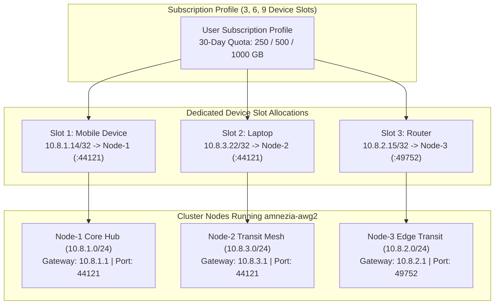
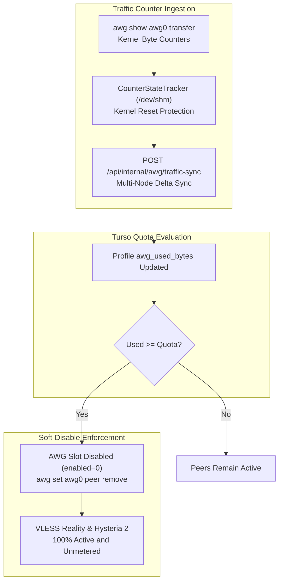

# AmneziaWG Slot Topology, Monotonic Quota Accounting & Obfuscation Reference

> **Document Classification**: Diátaxis Technical Reference  
> **Status**: Authoritative Production Specification (Release v5.0 Active-Active Turso Mesh)  
> **Verification Status**: 100% Verified against Codebase (`128 unit tests passing`, `0 security leaks`)  
> **Target Scope**: Obfuscated WireGuard Subsystem, Multi-Device Slot Topologies, Quota Accounting, and Packet Obfuscation  
> **Related Documentation**: [README.md](README.md) • [README_RU.md](README_RU.md) • [ARCHITECTURE.md](ARCHITECTURE.md) • [DEPLOYMENT.md](DEPLOYMENT.md) • [WHITELIST_SPEC.md](WHITELIST_SPEC.md)

---

## 1. System Role & Architecture Overview

The **AmneziaWG** subsystem delivers low-latency Layer 3 (UDP) network tunneling across the SilentConnect cluster. Engineered specifically for high-throughput UDP workloads—including low-jitter online gaming, real-time voice/video conferencing, and hardware router integration (Keenetic, OpenWrt, Mikrotik)—AmneziaWG enhances the standard WireGuard protocol with dynamic junk packet injection and cryptographic header mutation to evade Deep Packet Inspection (DPI) signature filtering.

Unlike conventional VPN providers that issue a single shared configuration file across all customer hardware (causing state corruption, duplicate nonce drops, and packet loss when multiple devices connect simultaneously), SilentConnect implements a strict **Dedicated Multi-Device Slot Architecture**:
1. Every customer subscription provisions an isolated pool of independent cryptographic slots scaled to the chosen tier: **3, 6, or 9 dedicated device slots**.
2. Each device slot maintains a distinct Curve25519 keypair, an individual `/32` client tunnel address, and a customized device label (up to 16 characters, e.g., `Phone-Primary`, `Workstation`, `Home-Router`) stored centrally in **Turso Cloud (libSQL)**.
3. Users can rebind any device slot between mesh nodes (`Node-1`, `Node-2`, `Node-3`, or `Node-N`) on demand via the web cabinet or Telegram bot, receiving an instantly generated, node-optimized `.conf` profile.



---

## 2. Dedicated Slot Topology & Subnet IP Addressing

Each cluster node operates an isolated, non-overlapping `/24` IPv4 tunnel subnet. This prevents routing collisions and guarantees deterministic traffic isolation across the active-active mesh.

### 2.1. Node Subnet Allocation Matrix

| Cluster Node | Topological Role | Subnet IPv4 | Endpoint Port | Gateway IP | Container Interface | Host Container Name |
|---|---|---|---|---|---|---|
| **Node-1** | Core Hub & Control Plane | `10.8.1.0/24` | `44121/udp` | `10.8.1.1` | `awg0` | `amnezia-awg2` |
| **Node-2** | High-Throughput Transit | `10.8.3.0/24` | `44121/udp` | `10.8.3.1` | `awg0` | `amnezia-awg2` |
| **Node-3** | Edge Transit Mesh Peer | `10.8.2.0/24` | `49752/udp` | `10.8.2.1` | `awg0` | `amnezia-awg2` |
| **Node-N** | Modular Template Peer | `10.8.N.0/24` | `44121/udp` | `10.8.N.1` | `awg0` | `amnezia-awg2` |

### 2.2. Reserved Subnet Host Addresses

On every node subnet (`10.8.x.0/24`), addresses `.1, .2, .3, .4, .6` are strictly reserved by the runtime environment (`reserved_ips = {f"{subnet}.1", f"{subnet}.2", f"{subnet}.3", f"{subnet}.4", f"{subnet}.6"}` in `vpn_shop/awg_manager.py`):

| Subnet Offset | Address Pattern | Architectural Purpose & Binding |
|---|---|---|
| `.1` | `10.8.x.1` | **Default Gateway**: Assigned directly to `awg0` interface inside the container. |
| `.2` | `10.8.x.2` | **Container Bridge Loop**: Reserved for container healthchecks and local loopback probes. |
| `.3` | `10.8.x.3` | **Internal DNS Resolver**: Reserved for local DNS forwarding daemon. |
| `.4` | `10.8.x.4` | **Auxiliary Transit Hop**: Reserved for internal multi-hop routing interfaces. |
| `.6` | `10.8.x.6` | **Cluster Monitoring Probe**: Synthetic traffic injector for latency verification. |

### 2.3. Dynamic Client Allocation Algorithm (`_next_free_ip`)

Client tunnel IP addresses are dynamically allocated by `vpn_shop/awg_manager.py`:
1. Sequential scan iterates through host offsets from `.2` to `.254`.
2. Offsets belonging to `reserved_ips` (`.1, .2, .3, .4, .6`) are skipped.
3. Candidate IP is cross-checked against:
   - In-memory peer list from active WireGuard container configuration (`/opt/amnezia/awg/awg0.conf`).
   - Active database records in the `awg_slots` table in Turso libSQL.
4. The first unallocated IP is assigned atomically under file lock (`fcntl.flock`). If all 248 available host addresses are exhausted, the allocator raises `RuntimeError("AWG subnet exhausted")`.

### 2.4. Database Schema: `awg_slots` (`vpn_shop/store.py`)

Slot assignments, keypairs, and node bindings are persisted in Turso libSQL:

```sql
CREATE TABLE IF NOT EXISTS awg_slots (
    id INTEGER PRIMARY KEY AUTOINCREMENT,
    profile_public_id TEXT NOT NULL,
    slot_index INTEGER NOT NULL,          -- Slot number (1..3, 1..6, 1..9)
    slot_label TEXT NOT NULL,             -- Device name (up to 16 chars)
    server_code TEXT NOT NULL,            -- Node identifier ('nl', 'pl', 'fi')
    public_key TEXT NOT NULL,             -- Curve25519 32-byte Base64 key
    private_key TEXT NOT NULL,            -- Curve25519 32-byte Base64 key
    client_ip TEXT NOT NULL,              -- Dedicated /32 tunnel address
    enabled INTEGER NOT NULL DEFAULT 1,   -- 1 = Active in kernel, 0 = Disabled
    created_at INTEGER NOT NULL,          -- Epoch timestamp (UTC)
    updated_at INTEGER NOT NULL,          -- Epoch timestamp (UTC)
    FOREIGN KEY (profile_public_id) REFERENCES profiles(public_id),
    UNIQUE(profile_public_id, slot_index)
);
CREATE INDEX IF NOT EXISTS idx_awg_slots_pubkey ON awg_slots(public_key);
CREATE INDEX IF NOT EXISTS idx_awg_slots_server ON awg_slots(server_code, enabled);
```

---

## 3. Exact Packet Obfuscation Matrix

Standard WireGuard packets exhibit distinctive cryptographic signatures: fixed 4-byte message type headers (`0x01` Handshake Initiation, `0x02` Handshake Response, `0x03` Cookie Reply, `0x04` Transport Data) and predictable packet lengths (148 bytes for initiation, 92 bytes for response). Modern DPI filters passively identify and terminate these handshakes.

AmneziaWG 3.1 eliminates these signatures through two complementary mechanisms:
1. **Junk Packet Injection (`Jc`, `Jmin`, `Jmax`)**: Prepending random junk datagrams prior to session establishment to desynchronize stateful DPI parsers.
2. **Cryptographic Header & Padding Mutation (`H1`–`H4`, `S1`–`S4`)**: Mutating protocol magic numbers and adding random byte padding to vary packet lengths.

### 3.1. Node Parameter Matrix (`vpn_shop/web.py` & `vpn_shop/awg_manager.py`)

| Parameter | Node-1 (Core Hub) | Node-2 (Transit Mesh) | Node-3 (Edge Transit) | Node-N (Template) | Definition & Specification |
|---|---|---|---|---|---|
| **UDP Port** | **`44121`** | **`44121`** | **`49752`** | **`44121`** | External UDP socket exposed to clients |
| **Subnet** | `10.8.1.0/24` | `10.8.3.0/24` | `10.8.2.0/24` | `10.8.N.0/24` | Dedicated IPv4 address space |
| **Jc** | **`5`** | **`5`** | **`5`** | **`5`** | Junk packet count prepended before handshake |
| **Jmin** | **`10`** | **`10`** | **`10`** | **`10`** | Minimum junk payload size in bytes |
| **Jmax** | **`50`** | **`50`** | **`50`** | **`50`** | Maximum junk payload size in bytes |
| **S1** | **`12`** | **`12`** | **`51`** | **`12`** | Handshake initiation packet padding size (bytes) |
| **S2** | **`12`** | **`12`** | **`30`** | **`12`** | Handshake response packet padding size (bytes) |
| **S3** | **`12`** | **`12`** | **`34`** | **`12`** | Cookie reply packet padding size (bytes) |
| **S4** | **`12`** | **`12`** | **`12`** | **`12`** | Transport data packet padding size (bytes) |
| **H1** | **`1`** | **`1`** | **`1`** | **`1`** | Handshake initiation message header magic |
| **H2** | **`2`** | **`2`** | **`2`** | **`2`** | Handshake response message header magic |
| **H3** | **`3`** | **`3`** | **`3`** | **`3`** | Cookie reply message header magic |
| **H4** | **`4`** | **`4`** | **`4`** | **`4`** | Transport data message header magic |
| **Client MTU** | `1280` | `1280` | `1280` | `1280` | Prevents IP fragmentation under tunnel overhead |
| **Keepalive** | `25` | `25` | `25` | `25` | Persistent keepalive interval (seconds) |
| **DNS** | `1.1.1.1, 1.0.0.1` | `1.1.1.1, 1.0.0.1` | `1.1.1.1, 1.0.0.1` | `1.1.1.1, 1.0.0.1` | Cloudflare recursive resolvers |

### 3.2. Standard Client Configuration Specification

When a user downloads a configuration for a specific device slot, the system renders a standard AmneziaWG format:

```ini
[Interface]
Address = 10.8.1.14/32
PrivateKey = <CLIENT_PRIVATE_KEY>
DNS = 1.1.1.1, 1.0.0.1
MTU = 1280
Jc = 5
Jmin = 10
Jmax = 50
S1 = 12
S2 = 12
S3 = 12
S4 = 12
H1 = 1
H2 = 2
H3 = 3
H4 = 4

[Peer]
PublicKey = <SERVER_PUBLIC_KEY>
Endpoint = <NODE1_DOMAIN>:44121
AllowedIPs = 0.0.0.0/0
PersistentKeepalive = 25
```

---

## 4. 30-Day Monotonic Quota Accounting

AmneziaWG bandwidth is metered across a rolling 30-day accounting cycle to protect server uplink capacity while keeping general web access completely unconstrained.

### 4.1. Tiered Quota Allocations (`vpn_shop/store.py`)

Quota allocations scale with the subscription device limit:

| Device Tier Limit | 30-Day AWG Quota | Volume in Bytes | Code Constant (`store.py`) |
|---|---|---|---|
| **3 Devices** | **250 GB** | `268,435,456,000` B | `AWG_TIER_QUOTAS_GB[3] = 250` |
| **6 Devices** | **500 GB** | `536,870,912,000` B | `AWG_TIER_QUOTAS_GB[6] = 500` |
| **9 Devices** | **1000 GB (1 TB)** | `1,073,741,824,000` B | `AWG_TIER_QUOTAS_GB[9] = 1000` |

### 4.2. Monotonic 30-Day UTC Accounting Formula (`vpn_shop/quota.py`)

To eliminate calendar month drift (28 vs 31 days) and cleanly handle multi-month or lifetime subscriptions, quota cycles are calculated strictly in UTC seconds:

$$\text{CYCLE\_SECONDS} = 30 \times 86400 = 2{,}592{,}000\text{ seconds}$$

Given profile creation timestamp $T_{\text{start}}$ and current timestamp $T_{\text{now}}$:

$$\text{cycles\_passed} = \left\lfloor \frac{T_{\text{now}} - T_{\text{start}}}{2{,}592{,}000} \right\rfloor$$

$$\text{next\_reset\_utc} = T_{\text{start}} + \left( (\text{cycles\_passed} + 1) \times 2{,}592{,}000 \right)$$

When $T_{\text{now}} \ge \text{next\_reset\_utc}$, the background lease worker resets `awg_used_bytes = 0` and restores all disabled device slots.

### 4.3. Kernel Counter Ingestion & `CounterStateTracker`

The Linux kernel exposes WireGuard transfer metrics via `awg show awg0 transfer` (or `wg show awg0 transfer`) in tab-delimited format:

```text
<public_key>\t<rx_bytes>\t<tx_bytes>
```

Kernel counters reset to zero whenever:
- The network interface is reloaded or restarted (`awg-quick down/up`).
- The host or Docker daemon reboots.
- 64-bit unsigned integer counter overflow occurs.

To prevent counter resets from erasing recorded usage or generating corrupt negative deltas, `CounterStateTracker` (`vpn_shop/awg_traffic.py`) persists baseline snapshots in `/dev/shm/awg_last_counters.json` (falling back to `/tmp/awg_last_counters.json`):

```python
# Kernel Reset Detection Algorithm in CounterStateTracker
if curr_rx >= prev_rx:
    delta_rx = curr_rx - prev_rx
else:
    # Kernel counter reset detected: current value is total delta
    delta_rx = curr_rx

if curr_tx >= prev_tx:
    delta_tx = curr_tx - prev_tx
else:
    delta_tx = curr_tx

delta_rx = max(0, delta_rx)
delta_tx = max(0, delta_tx)
```

`/dev/shm` is backed by RAM (tmpfs), preventing SSD write wear during high-frequency polling while guaranteeing instant, sub-millisecond counter serialization.

### 4.4. Distributed Multi-Node Synchronization

Each node executes `AwgTrafficCollector` every 60 seconds:
1. Gathers current kernel metrics from local `awg0` interface.
2. Computes monotonic deltas using `CounterStateTracker`.
3. Dispatches deltas to the core database bridge via `POST /api/internal/awg/traffic-sync`:
   ```json
   {
     "node_id": "node-2",
     "collected_at": 1729512000,
     "deltas": [
       {
         "public_key": "<PEER_PUBLIC_KEY>",
         "delta_rx_bytes": 104857600,
         "delta_tx_bytes": 524288000
       }
     ]
   }
   ```
4. Core handler (`process_cluster_traffic_sync`) inserts records into `awg_traffic_ledger`, increments `profiles.awg_used_bytes`, and returns a list of public keys that must be disabled if the quota has been exceeded.

---

## 5. Soft-Disable Guarantee & Protocol Isolation

A critical design requirement of SilentConnect is the **Soft-Disable Guarantee**. Under no circumstances does exhausting an AmneziaWG quota interrupt primary internet access or invalidate customer subscription keys.



### 5.1. Quota Enforcement Actions (`enforce_quota_soft_disable`)

When a profile reaches or exceeds its quota (`awg_used_bytes >= awg_quota_bytes`):
1. **Turso Database**: The system updates `UPDATE awg_slots SET enabled = 0 WHERE profile_public_id = ?`.
2. **Kernel State**: The daemon executes `awg set awg0 peer <public_key> remove` across all cluster nodes. The peer interface is detached from the kernel wire.
3. **Web Cabinet & Bot**: The UI marks the slots as `Quota Exceeded` with a countdown to the next UTC reset cycle (`next_reset_utc`).

### 5.2. Strict Protocol Isolation Invariant

| Protocol / Transport | Socket / Port | Quota Enforcement Status | Operational Guarantee |
|---|---|---|---|
| **AmneziaWG (UDP)** | `:44121`, `:49752` | **Metered & Disabled** | Peers detached from kernel memory until reset cycle |
| **VLESS Reality Vision** | `TCP 443 -> 23385` | **100% Active & Unmetered** | Never restricted; client connects without limits |
| **VLESS Reality gRPC** | `TCP 29443` | **100% Active & Unmetered** | Never restricted; multiplexed streaming continues |
| **VLESS Reality XHTTP** | `TCP 8443` | **100% Active & Unmetered** | Never restricted; packet-up streaming continues |
| **Hysteria 2 (Gecko)** | `UDP 38443` | **100% Active & Unmetered** | Never restricted; high-speed QUIC stays active |

The 3X-UI SQLite database (`x-ui.db`) and Xray Core memory are completely isolated from the AWG quota subsystem. Client subscription links in Happ, Sing-Box, Streisand, and Clash remain functional throughout the quota period.

---

## 6. BitTorrent Container FORWARD DPI Filter

To protect host IP reputation and eliminate upstream DMCA copyright abuse notices, all AmneziaWG Docker containers (`amnezia-awg2`) enforce mandatory packet string filtering directly within the container iptables `FORWARD` chain (`vpn_shop/awg_reconcile.py: ensure_torrent_block`).

```bash
# TCP Handshake Match (Standard BitTorrent Wire Protocol)
iptables -I FORWARD 1 -p tcp -m string --string 'BitTorrent protocol' --algo bm -j REJECT --reject-with icmp-port-unreachable

# UDP Handshake Match (Distributed Hash Table / DHT Announce)
iptables -I FORWARD 1 -p udp -m string --string 'd1:ad2:id20:' --algo bm -j REJECT --reject-with icmp-port-unreachable

# UDP Handshake Match (Local Peer Discovery / BitTorrent Search)
iptables -I FORWARD 1 -p udp -m string --string 'BT-SEARCH' --algo bm -j REJECT --reject-with icmp-port-unreachable
```

### Technical Characteristics:
- **Algorithm**: Boyer-Moore (`--algo bm`) string matching executes in kernel space with sub-microsecond latency.
- **Rejection Method**: `--reject-with icmp-port-unreachable` instantly resets client sockets, terminating torrent swarms before data payload transfer begins.
- **Idempotency**: The reconciler inspects `iptables -S FORWARD` prior to rule injection, preventing duplicate rules upon container restarts.

---

## 7. Hysteria 2 Technical Reference

Hysteria 2 provides high-throughput UDP transport over an optimized QUIC protocol utilizing custom BBR congestion control.

### 7.1. Listening Sockets & Gecko Obfuscation

Hysteria 2 operates on port `38443/udp` with mandatory `gecko` obfuscation:

```yaml
# /etc/hysteria/config.yaml
listen: :38443

obfs:
  type: gecko
  gecko:
    password: "<HYSTERIA_GECKO_PASSWORD>"
    min_packet_size: 64
    max_packet_size: 1400

auth:
  type: http
  http:
    url: http://127.0.0.1:3088/internal/hysteria-auth

quic:
  initStreamReceiveWindow: 8388608
  maxStreamReceiveWindow: 8388608
  initConnReceiveWindow: 20971520
  maxConnReceiveWindow: 20971520
  maxIdleTimeout: 30s
  keepAlivePeriod: 10s
```

> **CRITICAL SECURITY MANDATE**:  
> Legacy `salamander` obfuscation is blocked by active DPI and is **strictly prohibited**. All production nodes must configure `type: gecko` with packet padding between 64 and 1400 bytes.

### 7.2. Dynamic Port Hopping via NAT PREROUTING

To defeat ISP UDP rate limiting and port-specific throttling, nodes redirect incoming traffic from port `443` and dynamic range `30000:40000` to core daemon port `38443`:

```bash
# Redirect dynamic UDP port hopping range to core daemon
iptables -t nat -A PREROUTING -p udp --dport 30000:40000 -j REDIRECT --to-ports 38443

# Redirect UDP port 443 to core daemon
iptables -t nat -A PREROUTING -p udp --dport 443 -j REDIRECT --to-ports 38443
```

Client subscription endpoints receive port hopping specifications (e.g., `ports=30000-40000,443,38443`), allowing clients to hop ports dynamically during active sessions.

### 7.3. Dynamic HTTP Webhook Authentication (`subjson-service`)

Client credentials are authenticated against `subjson-service` via local HTTP webhook:
- **Webhook Endpoint**: `http://127.0.0.1:3088/internal/hysteria-auth`
- **Method**: `POST`
- **Payload Schema**:
  ```json
  {
    "addr": "198.51.100.25:52410",
    "auth": "<SUBSCRIPTION_SECRET_OR_PASSWORD>",
    "tx": 0
  }
  ```
- **Response**: Returns `{"ok": true, "id": "<profile_id>"}` if active in the local Turso replica, or `{"ok": false, "error": "Subscription expired"}` if invalid.

---

## 8. Verification & Diagnostic Reference

### 8.1. Operational Verification Commands

```bash
# 1. Inspect live WireGuard interface status and active peers
docker exec amnezia-awg2 awg show awg0

# 2. Inspect kernel transfer counters
docker exec amnezia-awg2 awg show awg0 transfer

# 3. Verify monotonic counter cache in RAM
cat /dev/shm/awg_last_counters.json

# 4. Verify BitTorrent DPI rejection rules in container FORWARD chain
docker exec amnezia-awg2 iptables -S FORWARD

# 5. Verify Hysteria 2 UDP listening socket
ss -ulnp | grep 38443

# 6. Verify Hysteria 2 port hopping NAT rules
iptables -t nat -S PREROUTING | grep 38443
```

### 8.2. Error Handling & Edge Cases

| Scenario | System Detection | Corrective Action |
|---|---|---|
| **Subnet Exhaustion** | Offsets `.7` to `.254` allocated | System raises `RuntimeError("AWG subnet exhausted")`. Administrator provisions new subnet on Node-N. |
| **Kernel Interface Restart** | `curr_rx < prev_rx` in collector | `CounterStateTracker` recognizes reset, sets delta to `curr_rx`, preventing usage loss. |
| **Quota Exceeded** | `awg_used_bytes >= quota` | `enforce_quota_soft_disable` detaches peer from kernel; VLESS and Hysteria 2 remain active. |
| **Cycle Renewal** | $T_{\text{now}} \ge \text{next\_reset\_utc}$ | Background worker resets `awg_used_bytes = 0` and invokes `restore_quota_peers`. |
