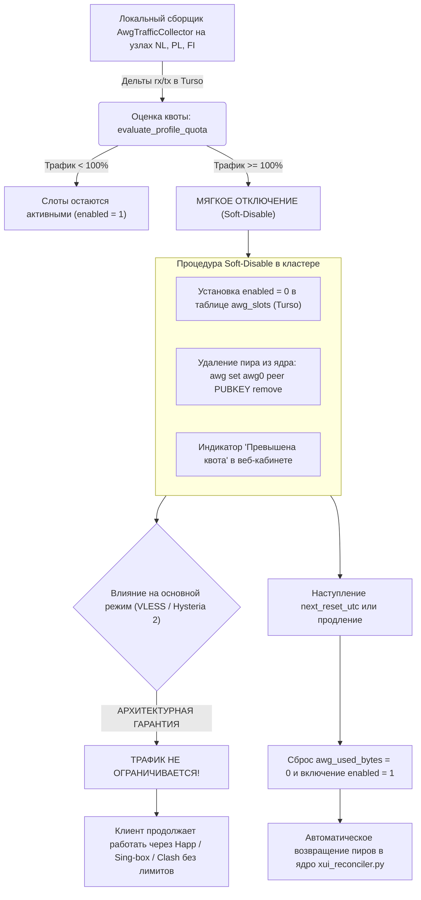

# Архитектура и спецификация хаба слотов AmneziaWG (Multi-Device Slot Hub)

> **Статус документа**: Актуальная боевая спецификация (Production Verified)  
> **Дата последней верификации**: 21.10.2026 (Релиз v5.0 Active-Active Turso Mesh)  
> **Область применения**: Подсистема обфусцированного WireGuard, распределённый учёт квот и автономная реконсиляция  
> **Связанные документы**: [ARCHITECTURE.md](ARCHITECTURE.md) • [DEPLOYMENT.md](DEPLOYMENT.md) • [WHITELIST_SPEC.md](WHITELIST_SPEC.md) • [README.md](README.md)

---

## 1. Концепция хаба слотов (Multi-Device Slot Hub)

Подсистема **AmneziaWG** в экосистеме **SilentConnect** предоставляет низкоуровневое L3-туннелирования (UDP) для игр, голосовых звонков и роутеров с защитой заголовков рукопожатия WireGuard от сигнатурного анализа ТСПУ.

В отличие от классических сервисов, выдающих один общий `.conf`-файл (что вызывает конфликт сессий и потерю пакетов при одновременном включении на телефоне и ПК), в SilentConnect реализована модель **выделенных аппаратных слотов**:
1. Каждая подписка предоставляет фиксированный пул независимых слотов в соответствии с тарифом: **3, 6 или 9 слотов**.
2. В облачной базе **Turso (`libSQL`)** в таблице `awg_slots` для каждого слота и выбранной страны создаётся уникальная ключевая пара **Curve25519**, выделенный внутренний IPv4-адрес (`/32`) и персональное имя устройства (до 16 символов, например: *«iPhone 16 Pro»*, *«Игровой ПК»*, *«Keenetic Дача»*).
3. Пользователь может переключать страну любого слота (**Нидерланды `nl`**, **Польша `pl`**, **Финляндия `fi`**) в 1 клик прямо в браузере с предварительным замером TCP-пинга до каждого узла.

```text
                           [ Профиль подписки (profile_public_id) ]
                           Лимит: 6 слотов / Квота: 500 GB на 30 дней
                                               │
            ┌──────────────────────────────────┼──────────────────────────────────┐
            ▼                                  ▼                                  ▼
       [ Слот #1 ]                        [ Слот #2 ]                      [ Слоты #3..#6 ]
    "iPhone 16 Pro"                    "Ноутбук Рабочий"                  (Доп. устройства)
    IP: 10.8.1.14/32                   IP: 10.8.3.22/32                   IP: 10.8.2.x/32
    Узел: NL (Active)                  Узел: PL (Active)                  Узел: FI / NL / PL
    Порт: 44121/udp                    Порт: 44121/udp                    Порт: 49752/udp
    Ключи: KeyPair #1                  Ключи: KeyPair #2                  Ключи: KeyPair #N
            │                                  │                                  │
            ▼                                  ▼                                  ▼
  [ Docker amn0 на NL ]              [ Docker amn0 на PL ]              [ Docker amn0 на FI ]
```

---

## 2. Матрица портов, подсетей и параметров обфускации

Каждый узел кластера работает в собственном непересекающемся адресном пространстве:

| Узел кластера | Внешний домен / IP | Порт UDP | Виртуальная подсеть | Шлюз контейнера | Зарезервированные IP | Параметры Junk и Magic Headers |
|---|---|---|---|---|---|---|
| **NL (`nl`)** | `<EDGE_DOMAIN>` (`<NL_IP>`) | **`44121`** | `10.8.1.0/24` | `10.8.1.1` | `.1, .2, .3, .4, .5, .6` | `Jc=5, Jmin=10, Jmax=50`, `S1-S4=12`, `H1=1, H2=2, H3=3, H4=4` |
| **PL (`pl`)** | `<PL_DOMAIN>` (`<PL_IP>`) | **`44121`** | `10.8.3.0/24` | `10.8.3.1` | `.1, .2, .3, .4, .5, .6` | `Jc=5, Jmin=10, Jmax=50`, `S1-S4=12`, `H1=1, H2=2, H3=3, H4=4` |
| **FI (`fi`)** | `<FI_DOMAIN>` (`<FI_IP>`) | **`49752`** | `10.8.2.0/24` | `10.8.2.1` | `.1, .2, .3, .4, .5, .6` | `Jc=5, Jmin=10, Jmax=50`, `S1=51, S2=30, S3=34, S4=12`, `H1=1..4` |

---

## 3. Тарифные планы и градация квот (Tier Quotas)

Учёт трафика AmneziaWG ведётся суммарно по всем слотам подписки во всех странах, но **полностью независимо** от безлимитных протоколов VLESS и Hysteria 2:

| Тарифный лимит устройств | 30-дневная квота AmneziaWG | Объём в байтах | Константа в `store.py` |
|---|---|---|---|
| **3 устройства (Личный)** | **250 GB** | `268 435 456 000` байт | `AWG_TIER_QUOTAS_GB[3] = 250` |
| **6 устройств (Домашний)** | **500 GB** | `536 870 912 000` байт | `AWG_TIER_QUOTAS_GB[6] = 500` |
| **9 устройств (Расширенный)**| **1000 GB (1 TB)** | `1 073 741 824 000` байт | `AWG_TIER_QUOTAS_GB[9] = 1000` |

---

## 4. Монотонный 30-дневный расчётный цикл UTC (`quota.py`)

Для исключения аномалий календарных месяцев и долгосрочных тарифов (на 3, 6, 12 месяцев или бессрочных профилей) в модуле `vpn_shop/quota.py` реализован строгий **монотонный 30-дневный цикл в UTC**:

```python
CYCLE_SECONDS = 30 * 86400  # 2 592 000 секунд
```

1. За базовую точку отсчёта (`start_ts`) берётся время создания профиля (`created_at` в UTC) либо первого подтверждённого заказа.
2. Число полных 30-дневных циклов с момента старта:
   $$\text{cycles\_passed} = \lfloor (\text{now\_ts} - \text{start\_ts}) / 2592000 \rfloor$$
3. Точное время следующего гарантированного сброса счётчика трафика:
   $$\text{next\_reset\_utc} = \text{start\_ts} + ((\text{cycles\_passed} + 1) \times 2592000)$$

---

## 5. Механизм мягкого отключения (Soft-Disable Guarantee)

При достижении 100% расхода квоты AmneziaWG в текущем 30-дневном цикле срабатывает процедура мягкого отключения `enforce_quota_soft_disable` (`vpn_shop/awg_traffic.py`):



> [!IMPORTANT]
> **Клиент никогда не остаётся без связи**: даже при полном исчерпании пакета AmneziaWG его основная подписка в разделе **«🛡️ Основной»** (VLESS Reality TCP/XHTTP/gRPC и Hysteria 2) продолжает работать на 100% скорости абсолютно безлимитно.

---

## 6. Автономная реконсиляция пиров и учёт трафика без SSH

В архитектуре **Active-Active Mesh** управление пирами и сбор трафика выполняются локально на каждом узле демоном `xui_reconciler.py` (`_reconcile_local_awg_and_traffic`):

1. **Триангуляция роли узла (`get_current_node_code`)**:
   Узел сверяет `/etc/silentconnect/node_code`, переменную `AWG_LOCAL_SERVER` и `hostname`. Поскольку код целевого сервера совпадает с локальным кодом ноды, `awg_manager._get_server(code)` автоматически переключает режим исполнения в `mode = "local"`.
2. **Локальная атомарная реконсиляция (`reconcile_awg_peers`)**:
   - Демон читает активные слоты своей страны из локальной NVMe-реплики Turso (`store.list_active_awg_slots(server_code=local_node)`).
   - Защищён предохранителем **Zero-Slots Guard** (ошибка БД не приводит к удалению пиров) и **Mass Deletion Circuit Breaker** (блокировка удаления `>30%` или `>10` пиров за цикл без флага `--force-mass-delete`).
   - Конфигурация собирается во временном каталоге `/opt/amnezia/awg/.stage.$$/awg0.conf` под `flock`, проверяется утилитой `awg-quick strip`, сохраняет до 20 бэкапов с правами `0600`, атомарно перемещается через `mv` и применяется к ядру через `awg syncconf awg0` без разрыва активных туннелей.
3. **Монотонный сбор трафика (`AwgTrafficCollector` & `CounterStateTracker`)**:
   - Каждые 15 секунд опрашивается `awg show awg0 transfer`.
   - Состояние счётчиков хранится в RAM-диске `/dev/shm/awg_last_counters.json`. Если интерфейс или контейнер перезапускался (текущие байты меньше предыдущих), трекер корректно вычисляет неотрицательную дельту от нуля.
   - Дельты записываются напрямую в таблицу `awg_traffic_ledger` и инкрементируют `profiles.awg_used_bytes` в Turso.

---

## 7. Схема таблиц базы данных (`store.py`)

```sql
CREATE TABLE IF NOT EXISTS awg_slots (
  id INTEGER PRIMARY KEY AUTOINCREMENT,
  profile_public_id TEXT NOT NULL,
  slot_index INTEGER NOT NULL,          -- Номер слота (1..9)
  slot_label TEXT NOT NULL,            -- Имя устройства (до 16 символов, защита от XSS)
  public_key TEXT NOT NULL UNIQUE,     -- Открытый ключ Curve25519 (44 символа Base64)
  private_key_enc TEXT NOT NULL,       -- Приватный ключ клиента
  preshared_key TEXT,                  -- PresharedKey (PSK)
  client_ip TEXT NOT NULL,             -- Выделенный IP (10.8.{1,2,3}.X)
  enabled INTEGER NOT NULL DEFAULT 1,  -- 1 = активен, 0 = приостановлен / soft-disabled
  created_at INTEGER NOT NULL,
  updated_at INTEGER NOT NULL,
  server_code TEXT NOT NULL DEFAULT 'nl', -- Локация: 'nl', 'pl' или 'fi'
  FOREIGN KEY (profile_public_id) REFERENCES profiles(public_id),
  UNIQUE(profile_public_id, slot_index, server_code)
);

CREATE UNIQUE INDEX IF NOT EXISTS uq_awg_slots_server_ip
  ON awg_slots(server_code, client_ip);

CREATE TABLE IF NOT EXISTS awg_traffic_ledger (
  id INTEGER PRIMARY KEY AUTOINCREMENT,
  node_id TEXT NOT NULL,
  slot_id INTEGER,
  profile_public_id TEXT NOT NULL,
  delta_rx_bytes INTEGER NOT NULL DEFAULT 0,
  delta_tx_bytes INTEGER NOT NULL DEFAULT 0,
  collected_at INTEGER NOT NULL,
  FOREIGN KEY (slot_id) REFERENCES awg_slots(id) ON DELETE SET NULL,
  FOREIGN KEY (profile_public_id) REFERENCES profiles(public_id) ON DELETE CASCADE
);
```

---

## 8. Клиентский интерфейс и замер пинга в браузере

В личном кабинете (`/{SECRET_SEGMENT}/import/{sub_id}` на вкладке **«🎮 Игровой»**) для каждого слота доступны:
- **📥 Скачивание `.conf`**: Отдаёт готовый файл с говорящим именем `SilentConnect_<ИмяУстройства>_<Страна>.conf`.
- **🔲 Генерация QR-кода**: Чистый встроенный генератор `vpn_shop/qr.py` (Zero-Dependency PNG/SVG) для мгновенного сканирования с экрана телефона.
- **📋 Копирование текстового ключа**: Прямое копирование текста конфигурации в буфер обмена для вставки в AmneziaVPN.
- **🔄 Смена страны с замером пинга (`/sub/awg/ping_servers`)**: При открытии модального окна смены локации браузер замеряет реальный RTT и отображает цветовую индикацию задержки до Нидерландов, Польши и Финляндии. При переключении страны старый пир автоматически деактивируется (`enabled = 0`), а пир в новой стране переводится в `enabled = 1`.
