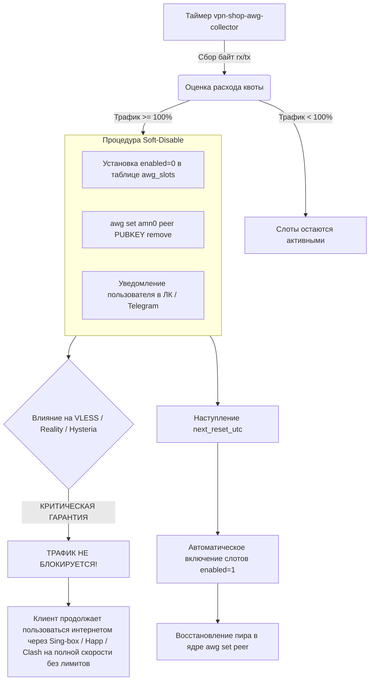

# Архитектура и спецификация хаба слотов AmneziaWG (Multi-Device Slot Hub)

> **Статус документа**: Актуальная боевая спецификация (Production Verified)  
> **Дата последней верификации**: 14.10.2026  
> **Область применения**: Подсистема обфусцированного WireGuard и управление квотами устройств  
> **Связанные документы**: [ARCHITECTURE.md](ARCHITECTURE.md) • [DEPLOYMENT.md](DEPLOYMENT.md) • [WHITELIST_SPEC.md](WHITELIST_SPEC.md) • [README.md](README.md)

---

## 1. Концепция хаба слотов (Multi-Device Slot Hub)

AmneziaWG в экосистеме **SilentConnect** решает задачу предоставления высокоскоростного L3-туннелирования с защитой от сигнатурного анализа handshake WireGuard со стороны ТСПУ.

В отличие от классических VPN, где один конфигурационный файл часто копируется пользователем на все личные устройства (что приводит к конфликтам маршрутизации и сбросу сессий внутри одной подсети WireGuard), в SilentConnect реализована модель **аппаратных слотов устройств**:
1. Каждый тарифный план предоставляет фиксированный лимит одновременных устройств: **3, 6 или 9 слотов**.
2. В базе данных `vpn_shop.db` для каждого устройства пользователя создаётся независимая запись с индивидуальной ключевой парой (Curve25519), статическим IP-адресом внутри виртуальной подсети и отдельным лейблом (например, *«iPhone 15»*, *«MacBook Pro»*, *«Домашний роутер»*).
3. Пользователь может гибко привязывать каждый слот к любому доступному серверу кластера (Нидерланды, Польша или Финляндия), выполняя мгновенное переключение геолокации без пересоздания остальных устройств.

```
                           [ Профиль пользователя (public_id) ]
                           Лимит устройств: 6 / Тарифный план 500 GB
                                          │
            ┌─────────────────────────────┼─────────────────────────────┐
            │                             │                             │
       [ Слот #1 ]                   [ Слот #2 ]                   [ Слот #3..#6 ]
    "iPhone 15 Pro"                 "Ноутбук Asus"                (Доп. устройства)
    IP: 10.8.1.14                  IP: 10.8.3.22                  IP: 10.8.1.x / 10.8.3.x
    Сервер: NL Master              Сервер: PL Standby             Сервер: NL / PL
    Порт: 44121/udp                Порт: 44121/udp                Порт: 44121/udp
    Ключи: KeyPair #1              Ключи: KeyPair #2              Ключи: KeyPair #N
            │                             │                             │
            ▼                             ▼                             ▼
    [ Docker amn0 (NL) ]           [ Docker amn0 (PL) ]           [ Docker amn0 ]
```

---

## 2. Матрица портов, подсетей и параметров обфускации

Каждый боевой сервер кластера изолирован в собственном адресном пространстве, что исключает пересечение частных IP-адресов при смене локаций и гарантирует стабильную маршрутизацию.

| Узел кластера | Внешний IP | Порт UDP (Host) | Виртуальная подсеть | Шлюз узла | Обфускация Junk | Магические байты заголовков |
|---|---|---|---|---|---|---|
| **NL Master** | `<NL_IP>` | **`44121`** | `10.8.1.0/24` | `10.8.1.1` | `Jc=5, Jmin=10, Jmax=50` | `S1=12, S2=12, S3=12, S4=12`, `H1=1, H2=2, H3=3, H4=4` |
| **PL Standby**| `<PL_IP>`  | **`44121`** | `10.8.3.0/24` | `10.8.3.1` | `Jc=5, Jmin=10, Jmax=50` | `S1=12, S2=12, S3=12, S4=12`, `H1=1, H2=2, H3=3, H4=4` |
| **FI Standby**| `<FI_IP>`    | **`49752`** | `10.8.2.0/24` | `10.8.2.1` | `Jc=5, Jmin=10, Jmax=50` | `S1=51, S2=30, S3=34, S4=12`, `H1=1, H2=2, H3=3, H4=4` |

### Значение параметров обфускации:
- **`Jc` (Junk packet count)**: количество шумовых пакетов со случайным содержимым, отправляемых перед инициализацией сессии (5 пакетов).
- **`Jmin` / `Jmax` (Junk packet size)**: минимальный и максимальный размер шумовых пакетов в байтах (от 10 до 50 байт).
- **`S1`–`S4` (Init & Response Magic Headers)**: модификация фиксированных сигнатур начала пакетов рукопожатия WireGuard, предотвращающая срабатывание регулярных выражений DPI.
- **`H1`–`H4` (Transport Header Magic)**: смещение стандартных заголовков транспортных пакетов с данными.

---

## 3. Тарифные планы и градация квот (Tier Quotas)

Учёт расхода трафика AmneziaWG ведётся независимо от протоколов VLESS и Hysteria. Лимиты трафика строго сопоставлены с количеством доступных слотов устройств:

| Лимит устройств | Месячная квота трафика | Размер квоты в байтах | Константа в коде (`store.py`) |
|---|---|---|---|
| **3 устройства** | **250 GB** | `268 435 456 000` байт | `AWG_TIER_QUOTAS_GB[3] = 250` |
| **6 устройств** | **500 GB** | `536 870 912 000` байт | `AWG_TIER_QUOTAS_GB[6] = 500` |
| **9 устройств** | **1000 GB (1 TB)** | `1 073 741 824 000` байт | `AWG_TIER_QUOTAS_GB[9] = 1000` |

---

## 4. Монотонный 30-дневный расчётный цикл UTC

В традиционных биллинговых системах квоты часто сбрасываются 1-го числа календарного месяца или в день окончания срока подписки (что создаёт аномалии при покупке тарифов на 6, 12 месяцев или бессрочных тарифов, где дата сброса уходит на годы вперёд).

В SilentConnect внедрён **строгий монотонный 30-дневный цикл в UTC**, реализованный в модуле `vpn_shop/quota.py`:

```python
CYCLE_SECONDS = 30 * 86400  # 2 592 000 секунд
```

### Алгоритм вычисления текущего периода:
1. За точку отсчёта (`start_ts`) берётся точное время создания подписки (`created_at` в UTC) из первого подтверждённого заказа.
2. Количество завершённых 30-дневных интервалов с момента покупки:
   $$\text{cycles\_passed} = \lfloor (\text{now\_ts} - \text{start\_ts}) / \text{CYCLE\_SECONDS} \rfloor$$
3. Время начала текущего расчётного окна:
   $$\text{period\_start\_utc} = \text{start\_ts} + (\text{cycles\_passed} \times \text{CYCLE\_SECONDS})$$
4. Время гарантированного обнуления квоты:
   $$\text{next\_reset\_utc} = \text{start\_ts} + ((\text{cycles\_passed} + 1) \times \text{CYCLE\_SECONDS})$$

#### Преимущества модели:
- Абсолютная независимость от переменной длины календарных месяцев (28, 29, 30 или 31 день).
- Честный равный доступ: каждый пользователь получает полный объём трафика каждые 2 592 000 секунд.
- При покупке долгосрочного тарифа на 1 год трафик не выдаётся единым куском (например, 3 ТБ сразу), а порционно начисляется по 250/500/1000 ГБ каждые 30 дней.

---

## 5. Механизм мягкого отключения (Soft-Disable Guarantee)

При достижении 100% расхода квоты AmneziaWG в рамках текущего 30-дневного интервала срабатывает процедура мягкого отключения `enforce_quota_soft_disable` (модуль `vpn_shop/awg_traffic.py`):



### Архитектурная гарантия безопасности связи:
- Отключение WireGuard при перерасходе спасает серверный узел от исчерпания полосы пропускания и деградации L3-интерфейсов.
- **Пользователь НИКОГДА не остаётся без связи**: его основной профиль VLESS Reality (XHTTP, TCP Vision) и Hysteria 2 продолжает работать на 100% скорости без ограничений по объёму трафика.
- В веб-кабинете отображается индикатор: *«Лимит высокоскоростного WireGuard исчерпан. Доступ через Sing-box/Happ активен безлимитно. Сброс квоты: DD.MM.YYYY»*.

---

## 6. Схема базы данных слотов (`vpn_shop.db`)

Таблица `awg_slots` защищена составными уникальными индексами, предотвращающими коллизии IP-адресов и повторное назначение индексов слотов:

```sql
CREATE TABLE awg_slots (
  id INTEGER PRIMARY KEY AUTOINCREMENT,
  profile_public_id TEXT NOT NULL,
  slot_index INTEGER NOT NULL,          -- Индекс слота устройства (0, 1, 2...)
  slot_label TEXT NOT NULL,            -- Человекочитаемое имя ("iPhone", "PC")
  public_key TEXT NOT NULL UNIQUE,     -- Публичный ключ WireGuard (Base64)
  private_key_enc TEXT NOT NULL,       -- Зашифрованный приватный ключ
  preshared_key TEXT,                  -- Опциональный PSK
  client_ip TEXT NOT NULL,             -- Локальный IP в подсети ноды (напр. 10.8.1.15)
  enabled INTEGER NOT NULL DEFAULT 1,  -- Флаг активности (0 при soft-disable)
  created_at INTEGER NOT NULL,
  updated_at INTEGER NOT NULL,
  server_code TEXT NOT NULL DEFAULT 'nl', -- Текущий сервер привязки ('nl', 'pl', 'fi')
  FOREIGN KEY (profile_public_id) REFERENCES profiles(public_id),
  UNIQUE(profile_public_id, slot_index, server_code)
);

CREATE UNIQUE INDEX IF NOT EXISTS uq_awg_slots_server_ip 
  ON awg_slots(server_code, client_ip);
```

---

## 7. Генерация клиентских конфигураций

Система поддерживает экспорт конфигураций для официальных приложений **AmneziaVPN** и **AmneziaWG Client**:

### Пример сгенерированного `.conf` файла (Слот NL Master):
```ini
[Interface]
Address = 10.8.1.15/32
PrivateKey = <CLIENT_PRIVATE_KEY>
DNS = 1.1.1.1, 8.8.8.8
Jc = 5
Jmin = 10
Jmax = 50
S1 = 12
S2 = 12
S3 = 12
S4 = 12
H1 = 1
H2 = 2
H3 = 3
H4 = 4

[Peer]
PublicKey = <SERVER_PUBLIC_KEY>
Endpoint = <EDGE_DOMAIN>:44121
AllowedIPs = 0.0.0.0/0, ::/0
PersistentKeepalive = 25
```

### Способы импорта:
1. **QR-код**: отображается в веб-кабинете для моментального сканирования камерой смартфона.
2. **Файл конфигурации (`.conf`)**: скачивание в 1 клик для ПК и роутеров (Keenetic, OpenWrt с поддержкой AWG).
3. **AmneziaVPN JSON Payload**: импорт через буфер обмена в мобильное приложение AmneziaVPN.
