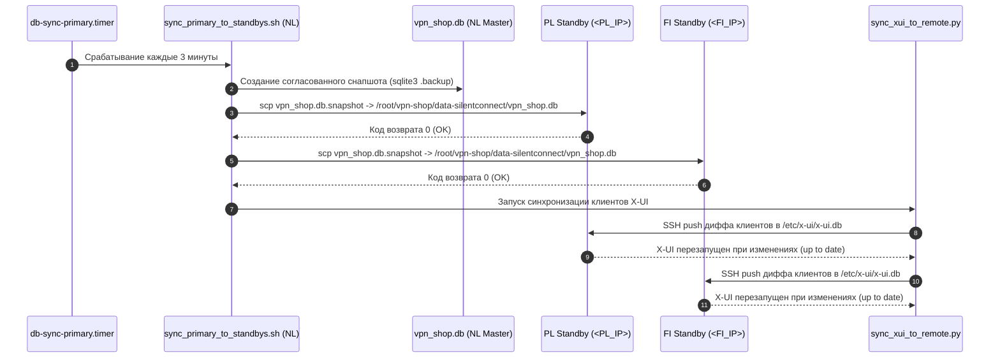

# Архитектура платформы SilentConnect

> **Статус документа**: Актуальная боевая спецификация (Production Verified)  
> **Дата последней верификации**: 14.10.2026  
> **Область применения**: Архитектурная спецификация кластера  
> **Связанные документы**: [README.md](README.md) • [DEPLOYMENT.md](DEPLOYMENT.md) • [WHITELIST_SPEC.md](WHITELIST_SPEC.md) • [AMNEZIA_SLOTS.md](AMNEZIA_SLOTS.md)

---

## 1. Обзор платформы и назначение

**SilentConnect** — распределённая отказоустойчивая инфраструктура предоставления защищённого туннелирования и обхода DPI-фильтрации. Архитектура объединяет:
1. **Торговую автоматизацию и биллинг**: Telegram-бот (`vpn_shop.bot`), веб-витрину с приёмом платежей СБП (`vpn_shop.web`), систему квот и 30-дневных циклов подписок.
2. **Мультипротокольный шлюз туннелирования**:
   - **VLESS Reality** (TCP Vision, XHTTP, gRPC) с маскировкой под доверенные зарубежные домены.
   - **Hysteria 2** с обязательной обфускацией `gecko` (протокол UDP, порт 38443, редиректы 443 и 30000–40000).
   - **AmneziaWG** (контейнеризированный WireGuard с заголовками и junk-пакетами `Jc/Jmin/Jmax/S/H`).
   - **OpenFlux v0.3.0** (выделенные слоты обхода строгой изоляции через Cloud Document Collaboration Stream).
3. **Генератор клиентских подписок** (`subjson-service`): динамическая трансляция профилей под Sing-box (MT и official 1.18+), Clash Meta, Happ, Streisand, v2rayN.
4. **Геораспределённый кластер**: Primary-узел (NL Master) и два Standby-узла (PL Standby 10Gbps и FI Standby) с односторонней синхронизацией SQLite и X-UI каждые 3 минуты.

---

## 2. Топология боевых узлов (Production Node Topology)

Инфраструктура состоит из четырёх серверов: одного активного мастера (NL), двух резервных узлов (PL и FI) и одного выводимого из эксплуатации узла (Old PL), на котором временно изолирован активный воркер OpenFlux.

```text
                                       [ Пользователи и Клиенты ]
                                                   │
               ┌───────────────────────────────────┴───────────────────────────────────┐
               │                                                                       │
     [ HTTPS: Магазин и Подписки ]                                            [ VPN-трафик (Обход DPI) ]
               │                                                                       │
     https://<SUB_DOMAIN>                                                     https://<EDGE_DOMAIN>
  (API Gateway / Edge Буфер)                                                    (Прямой A-Record)
               │                                                                       │
               ▼                                                                       │
┌──────────────────────────────────────────────┐                                       │
│          NL MASTER (Основной Узел)           │                                       │
│  Ubuntu 24.04 LTS (1 Gbps Uplink)            │                                       │
│  • Telegram Bot (АКТИВНЫЙ мастер-демон)      │                                       │
│  • Web Shop (:3090) & SubJSON (:3088)        │                                       │
│  • Master SQLite WAL (vpn_shop.db, x-ui.db)  │                                       │
│  • Xray Reality (:443) / Hysteria 2 (:38443) │◄──────────────────────────────────────┤
│  • AmneziaWG (:44121) / OpenFlux Worker      │                                       │
└──────────────────────┬───────────────────────┘                                       │
                       │                                                               │
         [ Периодический push БД (каждые 3 мин) ]                                      │
              (sync_primary_to_standbys.sh)                                            │
                       │                                                               │
        ┌──────────────┴──────────────┐                                                │
        ▼                             ▼                                                │
┌───────────────────────────┐ ┌───────────────────────────┐                            │
│   PL STANDBY (10 Gbps)    │ │   FI STANDBY (Резерв)     │                            │
│   Debian 13 (Trixie)      │ │   Linux Standby Node      │                            │
│ • SQLite Реплика (Sync)   │ │ • SQLite Реплика (Sync)   │                            │
│ • SubJSON & Web (Standby) │ │ • SubJSON & Web (Standby) │                            │
│ • Xray Reality (АКТИВЕН)  │ │ • Xray Reality (АКТИВЕН)  │◄───────────────────────────┤
│ • Hysteria 2 & AWG АКТИВНЫ│ │ • Hysteria 2 & AWG АКТИВНЫ│                            │
│ • OpenFlux Worker АКТИВЕН │ │ • HA Health Monitor       │                            │
└─────────────┬─────────────┘ └───────────────────────────┘                            │
              ▲                                                                        │
              │ (Миграция завершена)                                                   │
┌─────────────┴─────────────┐                                                          │
│    Old PL (<OLD_PL_IP>)   │                                                          │
│  DECOMMISSIONED (Выведен) │                                                          │
│  • Нагрузки перенесены    │                                                          │
│  • Готов к удалению       │                                                          │
└───────────────────────────┘                                                          │
              ▲                                                                        │
              └────────────────────────────────────────────────────────────────────────┘
                                 [ Прямой транзит VPN-трафика через все ноды ]
                                 (VLESS Reality, Hysteria 2 gecko, AmneziaWG)
```

### Сводная таблица инвентаря серверов

| Роль в кластере | IP-адрес | Локация и Датацентр | ОС | Роли сервисов | Статус репликации |
|---|---|---|---|---|---|
| **Primary Master** | `<NL_IP>` | Западная Европа (Datacenter NL) | Ubuntu 24.04 LTS | Telegram Bot, Web Shop, SubJSON, X-UI, Hysteria 2, AWG, OpenFlux | Источник мастер-данных (Primary) |
| **Standby Node (PL)** | `<PL_IP>` | Центральная Европа (Datacenter PL 10Gbps) | Debian 13 (Trixie) | Standby Web, SubJSON, X-UI, Hysteria 2, AWG, OpenFlux (Bot отключён) | Принимает push БД каждые 3 мин (`OK`) |
| **Standby Node (FI)** | `<FI_IP>` | Северная Европа (Datacenter FI) | Linux Standby | Standby Web, SubJSON, X-UI, Hysteria 2, AWG, HA Health Checker | Принимает push БД каждые 3 мин (`OK`) |
| **Legacy Worker Node** | `<OLD_PL_IP>` | Центральная Европа (Старая нода) | Linux Legacy | DECOMMISSIONED (Все нагрузки сняты) | Готов к отключению в панели хостинга |

---

## 3. Сетевая маршрутизация и доменная модель

Архитектура разделяет клиентский трафик на два независимых потока: прикладной веб-трафик и протокольный туннельный трафик.

### 3.1. `<SUB_DOMAIN>` (Веб, API, Подписки)
- **Маршрутизация**: Проходит через **Yandex Cloud API Gateway**.
- **Ограничение протоколов**: Обрабатывает **СТРОГО HTTPS (TCP)**. Любой UDP-трафик шлюзом сбрасывается.
- **Назначение**:
  - Раздача динамических подписок клиентам: `/singbox/{sub_id}`, `/clash/{sub_id}`, `/happ/{sub_id}`, `/v2ray/{sub_id}`.
  - Веб-мастер первичной настройки: `/{SECRET_SEGMENT}/import/{sub_id}` с автоматическим детектированием платформы (iOS, Android, Windows, macOS, Linux).
  - Приём платёжных вебхуков (Platega / СБП): `/api/payment/platega/callback`.

### 3.2. `<EDGE_DOMAIN>` (Протокольные подключения)
- **Маршрутизация**: Прямая DNS A-запись на текущий активный мастер (`<NL_IP>`).
- **Назначение**:
  - Точка подключения VLESS Reality (SNI spoofing на порту TCP 443).
  - Точка подключения Hysteria 2 (UDP 38443, редиректы 443 и 30000–40000).
  - Точка подключения AmneziaWG (UDP 44121).
  - **КАТЕГОРИЧЕСКОЕ ПРАВИЛО**: Все клиентские конфиги для NL узла обязаны использовать домен `<EDGE_DOMAIN>`, а не `<SUB_DOMAIN>`, чтобы исключить сброс UDP пакетов ТСПУ и API Gateway.

### 3.3. Региональные домены Standby-узлов
- `<PL_DOMAIN>` — прямая A-запись на `<PL_IP>` (TTL 60). Используется для прямого подключения клиентов к польскому узлу и резервного веб-интерфейса.
- `<FI_DOMAIN>` — прямая A-запись на `<FI_IP>` (TTL 60). Используется для финского узла.

---

## 4. Поток репликации данных (Data Replication Flow)

### 4.1. Реальный рабочий механизм: Shell Push Sync
Единственным штатно функционирующим механизмом репликации на 14.10.2026 является скрипт `/root/sync_primary_to_standbys.sh`, запускаемый по таймеру `db-sync-primary.timer` каждые 3 минуты на NL Master.



#### Детали реализации синхронизации:
1. **Безопасный снапшот SQLite**: На мастере выполняется онлайн-бэкап базы данных без блокировки активных писателей:
   ```bash
   sqlite3 /root/vpn-shop/data-silentconnect/vpn_shop.db ".backup '/tmp/vpn_shop_sync.db'"
   ```
2. **Передача на Standby-узлы**: Снапшот копируется по SSH на `<PL_IP>` и `<FI_IP>` с атомарной заменой файла через временный путь.
3. **Синхронизация X-UI (`sync_xui_to_remote.py`)**: Скрипт извлекает список клиентов из локальной базы `/etc/x-ui/x-ui.db` на мастере, передаёт поток команд воркеру на резервном сервере (`/tmp/xui_sync_worker.py`) через SSH stdin. Воркер сопоставляет UUID клиентов, выполняет `INSERT/UPDATE` и при необходимости перезапускает службу `x-ui.service`.

### 4.2. Статус Litestream (Анализ отказа)
В документации ранних версий заявлялась непрерывная потоковая репликация WAL через Litestream.  
**Фактическое состояние**:
- На **NL Master** сервис `litestream.service` находится в бесконечном цикле перезапуска (`failed` / `restarting`). Конфигурация `/etc/litestream.yml` ссылается на выведенный финский IP `<OLD_FI_IP>` и падает с ошибкой:
  `stat /root/vpn-shop/data-silentconnect/vpn_shop.db-wal: no such file or directory`.
- На **PL Standby** бинарник установлен, но сервис отключён, конфигурационный файл отсутствует.
- На **FI Standby** демон Litestream отключён, локальные реплики в `/var/lib/litestream/` заброшены с сентября 2026 года.
- **Заключение**: Litestream признан неработоспособным и не участвует в обеспечении высокой доступности. Основная нагрузка синхронизации лежит на `sync_primary_to_standbys.sh`.

---

## 5. Процедуры отказоустойчивости (Failover: Reality As-Is)

В кластере **отсутствует автономный автоматический демон переключения** (нет keepalived, consul или pacemaker). Переключение ролей выполняется в **полуавтоматическом / ручном режиме** администратором либо оперативным скриптом.

### 5.1. Утилита переключения роли: `/root/switch_primary.py`
Находится на мастере и резервных узлах. Поддерживает аргументы:
- `--target nl`: назначить Нидерланды мастером.
- `--target pl`: назначить Польшу (`<PL_IP>`) мастером.
- `--dry-run`: проверка доступности и предварительный аудит без изменений.
- `--preflight`: валидация целостности баз SQLite и сетевых сокетов.
- `--postflight`: верификация запуска Telegram-бота и Caddy после переключения.

```bash
# Пример проверки готовности переключения на Польшу
python3 /root/switch_primary.py --target pl --dry-run

# Боевое переключение Primary на Польшу
python3 /root/switch_primary.py --target pl --confirm
```

#### Последовательность шагов переключения Primary:
1. Остановка Telegram-бота на старом мастере (`systemctl stop vpn-shop-silentconnect`).
2. Финальный сброс снапшота базы данных и push на целевой узел.
3. Остановка таймера синхронизации на старом мастере (`systemctl stop db-sync-primary.timer`).
4. Запуск Telegram-бота на новом мастере (`systemctl start vpn-shop-silentconnect`).
5. Перенаправление DNS-записи `<EDGE_DOMAIN>` на IP нового мастера в панели Cloudflare / Yandex Cloud.
6. Активация таймера репликации с нового мастера на резервные узлы.

### 5.2. Мониторинг на узле Финляндии: `ha_health_checker.py`
На сервере FI Standby запущен фоновый сервис `ha-health-checker.service` (PID 2736289):
- Каждые 5 секунд выполняет GET-запрос на `https://<EDGE_DOMAIN>/healthz`.
- При фиксации сбоя длительностью более 30 секунд сервис переводит свой внутренний статус в `FI_PRIMARY`.
- **Ограничение**: Автоматический промоушен узла намеренно заблокирован. Сервер не переключает DNS и не запускает бота самостоятельно, чтобы избежать сценария Split-Brain.
- Для принудительного ввода FI в роль Primary требуется ручное выполнение:
  ```bash
  /root/promote_fi.sh PROMOTE-YES
  ```
  *(Примечание: скрипт содержит закомментированный старый IP `<LEGACY_FI_IP>`, перед запуском необходимо сверить параметры).*

---

## 6. Карта портов, протоколов и обратных прокси

### 6.1. Демаркация порта 443 TCP: Dokodemo-Door Multiplexer
Чтобы обслуживать веб-трафик магазина, подписки и маскированный трафик VLESS Reality на одном порту 443 TCP без конфликтов, применяется SNI-мультиплексор на базе ядра Xray:

```
                            Входящий трафик: TCP 0.0.0.0:443
                                          │
                                          ▼
                      [ xray-multiplexer / dokodemo-door ]
                                          │
                    Сниффинг SNI (Server Name Indication)
                                          │
              ┌───────────────────────────┴───────────────────────────┐
              │                                                       │
   SNI совпадает с Reality                                Любой другой SNI
   (<REALITY_SNI_PRIMARY>,                                (<SHOP_DOMAIN>,
    <REALITY_SNI_SECONDARY>,                               <SUB_DOMAIN>)
    <REALITY_SNI_GRPC>)
              │                                                       │
              ▼                                                       ▼
   Xray Reality Inbounds                                   Caddy Reverse Proxy
   127.0.0.1:23385 (TCP Vision)                           127.0.0.1:4430
   127.0.0.1:8443  (XHTTP)                                ├── /order/* -> :3090 (Web)
   127.0.0.1:29443 (gRPC)                                 ├── /api/*   -> :3088 (SubJSON)
                                                          └── /sc-ws-* -> :10010 (WS)
```

### 6.2. Матрица протоколов и портов кластера

| Протокол / Сервис | Транспорт L4 | Внешний порт | Внутренний порт | Обработчик | Особенности и маскировка |
|---|---|---|---|---|---|
| **VLESS Reality Vision** | TCP | `443` / `23385` | `127.0.0.1:23385` | `xray-linux-amd6` (X-UI) | `minClientVer: 0.0.0`, SNI: `<REALITY_SNI_VISION>`, Flow: `xtls-rprx-vision` |
| **VLESS Reality XHTTP** | TCP | `8443` | `0.0.0.0:8443` | `xray-linux-amd6` (X-UI) | `minClientVer: 0.0.0`, SNI: `<REALITY_SNI_XHTTP>`, XHTTP stream |
| **VLESS Reality gRPC** | TCP | `29443` | `0.0.0.0:29443` | `xray-linux-amd6` (X-UI) | `minClientVer: 0.0.0`, SNI: `<REALITY_SNI_GRPC>` |
| **VLESS WebSocket 443** | TCP | `443` (через Caddy) | `127.0.0.1:10010` | `xray-ws443.service` | Path: `/sc-ws-path`, Host-заголовок, проксируется Caddy |
| **Hysteria 2** | UDP | `38443` | `0.0.0.0:38443` | `hysteria-server` | **СТРОГО gecko obfs**. Аутентификация через SubJSON API |
| **Hysteria 2 Redirects**| UDP | `443`, `30000:40000`| `-> 38443` | Iptables PREROUTING | Автоматический редирект портов для обхода фильтрации UDP |
| **AmneziaWG (NL & PL)**| UDP | `44121` | `172.17.0.2:44121` | Docker: `amnezia-awg2` | Junk: `Jc=5, Jmin=10, Jmax=50, S1-S4=12, H1-H4=1..4` |
| **AmneziaWG (FI)** | UDP | `49752` | `172.29.172.2:49752`| Docker: `amnezia-awg2` | Специфичный порт FI; `S1=51, S2=30, S3=34, S4=12` |
| **Caddy HTTPS** | TCP | `4430` | `0.0.0.0:4430` | `caddy.service` | TLS-терминация для веб-сервисов и API |
| **Caddy QUIC (HTTP/3)** | UDP | `4430` | `0.0.0.0:4430` | `caddy.service` | Быстрая доставка веб-страниц |
| **VPN Shop Web** | TCP | Локальный | `127.0.0.1:3090` | `vpn-shop-web.service` | Python FastAPI/Uvicorn витрина СБП и личный кабинет |
| **SubJSON Service** | TCP | Локальный | `127.0.0.1:3088` | `subjson.service` | Раздача подписок, валидация Hysteria auth |
| **X-UI Web Admin** | TCP | `2053`, `2096` | `0.0.0.0:2053` | `x-ui` | Заблокированы снаружи в UFW (`DENY IN`), доступ по SSH-туннелю |
| **SSH Management** | TCP | `22` | `0.0.0.0:22` | `sshd` | UFW rate limit: `hitcount 6 / 30s` |

---

## 7. Бэкапы и долгосрочное хранение данных

На всех боевых серверах настроено автоматическое резервное копирование в изолированное хранилище Google Drive через утилиту `rclone`.

- **Расписание**: Ежедневно в `01:00` MSK на NL и PL, в `01:30` UTC на FI.
- **Скрипт**: `/root/backup_to_gdrive.sh`.
- **Временные каталоги сборки**:
  - NL Master: `/tmp/` (`/tmp/full_os_...` и `/tmp/aeza_nl_stack_...`).
  - PL Standby: `/var/tmp/`.
  - FI Standby: `/tmp/`.
- **Политика ротации архивов (Retention Policy)**:
  - `full_os_*.tar.gz`: полный образ системных конфигураций, ротация **7 дней**.
  - `*_stack_*.tar.gz`: архив баз данных SQLite, конфигураций Caddy, Xray, Hysteria и Docker, ротация **30 дней**.
- **Целевые папки в Google Drive**:
  - `gdrive:<GDRIVE_BACKUP_FOLDER_ID>/backup_nl/`
  - `gdrive:<GDRIVE_BACKUP_FOLDER_ID>/backup_pl/`
  - `gdrive:<GDRIVE_BACKUP_FOLDER_ID>/backup_fi/`

