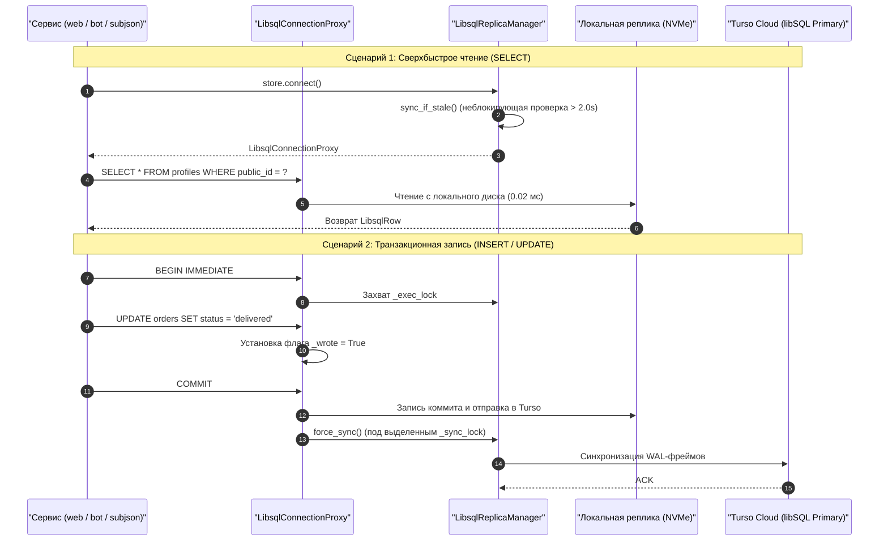
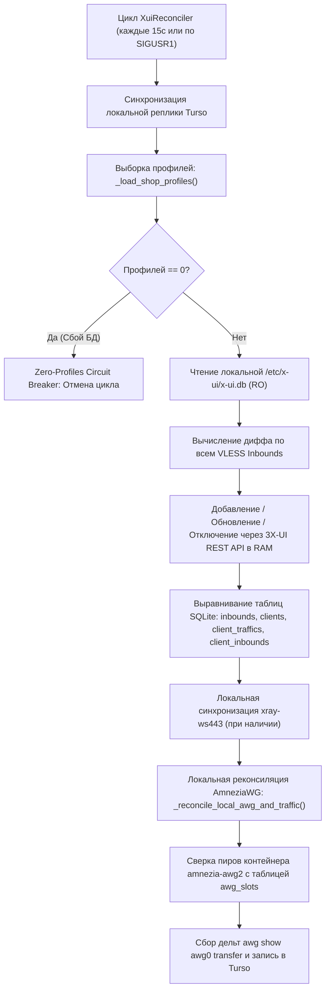
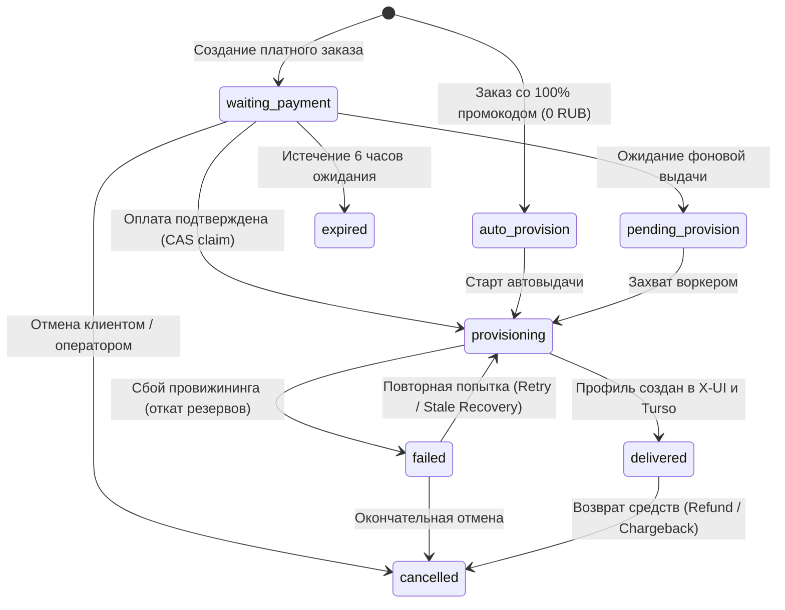

# Архитектура платформы SilentConnect (Active-Active Mesh)

> **Статус документа**: Актуальная боевая спецификация (Production Verified)  
> **Дата последней верификации**: 21.10.2026 (Релиз v5.0 Active-Active Turso Mesh)  
> **Область применения**: Архитектурная спецификация распределённого кластера и плоскости данных  
> **Связанные документы**: [README.md](README.md) • [README_RU.md](README_RU.md) • [DEPLOYMENT.md](DEPLOYMENT.md) • [AMNEZIA_SLOTS.md](AMNEZIA_SLOTS.md) • [WHITELIST_SPEC.md](WHITELIST_SPEC.md)

---

## 1. Обзор платформы и парадигма Active-Active Mesh

**SilentConnect** — геораспределённая отказоустойчивая инфраструктура предоставления защищённого сетевого доступа и автоматизации продаж. В релизе **v5.0** платформа полностью переведена с устаревшей модели «Master/Standby с cron-пушем по SCP» на симметричную архитектуру **Active-Active Mesh**:

1. **Единый облачный источник истины (Turso libSQL) + Локальные NVMe-реплики**:
   - Все узлы кластера (**NL**, **PL**, **FI**) работают с единой базой данных в облаке **Turso** через менеджер встроенных реплик `vpn_shop/libsql_replica.py`.
   - Чтение профилей, заказов и слотов выполняется локально с NVMe-диска за `~0.02 мс`, а фоновая синхронизация (`sync_if_stale`) происходит каждые `2.0 секунды` без блокировки читателей.
2. **Автономная Pull-реконсиляция плоскости данных (`xui_reconciler.py`)**:
   - На каждой ноде работает независимый демон `XuiReconciler`, который сам вытягивает изменения из локальной реплики Turso и применяет их к локальной панели **3X-UI** через REST API в оперативной памяти (Zero-Downtime, без рестарта `xray`) и к локальному контейнеру **AmneziaWG** (`amnezia-awg2`) без межсерверного SSH.
3. **Anycast-отказоустойчивость витрины и API (Yandex Cloud API Gateway)**:
   - Весь HTTPS-трафик витрины, личного кабинета, генератора подписок и платёжных вебхуков проходит через серверлесс-прокси в Yandex Cloud, который прозрачно переключает запросы по цепочке `NL -> PL -> FI` за `3.5 секунды`.
4. **Бессерверная координация фоновых задач (`cluster_leases`)**:
   - Периодические задачи жизненного цикла (отключение истёкших подписок, отправка уведомлений за 24ч/1ч, сверка Digiseller) координируются через таблицу распределённых блокировок `cluster_leases` в Turso.

---

## 2. Топология боевых узлов (Active-Active Node Topology)

```text
                                       [ Пользователи, Клиенты и Вебхуки ]
                                                        │
                 ┌──────────────────────────────────────┴──────────────────────────────────────┐
                 │                                                                             │
  [ HTTPS: Магазин, Кабинет и Подписки ]                                        [ VPN-трафик (Обход DPI) ]
                 │                                                                             │
       https://<SUB_DOMAIN>                                                    https://<EDGE_DOMAIN> / <PL_DOMAIN>
 (Yandex Cloud API Gateway + Function)                                                 / <FI_DOMAIN>
  Авто-фэйловер: NL -> PL -> FI (3.5s)                                          (Прямые A-записи узлов)
                 │                                                                             │
       ┌─────────┴──────────────────────────────┬────────────────────────────────────┐         │
       ▼                                        ▼                                    ▼         ▼
┌───────────────────────────────┐      ┌───────────────────────────────┐      ┌───────────────────────────────┐
│     NL NODE (1 Gbps Mesh)     │      │    PL NODE (10 Gbps Mesh)     │      │     FI NODE (1 Gbps Mesh)     │
│     Ubuntu 24.04 LTS          │      │    Debian 13 (Trixie)         │      │     Linux Mesh Node           │
│ • Xray Dokodemo Mux (:443)    │      │ • Xray Dokodemo Mux (:443)    │      │ • Xray Dokodemo Mux (:443)    │
│ • Caddy v2 TLS (:4430)        │      │ • Caddy v2 TLS (:4430)        │      │ • Caddy v2 TLS (:4430)        │
│ • Web Shop (:3090) & SubJSON  │      │ • Web Shop (:3090) & SubJSON  │      │ • Web Shop (:3090) & SubJSON  │
│ • Xray Reality / Hysteria 2   │      │ • Xray Reality / Hysteria 2   │      │ • Xray Reality / Hysteria 2   │
│ • AmneziaWG (:44121)          │      │ • AmneziaWG (:44121)          │      │ • AmneziaWG (:49752)          │
│ • OpenFlux v0.3.0 Worker      │      │ • OpenFlux v0.3.0 Worker      │      │ • Cluster Watchdog Daemon     │
│ • xui_reconciler.py (АКТИВЕН) │      │ • xui_reconciler.py (АКТИВЕН) │      │ • xui_reconciler.py (АКТИВЕН) │
│ • Локальная реплика Turso     │      │ • Локальная реплика Turso     │      │ • Локальная реплика Turso     │
└───────────────┬───────────────┘      └───────────────┬───────────────┘      └───────────────┬───────────────┘
                │                                      │                                      │
                └──────────────────────────────────────┼──────────────────────────────────────┘
                                                       │
                                   [ Двунаправленная синхронизация libSQL (2.0s) ]
                                                       ▼
                                     ┌───────────────────────────────────┐
                                     │     TURSO CLOUD (libSQL Primary)  │
                                     │ • Единая база vpn_shop            │
                                     │ • Таблицы: profiles, orders,      │
                                     │   awg_slots, openflux_slots,      │
                                     │   cluster_leases, webhook_events  │
                                     └─────────────────┬─────────────────┘
                                                       ▲
                                                       │
                                     ┌─────────────────┴─────────────────┐
                                     │  Движок Telegram-бота (tgcloud)   │
                                     │  + Периодический Lease-воркер     │
                                     └───────────────────────────────────┘
```

### Сводная таблица инвентаря серверов

| Код узла | IP-адрес | Локация и Канал | ОС | Активные сервисы | Статус в Mesh-кластере |
|---|---|---|---|---|---|
| **NL (`nl`)** | `<NL_IP>` | Западная Европа (NL, 1 Gbps) | Ubuntu 24.04 LTS | `vpn-shop-web`, `subjson`, `xui_reconciler`, `x-ui`, `hysteria-server`, `amnezia-awg2`, `openflux`, `bot` | **ACTIVE MESH PEER**<br>(1-й приоритет в YC Edge Gateway; синхронизирован с Turso) |
| **PL (`pl`)** | `<PL_IP>` | Центральная Европа (PL, **10 Gbps**) | Debian 13 (Trixie) | `vpn-shop-web`, `subjson`, `xui_reconciler`, `x-ui`, `hysteria-server`, `amnezia-awg2`, `openflux` | **ACTIVE MESH PEER**<br>(2-й приоритет в YC Edge Gateway; синхронизирован с Turso) |
| **FI (`fi`)** | `<FI_IP>` | Северная Европа (FI, 1 Gbps) | Linux Mesh Node | `vpn-shop-web`, `subjson`, `xui_reconciler`, `x-ui`, `hysteria-server`, `amnezia-awg2`, `cluster_watchdog` | **ACTIVE MESH PEER**<br>(3-й приоритет в YC Edge Gateway; синхронизирован с Turso) |

---

## 3. Сетевая маршрутизация и Serverless Edge Failover

Архитектура строго разделяет плоскость управления (HTTPS API, магазин, выдача подписок) и плоскость данных (туннельный трафик VLESS, Hysteria 2, AmneziaWG).

### 3.1. `<SUB_DOMAIN>` и `<SHOP_DOMAIN>` (Плоскость управления через Yandex Cloud Edge)
- **Маршрутизация**: Внешний DNS в Cloudflare работает в режиме `DNS-Only` (серое облако, CNAME Flattening для корня домена) и указывает на Anycast IP **Yandex Cloud API Gateway** (`sub-proxy-gateway`).
- **Функция маршрутизации (`sub-proxy`, Node.js 22)**:
  - Принимает входящий HTTPS-запрос и направляет его на узел **NL** (`https://<EDGE_DOMAIN>`).
  - Если узел NL не отвечает за **3.5 секунды** или возвращает ошибку `HTTP 502–504`, функция прозрачно повторяет запрос к узлу **PL** (`https://<PL_DOMAIN>`), а затем к **FI** (`https://<FI_DOMAIN>`).
  - Поскольку на всех трёх узлах работают идентичные инстансы `vpn-shop-web` (`:3090`) и `subjson-service` (`:3088`), подключённые к единому облаку **Turso**, переключение происходит **мгновенно и без потери состояния сессии или заказа**.
- **Аварийные заглушки (Emergency Stubs)**: При одновременной недоступности всех апстримов шлюз отдаёт валидный сервисный JSON-профиль для Sing-box/Happ с информационным статусом, предотвращая удаление профиля клиентским приложением.

### 3.2. `<EDGE_DOMAIN>`, `<PL_DOMAIN>`, `<FI_DOMAIN>` (Плоскость данных VPN)
- **Маршрутизация**: Прямые DNS A-записи на IP-адреса соответствующих физических узлов (`<NL_IP>`, `<PL_IP>`, `<FI_IP>`).
- **Клиентская авто-балансировка**:
  - В конфигурациях **Sing-box** (`urltest` группа `auto-urltest`) и **Clash Meta** (`url-test` и `fallback` группы) зашиты все 3 локации и все протоколы сразу.
  - Клиентское ядро само измеряет задержку через `https://cp.cloudflare.com/generate_204` и переключает трафик на лучший узел без участия пользователя.

---

## 4. Распределённый слой данных: Turso (libSQL) и Embedded Replicas

Вместо ручного копирования файлов SQLite по SSH в SilentConnect используется модуль `vpn_shop/libsql_replica.py`.



### Ключевые особенности реализации `libsql_replica.py`:
1. **Изоляция файлов реплик по процессам**: Каждый демон на сервере создаёт собственный файл локальной реплики (`vpn_shop_replica_web.db`, `vpn_shop_replica_bot.db`, `vpn_shop_replica_subjson.db`, `vpn_shop_replica_xui_reconcile.db`), что полностью исключает межпроцессные блокировки `SQLITE_BUSY` на уровне файловой системы.
2. **Разделение блокировок (`_exec_lock` vs `_sync_lock`)**: Сетевой обмен с облаком Turso изолирован в `_sync_lock`, благодаря чему параллельные потоки чтения не ждут окончания сетевого синка.
3. **Гарантия Read-After-Write**: При промахе чтения свежесозданного заказа или профиля (`get_order`, `get_profile`) `Store` автоматически вызывает `force_sync()` и повторяет запрос к обновлённой реплике.
4. **Безопасная трансляция `PRAGMA`**: Информационные запросы (`PRAGMA table_info`, `PRAGMA index_list`) направляются в read-only дескриптор локальной реплики, а конфигурационные `PRAGMA` перехватываются без ошибок драйвера `libsql`.

---

## 5. Автономная Pull-реконсиляция 3X-UI и AmneziaWG (`xui_reconciler.py`)

Каждая нода кластера самостоятельно поддерживает своё локальное состояние Xray и WireGuard в точном соответствии с базой Turso с помощью демона `vpn_shop/xui_reconciler.py`.



### Архитектурные гарантии `XuiReconciler`:
- **Zero-Downtime обновление Xray**: Клиенты добавляются и обновляются через локальный API 3X-UI (`/panel/api/clients/add`, `/panel/api/clients/update/{uuid}`). Ядро Xray применяет изменения в оперативной памяти без разрыва активных TCP/UDP-сессий других пользователей.
- **Автоопределение схемы 3X-UI (`xui_api.py`)**: Клиент API автоматически извлекает `csrf-token` для 3X-UI v2.4+ и прозрачно переключает схему `https://127.0.0.1:2053` и `http://127.0.0.1:2053` при ошибках SSL-рукопожатия.
- **Мгновенное пробуждение (`SIGUSR1`)**: При подтверждении оплаты или вызове `/api/bridge` (`action="reconcile_xui"`) функция `notify_local_reconciler()` отправляет сигнал `SIGUSR1` по PID из `/tmp/silentconnect_xui_reconcile.pid`, пробуждая демон менее чем за `100 мс`.
- **Самоисцеление `xui_sub_id`**: Если на ноде обнаружен клиент с валидным `subId`, который ещё не записан в колонку `profiles.xui_sub_id` в Turso, реконсилятор автоматически сохраняет его в облачную БД для единой выдачи на всех узлах.
- **Сохранение истёкших платных профилей**: При истечении срока оплаченной подписки профиль **не удаляется** из X-UI, а переводится в `enable = False`, чтобы при последующей оплате продления старая ссылка клиента мгновенно заработала снова. Физически удаляются только помеченные `deleted` и одноразовые триалы (`public_trial_7d_auto_delete`, `admin_test_24h_auto_delete`).

---

## 6. Координация фоновых задач и Serverless Bridge

### 6.1. Таблица распределённых лизов (`cluster_leases`)
Чтобы избежать дублирования фоновых рассылок в Telegram и по Email в Active-Active кластере, используется механизм распределённых лизов (`Store.try_acquire_cluster_lease`):
- Перед запуском периодических задач (`_execute_periodic_tasks` в `bot.py`) узел пытается атомарно захватить лиз `periodic_tasks` на `90 секунд` в Turso:
  ```sql
  INSERT INTO cluster_leases(lease_name, holder_node, expires_at, updated_at)
  VALUES('periodic_tasks', ?, ?, ?)
  ON CONFLICT(lease_name) DO UPDATE SET
      holder_node = excluded.holder_node,
      expires_at = excluded.expires_at,
      updated_at = excluded.updated_at
  WHERE cluster_leases.expires_at <= ? OR cluster_leases.holder_node = ?;
  ```
- Только узел, удерживающий активный лиз, выполняет:
  1. `reap_expired_subscriptions()` — перевод истёкших подписок в статус `expired`.
  2. `cleanup_expired_test_profiles()` — очистку истёкших 24ч и 7д триалов.
  3. `send_subscription_expiry_reminders()` — отправку напоминаний за 24 часа и 1 час.
  4. `recover_stale_orders()` — восстановление заказов, зависших в статусе `provisioning`.
  5. `reconcile_digiseller_orders()` — сверку доставок и возвратов с API Digiseller.

### 6.2. Совместимость с `tgcloud` (`SERVERLESS_MODE`)
Если Telegram-бот обслуживается внешней серверлесс-инфраструктурой (`tgcloud`) и локальный вызов `getUpdates` получает `HTTP 409 Conflict`, демон `ShopBot.run_forever()` автоматически переключается в режим `SERVERLESS_MODE`: прекращает поллинг `getUpdates` и остаётся работать как фоновый исполнитель периодических задач по кластерному лизу.

### 6.3. Защищённый RPC-мост (`/api/bridge`)
Модуль `vpn_shop/bridge.py` предоставляет криптографически защищённый эндпоинт `POST /api/bridge`:
- Каждый запрос подписывается `HMAC-SHA256` от строки `"{timestamp}.{raw_body}"` с секретом `SERVERLESS_BRIDGE_SECRET`.
- Проверяется окно допустимого расхождения часов (`MAX_CLOCK_SKEW_SECONDS = 300`).
- Кэш `_REPLAY_CACHE` блокирует повторную отправку (replay-атаки) одного и того же пакета внутри временного окна.

---

## 7. Демаркация портов и матрица протоколов

### 7.1. Мультиплексирование порта 443 TCP (Dokodemo-Door)
На каждом узле кластера порт `0.0.0.0:443` (TCP) прослушивается процессом `xray-multiplexer`, который анализирует SNI в пакете `ClientHello` без терминации TLS:

```text
                            Входящий трафик: TCP 0.0.0.0:443
                                          │
                                          ▼
                      [ xray-multiplexer / dokodemo-door ]
                                          │
                    Сниффинг SNI (Server Name Indication)
                                          │
              ┌───────────────────────────┴───────────────────────────┐
              │                                                       │
   SNI совпадает с Reality                                Любой другой SNI
   (<REALITY_SNI_CLASSIC>,                                (<SHOP_DOMAIN>, <SUB_DOMAIN>,
    <REALITY_SNI_FAST>)                                    <EDGE_DOMAIN>, <PL_DOMAIN>, <FI_DOMAIN>)
              │                                                       │
              ▼                                                       ▼
   Xray Reality Inbound                                    Caddy Reverse Proxy
   127.0.0.1:23385 (TCP Vision)                            127.0.0.1:4430 (TLS Termination)
                                                           ├── /order/*, /api/* -> :3090 (Web Shop)
                                                           ├── /<SECRET>/*      -> :3088 (SubJSON)
                                                           └── /sc-ws-path* -> :10010 (VLESS WS)
```

### 7.2. Сводная матрица протоколов и портов

| Протокол / Сервис | Транспорт L4 | Внешний порт | Внутренний сокет | Обработчик | Маскировка и особенности |
|---|---|---|---|---|---|
| **VLESS Reality Vision** | TCP | `443` / `23385` | `127.0.0.1:23385` | `xray` (3X-UI) | Flow: `xtls-rprx-vision`, uTLS Chrome/Edge |
| **VLESS Reality XHTTP** | TCP | `8443` / `39443` | `0.0.0.0:8443` | `xray` (3X-UI) | XHTTP `packet-up`, путь `/xh-7m-path` |
| **VLESS Reality gRPC** | TCP | `29443` | `0.0.0.0:29443` | `xray` (3X-UI) | gRPC `serviceName: grpc-maxru` |
| **VLESS WebSocket TLS** | TCP | `443` (Caddy) | `127.0.0.1:10010` | `xray-ws443` | WebSocket поверх HTTP/1.1 TLS за Caddy |
| **Hysteria 2** | UDP | `38443` | `0.0.0.0:38443` | `hysteria-server` | Обфускация `gecko`, HTTP-авторизация через `:3088` |
| **Hysteria 2 Hopping** | UDP | `443`, `30000:40000` | `-> 38443` | `iptables NAT` | PREROUTING REDIRECT на сокет `38443` |
| **AmneziaWG (NL & PL)** | UDP | `44121` | `172.17.0.2:44121` | Docker `amnezia-awg2` | `Jc=5, Jmin=10, Jmax=50, S1-S4=12, H1-H4=1..4` |
| **AmneziaWG (FI)** | UDP | `49752` | `172.29.172.2:49752`| Docker `amnezia-awg2` | `Jc=5, Jmin=10, Jmax=50, S1=51, S2=30, S3=34, S4=12` |
| **Caddy HTTPS / H3** | TCP / UDP | `4430` | `0.0.0.0:4430` | `caddy.service` | Автоматический TLS, маршрутизация Web и SubJSON |
| **VPN Shop Web** | TCP | Внутренний | `127.0.0.1:3090` | `vpn-shop-web` | Витрина, чекаут, вебхуки Platega/Digiseller, `/api/bridge` |
| **SubJSON Service** | TCP | Внутренний | `127.0.0.1:3088` | `subjson.service` | Генерация подписок, мастер настройки, auth Hysteria 2 |
| **3X-UI Admin Panel** | TCP | Закрыт UFW | `127.0.0.1:2053` | `x-ui.service` | Внутренний REST API для `xui_reconciler.py` |

---

## 8. Конечный автомат заказов (Order FSM) и платёжные шлюзы

Все переходы статусов заказа в `vpn_shop/store.py` защищены строгим конечным автоматом (`ORDER_TRANSITIONS`) с оптимистичной блокировкой (`version = version + 1`) и журналированием в `order_state_log`:



### Защита платёжных интеграций:
1. **Platega.io (`vpn_shop/platega.py`)**:
   - Проверка `X-MerchantId` и `X-Secret` через `secrets.compare_digest`.
   - Двухсторонняя сверка статуса транзакции через `GET /transaction/{id}` и защита от недоплаты (`amount >= expected_rub - 0.5`).
2. **Digiseller / Plati.market (`vpn_shop/digiseller.py`)**:
   - Строгая проверка канонической подписи `SHA256` (форматы `secret;invoice;goods` и `HMAC-SHA256`; устаревшие `MD5` и бестоварные подписи отвергаются).
   - **Fail-Closed Outbound Verification**: Перед выдачей подписки сервер всегда запрашивает `/api/purchase/info/{invoice_id}`, сверяя `invoice_state == 3`, `date_pay`, `item_id == DIGISELLER_PRODUCT_ID` и минимальную сумму в `RUB`.
   - **Refund Tombstones**: При получении вебхука возврата профиль мгновенно отзывается (`revoke_profile_access`), а в `webhook_events` записывается маркер `tombstone:refund:{invoice_id}`, блокирующий выдачу при запоздалом вебхуке продажи.

---

## 9. Резервное копирование и мониторинг

- **Облачные снапшоты Turso**: Облачная БД Turso обеспечивает автоматическое хранение истории WAL и Point-in-Time Recovery (PITR), а каждая из 3 нод хранит полную физическую копию БД на своём NVMe-диске.
- **Ежедневные бэкапы конфигураций в Google Drive**: Скрипт `/root/backup_to_gdrive.sh` по расписанию выгружает зашифрованные архивы системных конфигураций (`Caddyfile`, `x-ui.db`, `/etc/hysteria/`, `/opt/amnezia/awg/`) в изолированные папки `gdrive:<GDRIVE_BACKUP_FOLDER_ID>/backup_{nl,pl,fi}/` с ротацией 7 и 30 дней.
- **Демон `cluster_watchdog.py`**: Выполняет периодическую проверку здоровья контейнеров `amnezia-awg2` на всех узлах, выбирает лидера через `/tmp/silentconnect_watchdog.leader.lock`, отправляет сигнал Dead Man's Switch (`WATCHDOG_HEARTBEAT_URL`) и отдаёт статус по защищённому эндпоинту `GET /api/internal/cluster/health` (с автоматическим `HTTP 503` при устаревании кэша свыше `180 секунд`).
