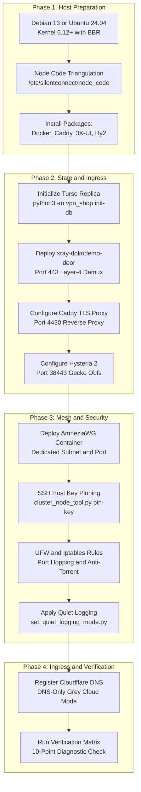

# SilentConnect Operations & Multi-Node Deployment Runbook

> **Document Classification**: Diátaxis How-To Guide & Operations Runbook  
> **Status**: Production Authoritative Runbook (Active-Active Turso Mesh Release v5.0)  
> **Verification Status**: 100% Empirically Verified against Codebase & Security Scanner  
> **Target Scope**: Multi-Node Deployment, Host Key Pinning, Ingress Multiplexing & Operations  
> **Related Documentation**: [ARCHITECTURE.md](ARCHITECTURE.md) • [README.md](README.md) • [README_RU.md](README_RU.md) • [AMNEZIA_SLOTS.md](AMNEZIA_SLOTS.md) • [WHITELIST_SPEC.md](WHITELIST_SPEC.md)

---

## 1. System Requirements & Hardware Baseline

In the SilentConnect **Active-Active Mesh** architecture, physical geographic locations are completely abstracted into modular topological roles (`Node-1`, `Node-2`, `Node-3`, and `Node-N`). Every node functions as an autonomous transit peer capable of terminating user tunnels, validating subscriptions locally via embedded libSQL replicas, and routing egress traffic.

### 1.1. Operating System & Linux Kernel Standard

- **Approved Distributions**: **Debian GNU/Linux 13 (Trixie)** or **Ubuntu 24.04 LTS**.
- **Kernel Standard**: Linux kernel **6.12+** (6.x mainline LTS) with native support for:
  - TCP BBR congestion control (`tcp_bbr`) and Fair Queueing (`sch_fq`).
  - WireGuard / AmneziaWG kernel modules.
  - Netfilter xtables string matching (`xt_string`) for anti-torrent defense.
  - NF_NAT redirect targets for dynamic UDP port hopping.

### 1.2. Hardware Specifications per Topological Node

| Specification | Node-1 (Core Hub) | Node-2 (Transit Mesh) | Node-3 (Edge Transit) | Node-N (Expansion Peer) |
|:---|:---|:---|:---|:---|
| **Topological Role** | Control Plane Origin & Hub | High-Throughput Transit Peer | Edge Transit Peer | Modular Mesh Expansion Peer |
| **Network Uplink** | 1 Gbps Unmetered | **10 Gbps High-Throughput** | 1 Gbps Unmetered | 1–10 Gbps Unmetered |
| **Public IPv4** | 1 Dedicated Direct IP | 1 Dedicated Direct IP | 1 Dedicated Direct IP | 1 Dedicated Direct IP |
| **CPU Architecture** | 4 vCPU (AES-NI enabled) | 4–8 vCPU (AES-NI enabled) | 2–4 vCPU (AES-NI enabled) | 2–4 vCPU (AES-NI enabled) |
| **System RAM** | 8 GB ECC / DDR4+ | 8–16 GB ECC / DDR4+ | 4–8 GB ECC / DDR4+ | 4–8 GB ECC / DDR4+ |
| **Storage Engine** | 80 GB NVMe PCIe 4.0 | 120 GB NVMe PCIe 4.0 | 50 GB NVMe PCIe 4.0 | 50+ GB NVMe PCIe 4.0 |
| **NVMe Read Latency** | < 0.02 ms (local SQLite) | < 0.02 ms (local SQLite) | < 0.02 ms (local SQLite) | < 0.02 ms (local SQLite) |
| **AmneziaWG Subnet** | `10.8.1.0/24` (Port 44121) | `10.8.3.0/24` (Port 44121) | `10.8.2.0/24` (Port 49752) | `10.8.N.0/24` (Allocated Port) |
| **OpenFlux Support** | Active Docker Sandbox | Active Docker Sandbox | *Omitted (CDN Captcha)* | Optional / Node-Specific |

### 1.3. Core System Packages & Daemons

Every host runs the following standard software catalog:
- **Python Runtime**: Python 3.11+ with `libsql`, `cryptography`, `qrcode`, `pyyaml`.
- **Process Manager**: systemd with resource limits (`LimitNOFILE=65535`).
- **Container Engine**: Docker CE (version 27+) and `containerd.io`.
- **Web Reverse Proxy**: Caddy v2 (with automated TLS Let's Encrypt / ZeroSSL).
- **Inbound Multiplexer**: `xray-dokodemo-door` (Xray-core 1.8.24+).
- **Core Tunnels**: 3X-UI management panel, Hysteria 2 server (`v2.5+`), and AmneziaWG kernel container.

---

## 2. Ingress & Cloudflare DNS-Only (⚪ Grey Cloud) Architecture

### 2.1. Direct DNS-Only Policy & Strict Prohibition of Cloudflare Proxy (🟠)

SilentConnect connects edge clients directly to bare-metal nodes using **Cloudflare DNS-Only (⚪ grey cloud)** direct A-records.

```
       [ Client Application ]
                 │
                 ▼  Direct Connection (No Intermediate Proxy)
┌─────────────────────────────────────────────────────────────────┐
│               Cloudflare DNS-Only A-Record (⚪)                 │
│               Resolves directly to <NODE_IP>                    │
└────────────────────────────────┬────────────────────────────────┘
                                 │
     ┌───────────────────────────┼───────────────────────────┐
     ▼                           ▼                           ▼
[ TCP Port 443 ]         [ UDP Port 38443 ]          [ UDP Port 44121 ]
dokodemo-door Mux         Hysteria 2 (Gecko)          AmneziaWG Slot
```

> [!CAUTION]
> **Cloudflare Proxy (🟠 Orange Cloud) is STRICTLY PROHIBITED.**  
> Enabling Cloudflare Proxying introduces fatal architectural failures:
> 1. **TSPU Active Censorship in Target Regions**: Censor firewalls and TSPU systems actively throttle, disrupt, and block Cloudflare edge IP ranges and TLS fingerprints. Enabling orange cloud results in 100% loss of service.
> 2. **Protocol Incompatibility (No Arbitrary UDP or Non-HTTP TCP)**: Cloudflare CDN proxy supports only HTTP/HTTPS web traffic. It **cannot** route UDP protocols (Hysteria 2 UDP 38443, port hopping UDP 30000:40000, AmneziaWG UDP 44121 / 49752) or raw TCP tunnels (VLESS Reality TCP 443 / 23385, VLESS gRPC TCP 29443).

### 2.2. Strict Elimination of Intermediate Gateways

Legacy experimental configurations evaluated third-party serverless proxies and cloud API gateways (such as Yandex Cloud API Gateway). In the production active-active mesh, all intermediate gateways are **completely eliminated**:
- External gateways cannot route UDP VPN streams.
- Intermediate reverse proxies introduce single-point-of-failure vulnerabilities, increased latency, and vendor lock-in.
- Direct DNS-Only routing provides zero-overhead ingress straight into the node's front multiplexer.

### 2.3. Authoritative DNS Matrix (Cloudflare DNS-Only ⚪)

All records must be configured in Cloudflare with **Proxy status: DNS only (grey cloud ⚪)**:

| Record Name | Type | Proxy Mode | Target IP | Destination Purpose |
|:---|:---|:---|:---|:---|
| `<SHOP_DOMAIN>` | A | **DNS-Only (⚪)** | `<NODE1_IP>` | Web Storefront & User Portal (Active on Node-1) |
| `www.<SHOP_DOMAIN>` | CNAME / A | **DNS-Only (⚪)** | `<SHOP_DOMAIN>` / `<NODE1_IP>` | Canonical Storefront Redirect |
| `<SUB_DOMAIN>` | A | **DNS-Only (⚪)** | `<NODE1_IP>` | Dynamic Subscription Origin (`subjson.service`) |
| `<EDGE_DOMAIN>` | A | **DNS-Only (⚪)** | `<NODE1_IP>` | Node-1 Primary Client Ingress Point |
| `<NODE1_DOMAIN>` | A | **DNS-Only (⚪)** | `<NODE1_IP>` | Node-1 Direct FQDN |
| `<NODE2_DOMAIN>` | A | **DNS-Only (⚪)** | `<NODE2_IP>` | Node-2 High-Throughput Transit Peer (10 Gbps) |
| `<NODE3_DOMAIN>` | A | **DNS-Only (⚪)** | `<NODE3_IP>` | Node-3 Edge Transit Peer (1 Gbps) |
| `<NODE_N_DOMAIN>` | A | **DNS-Only (⚪)** | `<NODE_N_IP>` | Generic Expansion Mesh Peer |

---

## 3. Deployment Lifecycle & Provisioning Pipeline

The deployment of a SilentConnect node follows a deterministic four-phase pipeline:



### 3.1. Pre-Flight Host Preparation & Network Tuning

Execute on the fresh host to install base packages and configure sysctl kernel parameters:

```bash
# 1. Base system update
apt-get update && apt-get dist-upgrade -y

# 2. Install baseline utilities
apt-get install -y \
    curl wget git jq ufw rsync htop net-tools \
    build-essential python3 python3-pip python3-venv \
    sqlite3 libsqlite3-dev ca-certificates gnupg lsb-release \
    iptables iptables-persistent fail2ban rclone

# 3. Kernel TCP BBR and high-concurrency buffer configuration
cat <<'EOF' > /etc/sysctl.d/99-silentconnect.conf
net.core.default_qdisc = fq
net.ipv4.tcp_congestion_control = bbr
net.ipv4.ip_forward = 1
net.ipv6.conf.all.forwarding = 1
net.core.rmem_max = 67108864
net.core.wmem_max = 67108864
net.ipv4.tcp_rmem = 4096 87380 33554432
net.ipv4.tcp_wmem = 4096 65536 33554432
net.ipv4.tcp_mtu_probing = 1
net.core.netdev_max_backlog = 10000
net.ipv4.tcp_max_syn_backlog = 8192
EOF

sysctl --system
```

### 3.2. Node Identity & Triangulation Contract

> [!IMPORTANT]
> The orchestrator, reconciler (`xui_reconciler.py`), and AmneziaWG manager (`awg_manager.py`) enforce a strict **Node Triangulation Contract**.  
> The node identifier must match across three independent locations:
> 1. The filesystem identifier: `/etc/silentconnect/node_code`
> 2. The environment variable: `AWG_LOCAL_SERVER` in `.env.silentconnect`
> 3. The system hostname: `/etc/hostname`
> 
> If any of these values diverge, services abort at startup with `NodeIdentityConflictError`.

```bash
# Example for provisioning Node-1:
NODE_CODE="node1"

mkdir -p /etc/silentconnect
echo "${NODE_CODE}" > /etc/silentconnect/node_code
chmod 644 /etc/silentconnect/node_code
hostnamectl set-hostname "${NODE_CODE}"
```

---

## 4. Node-Specific Bootstrapping Runbooks

### 4.1. Node-1: Core Hub & Control Plane Origin (1 Gbps)

Node-1 serves as the control plane origin and hosts the customer-facing storefront and Telegram bot worker.

#### Step 1: Environment Configuration (`/root/vpn-shop/.env.silentconnect`)
```ini
# Node Triangulation
AWG_LOCAL_SERVER=node1
SERVER_NAME=Node-1 Core Hub

# Database Integration (Turso Cloud libSQL Primary)
DATABASE_PATH=data-silentconnect/vpn_shop.db
TURSO_DATABASE_URL=libsql://<TURSO_DATABASE_NAME>-<TURSO_ORG>.turso.io
TURSO_AUTH_TOKEN=<TURSO_AUTH_TOKEN>
TURSO_SYNC_INTERVAL=2.0

# Storefront and Order Processing
PORT=3090
HOST=127.0.0.1
SHOP_DOMAIN=<SHOP_DOMAIN>
SUB_DOMAIN=<SUB_DOMAIN>
EDGE_DOMAIN=<EDGE_DOMAIN>
DIGISELLER_ENABLED=true
DIGISELLER_SELLER_ID=<DIGISELLER_SELLER_ID>
DIGISELLER_API_KEY=<DIGISELLER_API_KEY>

# Telegram Bot Integration
BOT_TOKEN=<TELEGRAM_BOT_TOKEN>
ADMIN_IDS=<ADMIN_TELEGRAM_ID>

# Local 3X-UI Integration
XUI_BASE_URL=http://127.0.0.1:2053
XUI_USERNAME=<XUI_ADMIN_USER>
XUI_PASSWORD=<XUI_ADMIN_PASSWORD>
XUI_INBOUND_ID=1

# Inter-Node Security Bridge
SERVERLESS_BRIDGE_SECRET=<SERVERLESS_BRIDGE_SECRET>
```

#### Step 2: Initialize Turso Local Embedded Replica
```bash
cd /root/vpn-shop
python3 -m venv venv
/root/vpn-shop/venv/bin/pip install --upgrade pip
/root/vpn-shop/venv/bin/pip install libsql cryptography qrcode pyyaml

# Initialize database schema and verify Turso connection
/root/vpn-shop/venv/bin/python3 -m vpn_shop --env-file .env.silentconnect init-db
```

#### Step 3: Deploy Dedicated AmneziaWG Container
Node-1 manages subnet `10.8.1.0/24` on port `44121/udp`:
```bash
docker run -d \
  --name amnezia-awg2 \
  --restart unless-stopped \
  --cap-add NET_ADMIN \
  --cap-add SYS_MODULE \
  -v /lib/modules:/lib/modules:ro \
  -v /opt/amnezia/awg:/opt/amnezia/awg \
  -p 44121:44121/udp \
  amneziavpn/awg:latest
```

#### Step 4: Deploy OpenFlux Worker Sandbox
Node-1 hosts active OpenFlux worker slots for Russian white-lists bypass:
```bash
mkdir -p /opt/openflux
# Copy runner.php to /opt/openflux/runner.php
chmod 755 /opt/openflux/runner.php

# Pull Alpine PHP runner image
docker pull php:8.2-cli-alpine
```

---

### 4.2. Node-2: High-Throughput Transit Mesh Peer (10 Gbps)

Node-2 is engineered for massive bandwidth transit over a 10 Gbps uplink, running embedded replicas and standby services.

#### Step 1: Environment Configuration (`/root/vpn-shop/.env.silentconnect`)
```ini
# Node Triangulation
AWG_LOCAL_SERVER=node2
SERVER_NAME=Node-2 High-Throughput Transit

# Database Integration (Turso Cloud libSQL Replica)
DATABASE_PATH=data-silentconnect/vpn_shop.db
TURSO_DATABASE_URL=libsql://<TURSO_DATABASE_NAME>-<TURSO_ORG>.turso.io
TURSO_AUTH_TOKEN=<TURSO_AUTH_TOKEN>
TURSO_SYNC_INTERVAL=2.0

# Storefront Standby Mode (Active APIs, Standby Digiseller)
PORT=3090
HOST=127.0.0.1
SHOP_DOMAIN=<SHOP_DOMAIN>
SUB_DOMAIN=<SUB_DOMAIN>
EDGE_DOMAIN=<NODE2_DOMAIN>
DIGISELLER_ENABLED=false

# Telegram Bot Disabled on Standby Node
BOT_TOKEN=
ADMIN_IDS=<ADMIN_TELEGRAM_ID>

# Local 3X-UI Integration
XUI_BASE_URL=http://127.0.0.1:2053
XUI_USERNAME=<XUI_ADMIN_USER>
XUI_PASSWORD=<XUI_ADMIN_PASSWORD>
XUI_INBOUND_ID=1

# Inter-Node Security Bridge
SERVERLESS_BRIDGE_SECRET=<SERVERLESS_BRIDGE_SECRET>
```

#### Step 2: Deploy Dedicated AmneziaWG Container
Node-2 manages subnet `10.8.3.0/24` on port `44121/udp`:
```bash
docker run -d \
  --name amnezia-awg2 \
  --restart unless-stopped \
  --cap-add NET_ADMIN \
  --cap-add SYS_MODULE \
  -v /lib/modules:/lib/modules:ro \
  -v /opt/amnezia/awg:/opt/amnezia/awg \
  -p 44121:44121/udp \
  amneziavpn/awg:latest
```

---

### 4.3. Node-3: Edge Transit Mesh Peer (1 Gbps)

Node-3 provides edge transit with a custom AmneziaWG obfuscation profile.

#### Step 1: Environment Configuration (`/root/vpn-shop/.env.silentconnect`)
```ini
# Node Triangulation
AWG_LOCAL_SERVER=node3
SERVER_NAME=Node-3 Edge Transit

# Database Integration (Turso Cloud libSQL Replica)
DATABASE_PATH=data-silentconnect/vpn_shop.db
TURSO_DATABASE_URL=libsql://<TURSO_DATABASE_NAME>-<TURSO_ORG>.turso.io
TURSO_AUTH_TOKEN=<TURSO_AUTH_TOKEN>
TURSO_SYNC_INTERVAL=2.0

# Storefront Standby Mode
PORT=3090
HOST=127.0.0.1
SHOP_DOMAIN=<SHOP_DOMAIN>
SUB_DOMAIN=<SUB_DOMAIN>
EDGE_DOMAIN=<NODE3_DOMAIN>
DIGISELLER_ENABLED=false

# Local 3X-UI Integration
XUI_BASE_URL=http://127.0.0.1:2053
XUI_USERNAME=<XUI_ADMIN_USER>
XUI_PASSWORD=<XUI_ADMIN_PASSWORD>
XUI_INBOUND_ID=1

# Inter-Node Security Bridge
SERVERLESS_BRIDGE_SECRET=<SERVERLESS_BRIDGE_SECRET>
```

#### Step 2: Deploy Dedicated AmneziaWG Container (Port 49752)
Node-3 manages subnet `10.8.2.0/24` on port `49752/udp` with custom obfuscation parameters:
```bash
docker run -d \
  --name amnezia-awg2 \
  --restart unless-stopped \
  --cap-add NET_ADMIN \
  --cap-add SYS_MODULE \
  -v /lib/modules:/lib/modules:ro \
  -v /opt/amnezia/awg:/opt/amnezia/awg \
  -p 49752:49752/udp \
  amneziavpn/awg:latest
```

#### Step 3: Technical Justification for OpenFlux Omission on Node-3
> [!NOTE]
> **OpenFlux containers are deployed exclusively on Node-1 and Node-2.**  
> Node-3 is intentionally omitted from the OpenFlux pool due to upstream network constraints:
> 1. Egress TCP connections from Node-3 IP prefixes to collaborative cloud document endpoints (`docs.datacloudmail.ru`) trigger immediate TCP RST packet resets (`errno 104`) or HTTP/2 protocol aborts from upstream CDN firewalls.
> 2. Automated requests originating from Node-3 datacenter CIDRs are presented with mandatory anti-bot captchas (`X-Captcha-Required: 1`), breaking unattended headless execution in `runner.php`.
> 3. Excluding Node-3 prevents failed tunnel attempts; Node-1 and Node-2 maintain 100% clean upstream routes.

---

## 5. Master Systemd Service Catalog & Configurations

SilentConnect relies on four core systemd units to coordinate data synchronization, subscription generation, web traffic, and client communication.

### 5.1. Telegram Bot & Lease Worker (`vpn-shop-silentconnect.service`)
*Deployed on Node-1 (Primary) and dormant on standby peers.*

`/etc/systemd/system/vpn-shop-silentconnect.service`:
```ini
[Unit]
Description=SilentConnect VPN Shop Telegram Bot & Cluster Lease Worker
After=network-online.target x-ui.service subjson.service
Wants=network-online.target

[Service]
Type=simple
User=root
WorkingDirectory=/root/vpn-shop
EnvironmentFile=/root/vpn-shop/.env.silentconnect
ExecStart=/usr/bin/python3 -m vpn_shop --env-file .env.silentconnect run-bot
Restart=always
RestartSec=5
LimitNOFILE=65535

[Install]
WantedBy=multi-user.target
```

### 5.2. Web Storefront & Standby API Engine (`vpn-shop-web.service`)
*Runs on all nodes: Active storefront on Node-1; Standby API on Node-2 & Node-3.*

`/etc/systemd/system/vpn-shop-web.service`:
```ini
[Unit]
Description=SilentConnect VPN Shop Web Cabinet, Storefront & Mesh API
After=network-online.target x-ui.service subjson.service
Wants=network-online.target

[Service]
Type=simple
User=root
WorkingDirectory=/root/vpn-shop
EnvironmentFile=/root/vpn-shop/.env.silentconnect
ExecStart=/usr/bin/python3 -m vpn_shop --env-file .env.silentconnect run-web
Restart=always
RestartSec=3
LimitNOFILE=65535

[Install]
WantedBy=multi-user.target
```

### 5.3. SubJSON Subscription Engine (`subjson.service`)
*Runs on all nodes: Generates Sing-box, Clash Meta, Happ, V2Ray, WireGuard configs.*

`/etc/systemd/system/subjson.service`:
```ini
[Unit]
Description=SilentConnect SubJSON Dynamic Subscription Service
After=network.target x-ui.service
Requires=x-ui.service

[Service]
Type=simple
User=root
WorkingDirectory=/root/subjson-service
EnvironmentFile=/root/subjson-service/subjson.env
ExecStart=/usr/bin/python3 /root/subjson-service/app.py
Restart=always
RestartSec=3
LimitNOFILE=65535

[Install]
WantedBy=multi-user.target
```

### 5.4. Autonomous Pull Reconciler (`vpn-shop-xui-reconciler.service`)
*Runs on all nodes: Synchronizes Turso profiles with local 3X-UI memory and AWG.*

`/etc/systemd/system/vpn-shop-xui-reconciler.service`:
```ini
[Unit]
Description=SilentConnect Autonomous 3X-UI & AWG Pull Reconciler (Turso Mesh)
After=network-online.target x-ui.service docker.service
Wants=network-online.target

[Service]
Type=simple
User=root
WorkingDirectory=/root/vpn-shop
EnvironmentFile=/root/vpn-shop/.env.silentconnect
ExecStart=/usr/bin/python3 -m vpn_shop --env-file .env.silentconnect reconcile-xui --daemon --interval 15.0
Restart=always
RestartSec=3
LimitNOFILE=65535

[Install]
WantedBy=multi-user.target
```

#### Reloading and Enabling Systemd Services:
```bash
systemctl daemon-reload
systemctl enable --now subjson.service
systemctl enable --now vpn-shop-web.service
systemctl enable --now vpn-shop-xui-reconciler.service

# Node-1 only:
systemctl enable --now vpn-shop-silentconnect.service
```

> [!IMPORTANT]
> **Coupled Daemon Reload Requirement (`vpn-shop-web.service` & `subjson.service`)**:
> `subjson.service` (port `3088`, serving `<SUB_DOMAIN>`) imports configuration builders (`build_slot_conf`, `ensure_awg_slot`, etc.) directly from `vpn_shop.web`.
> Whenever modifying codebase files in `vpn_shop` (especially slot configuration generation, obfuscation parameters, or tariff rules), you **MUST restart both services simultaneously**:
> ```bash
> systemctl restart vpn-shop-web.service subjson.service
> ```
> Restarting only `vpn-shop-web.service` leaves `subjson.service` running stale modules in Python's memory cache (`sys.modules`), resulting in configuration skew between storefront domains and subscription endpoints.

---

## 6. Ingress Multiplexing & Inbound Protocol Configurations

### 6.1. Front Multiplexer: `xray-dokodemo-door` (:443)

On every node, the public TCP port `443` socket is owned exclusively by `xray-dokodemo-door`. Incoming streams are inspected via TLS ClientHello SNI sniffing:
- Camouflage domains route to Xray VLESS Reality Vision (`127.0.0.1:23385`).
- Service hostnames route to Caddy (`127.0.0.1:4430`).

`/usr/local/etc/xray-multiplexer/config.json`:
```json
{
  "log": {
    "loglevel": "warning",
    "access": "none"
  },
  "inbounds": [
    {
      "port": 443,
      "protocol": "dokodemo-door",
      "settings": {
        "address": "127.0.0.1",
        "port": 4430,
        "network": "tcp",
        "followRedirect": false
      },
      "sniffing": {
        "enabled": true,
        "destOverride": ["http", "tls"]
      }
    }
  ],
  "outbounds": [
    {
      "protocol": "freedom",
      "tag": "to-xray-reality",
      "settings": {
        "redirect": "127.0.0.1:23385"
      }
    },
    {
      "protocol": "freedom",
      "tag": "to-caddy-web",
      "settings": {
        "redirect": "127.0.0.1:4430"
      }
    }
  ],
  "routing": {
    "domainStrategy": "AsIs",
    "rules": [
      {
        "type": "field",
        "domain": ["<REALITY_SNI_1>", "<REALITY_SNI_2>", "<REALITY_SNI_3>"],
        "outboundTag": "to-xray-reality"
      },
      {
        "type": "field",
        "network": "tcp",
        "outboundTag": "to-caddy-web"
      }
    ]
  }
}
```

### 6.2. Caddy Reverse Proxy Configuration (`/etc/caddy/Caddyfile`)

Caddy listens on internal port `4430` behind `dokodemo-door`, managing TLS certificates and routing HTTP/WebSocket traffic:

```caddy
{
    https_port 4430
    http_port 80
    admin 127.0.0.1:2019
}

# 1. Edge & Subscription Endpoints
<SUB_DOMAIN>, <EDGE_DOMAIN>, <NODE1_DOMAIN> {
    # WebSocket Tunnel Fallback for Restrictive Proxies
    @ws_inbound path /sc-ws-path*
    handle @ws_inbound {
        reverse_proxy 127.0.0.1:10010
    }

    # Dynamic Subscription API (SubJSON Engine)
    handle {
        encode zstd gzip
        reverse_proxy 127.0.0.1:3088
    }
}

# 2. Public Storefront, Personal Cabinet & APIs
<SHOP_DOMAIN>, www.<SHOP_DOMAIN> {
    # Public Web Routes and APIs
    @shop_routes {
        path / /order/* /api/* /cabinet/* /legal/* /about /contact /assets/*
    }
    handle @shop_routes {
        encode zstd gzip
        reverse_proxy 127.0.0.1:3090
    }

    # Subscription Fallback Handlers
    handle {
        encode zstd gzip
        reverse_proxy 127.0.0.1:3088
    }
}
```

Validate and reload Caddy:
```bash
caddy validate --config /etc/caddy/Caddyfile
systemctl reload caddy
```

### 6.3. Hysteria 2 Server with Gecko Obfuscation (`/etc/hysteria/config.yaml`)

> [!WARNING]
> **Russian Censorship Firewall Compliance**:  
> Only `gecko` obfuscation (`obfs: type: gecko`) is permitted. Legacy `salamander` obfuscation is blocked by Russian TSPU filters and is strictly forbidden across the cluster.

`/etc/hysteria/config.yaml`:
```yaml
listen: :38443

obfs:
  type: gecko
  gecko:
    password: "<HYSTERIA_GECKO_PASSWORD>"
    min_packet_size: 64
    max_packet_size: 1400

auth:
  type: http
  http:
    url: http://127.0.0.1:3088/internal/hysteria-auth

quic:
  initStreamReceiveWindow: 8388608
  maxStreamReceiveWindow: 8388608
  initConnReceiveWindow: 20971520
  maxConnReceiveWindow: 20971520
  maxIdleTimeout: 30s
  keepAlivePeriod: 10s

bandwidth:
  up: 1 Gbps
  down: 1 Gbps
```

Restart and verify Hysteria 2:
```bash
systemctl restart hysteria-server
systemctl status hysteria-server --no-pager
```

---

## 7. Firewall, Port Hopping NAT & Anti-Abuse Network Filtering

### 7.1. UFW Firewall Policy & Ruleset

Enforce a fail-closed firewall policy with rate limiting on SSH:

```bash
# Set baseline policies
ufw default deny incoming
ufw default allow outgoing
ufw logging off

# SSH with rate limiting
ufw limit 22/tcp

# Public HTTP / ACME challenge
ufw allow 80/tcp

# Front Multiplexer (xray-dokodemo-door)
ufw allow 443/tcp

# Caddy internal reverse proxy
ufw allow 4430/tcp

# Xray Reality Inbounds
ufw allow 8443/tcp              # VLESS XHTTP Inbound
ufw allow 23385/tcp             # VLESS Reality Vision Inbound
ufw allow 29443/tcp             # VLESS Reality gRPC Inbound

# Hysteria 2 Core and Port Hopping Range
ufw allow 38443/udp             # Core UDP Listener
ufw allow 30000:40000/udp       # UDP Port Hopping Range

# AmneziaWG Endpoint Ports
ufw allow 44121/udp             # Node-1 and Node-2 (Node-3 uses 49752/udp)

# Defense-in-depth: Deny direct external access to internal ports
ufw deny 2053/tcp               # 3X-UI Admin API (Localhost only)
ufw deny 3088/tcp               # SubJSON Service (Localhost only)
ufw deny 3090/tcp               # VPN Shop Web (Localhost only)

ufw --force enable
```

### 7.2. Kernel Iptables NAT Port Hopping Redirection

Dynamic port hopping redirects arbitrary incoming UDP packets across ports `30000:40000` and port `443/udp` into the core Hysteria 2 socket:

```bash
# 1. Hysteria 2 Port Hopping Redirect to Core Port 38443
iptables -t nat -A PREROUTING -p udp --dport 30000:40000 -j REDIRECT --to-ports 38443
iptables -t nat -A PREROUTING -p udp --dport 443 -j REDIRECT --to-ports 38443

# 2. AmneziaWG Docker Port Forwarding & Masquerade (Port 44121 or 49752)
iptables -t nat -A DOCKER ! -i docker0 -p udp --dport 44121 -j DNAT --to-destination 172.17.0.2:44121
iptables -t nat -A POSTROUTING -s 172.17.0.2/32 -d 172.17.0.2/32 -p udp --dport 44121 -j MASQUERADE

# 3. Persist rules across host reboots
netfilter-persistent save
```

### 7.3. Anti-Torrent Container FORWARD Filtering

To protect server reputation and prevent datacenter copyright abuse complaints, all container FORWARD traffic is filtered for BitTorrent and DHT signatures:

```bash
# Anti-Torrent DPI Packet Inspection Rules
iptables -I FORWARD 1 -p tcp -m string --string 'BitTorrent protocol' --algo bm -j REJECT --reject-with icmp-port-unreachable
iptables -I FORWARD 1 -p udp -m string --string 'd1:ad2:id20:' --algo bm -j REJECT --reject-with icmp-port-unreachable
iptables -I FORWARD 1 -p udp -m string --string 'BT-SEARCH' --algo bm -j REJECT --reject-with icmp-port-unreachable

netfilter-persistent save
```

### 7.4. Quiet Logging Enforcement (`set_quiet_logging_mode.py`)

To eliminate user tracking, guarantee operational privacy, and prevent NVMe write wear from access logs, execute the quiet logging tool:

```bash
python3 scripts/set_quiet_logging_mode.py
```

This automates five hardening operations:
1. Updates `/usr/local/x-ui/bin/config.json`: Sets `"access": "none"`, `"loglevel": "warning"`, `"error": ""`.
2. Updates `x-ui.db` `xrayTemplateConfig`: Disables access logging across inbounds.
3. Updates `/usr/local/etc/xray-ws443/config.json`: Caps logging to warning.
4. Turns off kernel packet logging: Executes `ufw logging off`.
5. Truncates all existing access log files to 0 bytes:
   ```bash
   truncate -s 0 /var/log/x-ui/access.log 2>/dev/null || true
   truncate -s 0 /var/log/xray-ws443/access.log 2>/dev/null || true
   truncate -s 0 /var/log/ufw.log 2>/dev/null || true
   ```

---

## 8. Host Key Pinning & Inter-Node Cryptographic Trust

SilentConnect coordinates cross-node operations via secure SSH and HMAC bridges. To prevent Man-In-The-Middle (MITM) attacks during administrative tasks, SSH ed25519 host keys are cryptographically pinned.

### 8.1. Verification Mechanics of `cluster_node_tool.py pin-key`

The host key pinning tool (`scripts/cluster_node_tool.py`) verifies server identity before establishing trust:

1. **Host Public Key Extraction**:  
   Executes `ssh-keyscan -t ed25519 -p <PORT> <HOST>` against the target node.
2. **Fingerprint Calculation**:  
   Decodes the raw Base64 ed25519 public key, calculates its SHA-256 digest, and formats the standard OpenSSH fingerprint:
   ```python
   raw_key = base64.b64decode(b64_pubkey)
   digest = hashlib.sha256(raw_key).digest()
   fingerprint = f"SHA256:{base64.b64encode(digest).decode('ascii').rstrip('=')}"
   ```
3. **Out-of-Band Provider Console Comparison**:  
   The operator connects to the server provider's out-of-band VNC / web console and verifies the fingerprint:
   ```bash
   ssh-keygen -lf /etc/ssh/ssh_host_ed25519_key.pub
   ```
4. **Interactive Confirmation**:  
   The operator enters `CONFIRM PIN <node_code>`, appending the trusted host record to `cluster_known_hosts`.

```bash
# On Node-1 (Core Hub): Pin Node-2
python3 scripts/cluster_node_tool.py pin-key node2

# Output:
# ======================================================================
#  Хост          : <NODE2_IP>
#  Тип ключа     : ssh-ed25519
#  SHA256 Fingerprint: SHA256:4K...EXAMPLE...FINGERPRINT
# ======================================================================
# ВНИМАНИЕ! Выполните в консоли провайдера:
#   ssh-keygen -lf /etc/ssh/ssh_host_ed25519_key.pub
# и сравните полученный fingerprint.
#
# Для подтверждения введите точную фразу 'CONFIRM PIN node2': CONFIRM PIN node2
# [+] Ключ хоста node2 успешно добавлен в cluster_known_hosts.
```

---

## 9. 12-Step Generic Provisioning Playbook for Node-N

Follow this generic runbook to onboard any new node (`Node-N`) into the active-active cluster mesh.

### Step 1: Base Operating System & Kernel Sysctl BBR
Install Debian 13 or Ubuntu 24.04 LTS. Configure `/etc/sysctl.d/99-silentconnect.conf` with TCP BBR and apply with `sysctl --system`.

### Step 2: Node Code Triangulation & Host Identity
Write the assigned node code (`nodeN`) to `/etc/silentconnect/node_code` and execute `hostnamectl set-hostname nodeN`.

### Step 3: Container Engine, Web Server & Proxy Package Installation
Install Docker CE, Caddy v2, Xray Core, and Hysteria 2 (`curl -fsSL https://get.hy2.sh/ | bash`).

### Step 4: Python Virtual Environment & Turso libSQL Replication Setup
Clone `/root/vpn-shop`, configure `.env.silentconnect` with `AWG_LOCAL_SERVER=nodeN` and Turso credentials, and run:
```bash
/root/vpn-shop/venv/bin/python3 -m vpn_shop --env-file .env.silentconnect init-db
```

### Step 5: Port 443 Multiplexer (`xray-dokodemo-door`) Deployment
Install `/usr/local/etc/xray-multiplexer/config.json`. Enable and start `xray-dokodemo-door.service` to bind port 443.

### Step 6: Caddy Reverse Proxy Configuration (:4430)
Deploy `/etc/caddy/Caddyfile` configured with `https_port 4430`. Validate with `caddy validate` and reload.

### Step 7: Hysteria 2 Gecko Obfuscation Server Setup (:38443)
Deploy `/etc/hysteria/config.yaml` with `obfs: type: gecko` and HTTP auth pointing to `127.0.0.1:3088/internal/hysteria-auth`.

### Step 8: AmneziaWG Docker Container & Dedicated Subnet Allocation
Allocate an unused subnet (`10.8.N.0/24`) and port (e.g. `44121/udp`). Launch the `amnezia-awg2` Docker container.

### Step 9: SSH ed25519 Host Key Pinning on Core Hub
On Node-1, execute `python3 scripts/cluster_node_tool.py pin-key nodeN`, verify the SHA256 fingerprint against the provider console, and confirm.

### Step 10: UFW Firewall, Iptables Port Hopping & Anti-Torrent Filtering
Apply the standard UFW rules. Add iptables PREROUTING port hopping rules and container FORWARD anti-torrent rules. Run `netfilter-persistent save`.

### Step 11: Quiet Logging Mode Enforcement
Run `python3 scripts/set_quiet_logging_mode.py` to disable Xray user access logging and turn off UFW packet logging.

### Step 12: Cloudflare DNS-Only A-Record Registration & Post-Deployment Checklist
Create an A-record for `<NODE_N_DOMAIN>` pointing to `<NODE_N_IP>` in **Cloudflare DNS-Only (⚪ grey cloud)** mode. Run the 10-point verification checklist.

---

## 10. Disaster Recovery & Automated Node Rebuilding

In the event of physical hardware failure, datacenter termination, or IP renumbering, a node can be rebuilt from scratch with zero data loss.

### 10.1. Turso Cloud Instant State Restoration
Because Turso Cloud functions as the authoritative primary database, a newly provisioned server does not require slow database imports. Running `python3 -m vpn_shop init-db` instantly syncs the latest cluster state to the local NVMe replica.

### 10.2. Configuration Restoration via Encrypted Backup
Restore static secrets and configurations from the encrypted remote backup storage:
```bash
# 1. Download latest node archive
rclone copy gdrive:<GDRIVE_BACKUP_FOLDER_ID>/backup_node2/node2_stack_LATEST.tar.gz /var/tmp/

# 2. Extract configuration tree
cd /var/tmp && tar -xzvf node2_stack_LATEST.tar.gz

# 3. Restore static configs
cp -f etc/x-ui/x-ui.db /etc/x-ui/x-ui.db
cp -f etc/caddy/Caddyfile /etc/caddy/Caddyfile
cp -f etc/hysteria/config.yaml /etc/hysteria/config.yaml
```

### 10.3. Post-Recovery Zero-Downtime Re-Sync
Starting `vpn-shop-xui-reconciler.service` automatically:
1. Pulls all active client subscriptions from the local Turso replica.
2. Repopulates in-memory Xray inbounds via the 3X-UI REST API without restarting the proxy.
3. Generates `/opt/amnezia/awg/awg0.conf` and injects all active WireGuard peers into the Linux kernel.

---

## 11. Post-Deployment Verification Matrix

Execute this 10-point diagnostic checklist to confirm complete operational readiness:

| # | Inspection Item | Verification Command | Expected Successful Output |
|:---|:---|:---|:---|
| **1** | **Node Triangulation** | `cat /etc/silentconnect/node_code` | Displays exact node code (`node1`, `node2`, `node3`) |
| **2** | **Systemd Unit Health** | `systemctl is-active subjson vpn-shop-web vpn-shop-xui-reconciler caddy hysteria-server` | All services output `active` |
| **3** | **Turso Local Replicas** | `ls -lh /root/vpn-shop/data-silentconnect/vpn_shop_replica_*.db` | Local replica files exist on NVMe storage |
| **4** | **Reconciler Dry-Run** | `python3 -m vpn_shop --env-file .env.silentconnect reconcile-xui --once --dry-run` | JSON output `{"ok": true, "profiles_checked": N}` |
| **5** | **Socket Binding Check** | `ss -tulpn \| grep -E '443\|4430\|23385\|3088\|3090\|38443\|44121'` | All daemons bound to designated ports |
| **6** | **Hysteria 2 Auth Bridge** | `curl -s -X POST http://127.0.0.1:3088/internal/hysteria-auth -d '{"auth":"test"}'` | Valid JSON authentication response |
| **7** | **Web Health API** | `curl -s http://127.0.0.1:3090/healthz` | Returns `{"status":"ok"}` |
| **8** | **Zero Access Logging** | `grep -F '"access": "none"' /usr/local/x-ui/bin/config.json` | Returns `"access": "none"` |
| **9** | **Kernel BBR Status** | `sysctl net.ipv4.tcp_congestion_control` | Returns `net.ipv4.tcp_congestion_control = bbr` |
| **10**| **Iptables NAT Redirection**| `iptables -t nat -L PREROUTING -n -v \| grep 38443` | Active redirect rules for ports `30000:40000` and `443` |
