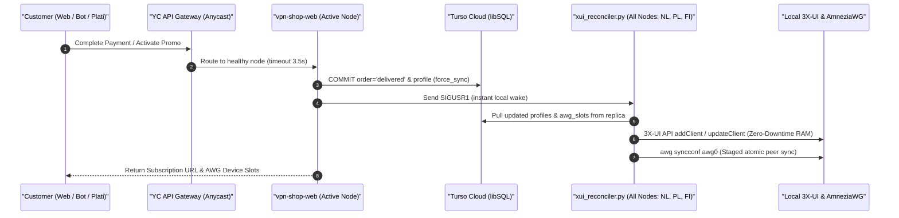

# SilentConnect: High-Availability Active-Active VPN & Subscription Mesh

[](#automated-security--zero-leak-verification)
[-10b981.svg?style=flat-square)](#automated-security--zero-leak-verification)
[](#architecture-overview)
[](https://www.python.org/)
[](LICENSE)
[](#protocol--subscription-delivery)

**SilentConnect** is a geo-distributed, **Active-Active Mesh** multi-protocol tunneling and subscription automation platform engineered to withstand aggressive Deep Packet Inspection (DPI), TSPU packet manipulation, and datacenter outages.

The platform unifies a serverless-ready Telegram bot (`tgcloud` / `vpn_shop.bot`), an asynchronous web storefront with instant SBP / Platega / Digiseller checkout (`vpn_shop.web`), a multi-format subscription engine (`subjson-service`), an **AmneziaWG Device Slots Hub** with monotonic 30-day quota accounting, and **autonomous zero-downtime 3X-UI & WireGuard pull reconciliation** powered by **Turso (libSQL)** embedded NVMe replicas.

---

## Table of Contents

1. [Architecture Overview](#architecture-overview)
2. [Production Node Inventory](#production-node-inventory)
3. [Microservices & Core Engines](#microservices--core-engines)
4. [Active-Active Data Plane & Autonomous Reconciliation](#active-active-data-plane--autonomous-reconciliation)
5. [Protocol & Subscription Delivery](#protocol--subscription-delivery)
6. [Supported Platforms & Client Matrix](#supported-platforms--client-matrix)
7. [Telegram Bot & Administrative Workflows](#telegram-bot--administrative-workflows)
8. [Web Storefront, Payment Gateways & Self-Service Cabinet](#web-storefront-payment-gateways--self-service-cabinet)
9. [Configuration & Environment Catalog](#configuration--environment-catalog)
10. [Deployment & Quickstart Guide](#deployment--quickstart-guide)
11. [Automated Security & Zero-Leak Verification](#automated-security--zero-leak-verification)
12. [In-Depth Documentation Index](#in-depth-documentation-index)

---

## Architecture Overview

SilentConnect operates on ashared-nothing **Active-Active Mesh** topology where every cluster node (**NL**, **PL**, **FI**) is self-sufficient, serves live traffic simultaneously, reads from a local NVMe embedded replica in `0.02 ms`, and autonomously reconciles its own kernel and proxy state from **Turso (libSQL)**:

```text
                                       [ Users, Clients & Payment Webhooks ]
                                                         │
                  ┌──────────────────────────────────────┴──────────────────────────────────────┐
                  │                                                                             │
   [ HTTPS: Store, Cabinet & Subscriptions ]                                     [ VPN Traffic (DPI Bypass) ]
                  │                                                                             │
        https://<SUB_DOMAIN>                                                 https://<EDGE_DOMAIN> / <PL_DOMAIN>
  (Yandex Cloud API Gateway Anycast)                                                    / <FI_DOMAIN>
   Auto-Failover: NL -> PL -> FI (3.5s)                                         (Direct Multi-Node A-Records)
                  │                                                                             │
        ┌─────────┴──────────────────────────────┬────────────────────────────────────┐         │
        ▼                                        ▼                                    ▼         ▼
┌───────────────────────────────┐      ┌───────────────────────────────┐      ┌───────────────────────────────┐
│     NL NODE (1 Gbps Mesh)     │      │    PL NODE (10 Gbps Mesh)     │      │     FI NODE (1 Gbps Mesh)     │
│                               │      │                               │      │                               │
│ • Xray Dokodemo Mux (:443)    │      │ • Xray Dokodemo Mux (:443)    │      │ • Xray Dokodemo Mux (:443)    │
│ • Caddy v2 TLS (:4430)        │      │ • Caddy v2 TLS (:4430)        │      │ • Caddy v2 TLS (:4430)        │
│ • Web Shop (:3090) & SubJSON  │      │ • Web Shop (:3090) & SubJSON  │      │ • Web Shop (:3090) & SubJSON  │
│ • Xray Reality / Hysteria 2   │      │ • Xray Reality / Hysteria 2   │      │ • Xray Reality / Hysteria 2   │
│ • AmneziaWG (:44121)          │      │ • AmneziaWG (:44121)          │      │ • AmneziaWG (:49752)          │
│ • OpenFlux v0.3.0 Worker      │      │ • OpenFlux v0.3.0 Worker      │      │ • Cluster Watchdog Daemon     │
│ • xui_reconciler.py (Daemon)  │      │ • xui_reconciler.py (Daemon)  │      │ • xui_reconciler.py (Daemon)  │
│ • Local NVMe libSQL Replica   │      │ • Local NVMe libSQL Replica   │      │ • Local NVMe libSQL Replica   │
└───────────────┬───────────────┘      └───────────────┬───────────────┘      └───────────────┬───────────────┘
                │                                      │                                      │
                └──────────────────────────────────────┼──────────────────────────────────────┘
                                                       │
                                      [ Bi-Directional Embedded Sync (2.0s) ]
                                                       ▼
                                     ┌───────────────────────────────────┐
                                     │     TURSO CLOUD (libSQL Primary)  │
                                     │ • Global Authoritative State      │
                                     │ • Profiles, Orders, AWG Slots     │
                                     │ • Distributed Cluster Leases      │
                                     └─────────────────┬─────────────────┘
                                                       ▲
                                                       │
                                     ┌─────────────────┴─────────────────┐
                                     │   Serverless Telegram Bot Engine  │
                                     │  (tgcloud / Periodic Lease Worker)│
                                     └───────────────────────────────────┘
```

> [!IMPORTANT]
> **Zero Cross-Node SSH & Zero Cron SCP**: Nodes never push SQLite files to each other over SCP, and the web/bot tier never blocks on cross-node SSH during checkout. Every node converges autonomously from Turso via `xui_reconciler.py`.

---

## Production Node Inventory

| Node Code | Region | Uplink | Active Services | Mesh Role |
|---|---|---|---|---|
| **NL (`nl`)** | Western Europe (Netherlands) | 1 Gbps | • `vpn-shop-web` (`:3090`) & `subjson` (`:3088`)<br>• `xui_reconciler.py` (Pull Daemon)<br>• Xray Reality / Hysteria 2 (`gecko`)<br>• AmneziaWG (`10.8.1.0/24`, `:44121`)<br>• OpenFlux v0.3.0 Dedicated Workers | **ACTIVE MESH PEER**<br>(Primary origin for YC Edge Gateway; holds local NVMe Turso replica) |
| **PL (`pl`)** | Central Europe (Poland) | **10 Gbps** | • `vpn-shop-web` (`:3090`) & `subjson` (`:3088`)<br>• `xui_reconciler.py` (Pull Daemon)<br>• Xray Reality / Hysteria 2 (`gecko`)<br>• AmneziaWG (`10.8.3.0/24`, `:44121`)<br>• OpenFlux v0.3.0 Dedicated Workers | **ACTIVE MESH PEER**<br>(Secondary origin for YC Edge Gateway; 10 Gbps high-capacity transit) |
| **FI (`fi`)** | Northern Europe (Finland) | 1 Gbps | • `vpn-shop-web` (`:3090`) & `subjson` (`:3088`)<br>• `xui_reconciler.py` (Pull Daemon)<br>• Xray Reality / Hysteria 2 (`gecko`)<br>• AmneziaWG (`10.8.2.0/24`, `:49752`)<br>• Cluster Watchdog Daemon | **ACTIVE MESH PEER**<br>(Tertiary origin for YC Edge Gateway; active VPN transit node) |

---

## Microservices & Core Engines

### 1. `vpn_shop.libsql_replica` (Turso Embedded Replica Manager)
- **Path**: [`vpn-shop/vpn_shop/libsql_replica.py`](vpn-shop/vpn_shop/libsql_replica.py)
- **Description**: Thread-safe embedded replica wrapper (`LibsqlReplicaManager` & `LibsqlConnectionProxy`) providing `sqlite3.Row`-compatible access (`LibsqlRow`).
- **Key Mechanics**:
  - **Sub-millisecond Local Reads**: Queries read directly from the local NVMe replica (`vpn_shop_replica_{service}.db`) in `~0.02 ms`.
  - **Non-Blocking Background Sync**: `sync_if_stale()` refreshes the local replica from Turso Cloud every `2.0s` under an isolated `_sync_lock` without blocking concurrent readers.
  - **Immediate Write Propagation**: Modifying transactions (`INSERT`, `UPDATE`, `DELETE`) automatically trigger `force_sync()` upon `COMMIT`, ensuring global cluster visibility within milliseconds.

### 2. `vpn_shop.xui_reconciler` (Autonomous 3X-UI & AWG Pull Daemon)
- **Path**: [`vpn-shop/vpn_shop/xui_reconciler.py`](vpn-shop/vpn_shop/xui_reconciler.py)
- **Description**: Autonomous background daemon running on every node (`python3 -m vpn_shop reconcile-xui --daemon --interval 15.0`).
- **Key Mechanics**:
  - **Zero-Downtime Xray Provisioning**: Pulls `profiles` from the local Turso replica, computes diffs against `/etc/x-ui/x-ui.db`, and calls the local 3X-UI REST API (`add_client`, `update_client`, `delete_client`) to update Xray in RAM **without restarting the Xray service**.
  - **Instant `<100ms` Wake**: Listens for `SIGUSR1` (`notify_local_reconciler()`) to apply local purchases or renewals instantaneously.
  - **Zero-Profiles Circuit Breaker**: Refuses to wipe local clients if an upstream database error returns 0 profiles (`zero_profiles_circuit_breaker`).
  - **Autonomous Local AWG Sync**: Reconciles local `amnezia-awg2` container peers (`reconcile_awg_peers`) and flushes kernel traffic deltas (`AwgTrafficCollector`) directly to Turso without cross-node SSH.

### 3. `vpn_shop.bot` & `tgcloud` (Serverless-Ready Telegram Engine)
- **Path**: [`vpn-shop/vpn_shop/bot.py`](vpn-shop/vpn_shop/bot.py)
- **Description**: Deterministic FSM controller for customer onboarding, tariff selection, promo codes, affiliate payouts, and admin operations.
- **Distributed Coordination**: Uses Turso-backed **Cluster Leases** (`store.try_acquire_cluster_lease("periodic_tasks", holder_node, ttl_seconds=90)`) so that only one active node executes expiration reapers, renewal reminders, stale order recovery, and Digiseller reconciliation. Automatically switches to background worker mode (`SERVERLESS_MODE`) if `tgcloud` webhook/polling is active.

### 4. `vpn_shop.web` & Payment Gateways (Storefront & Self-Service Cabinet)
- **Path**: [`vpn-shop/vpn_shop/web.py`](vpn-shop/vpn_shop/web.py), [`platega.py`](vpn-shop/vpn_shop/platega.py), [`digiseller.py`](vpn-shop/vpn_shop/digiseller.py), [`bridge.py`](vpn-shop/vpn_shop/bridge.py)
- **Description**: Asynchronous web checkout and self-service cabinet running on port `3090`.
- **Capabilities**:
  - **Platega.io Acquiring**: Instant SBP QR code, Russian bank cards (MIR/Visa/Mastercard), and crypto checkout with active polling reconciliation.
  - **Digiseller / Plati.market Integration**: Full two-way API verification (`get_purchase_info`), canonical `SHA256` signature validation, automatic `unique_code` fulfillment, and refund tombstones.
  - **HMAC Serverless Bridge (`/api/bridge`)**: Constant-time HMAC-SHA256 authenticated RPC endpoint with a 300s clock-skew guard and replay protection cache.

### 5. `subjson-service` (Multi-Format Subscription Engine)
- **Path**: [`subjson-service/app.py`](subjson-service/app.py)
- **Description**: High-throughput subscription generator running on port `3088`.
- **Capabilities**:
  - Dynamic profile rendering for **Sing-box 1.10+**, **Clash Meta (Mihomo)**, **Happ**, **Streisand**, **v2rayN**, and **NekoBox**.
  - Interactive Web Onboarding Wizard (`/{SECRET_SEGMENT}/import/{sub_id}`) with OS auto-detection, in-place renewal, AmneziaWG slot management, and OpenFlux White-List slot controls.

---

## Active-Active Data Plane & Autonomous Reconciliation



---

## Protocol & Subscription Delivery

| Protocol / Transport | Layer | Server Ports | Client Route | Key Capabilities |
|---|---|---|---|---|
| **VLESS Reality Vision** | TCP | `443` / `23385` | `/singbox/{id}`, `/happ/{id}` | TLS 1.3 masquerade (`minClientVer: 0.0.0`), `xtls-rprx-vision` |
| **VLESS Reality XHTTP** | TCP | `8443` / `39443` | `/singbox/{id}`, `/happ/{id}` | Multiplexed HTTP/2 packet-up streaming against DPI |
| **VLESS Reality gRPC** | TCP | `29443` | `/singbox/{id}`, `/happ/{id}` | Resilient gRPC transport for high-latency mobile links |
| **VLESS WebSocket TLS** | TCP | `443` (via Caddy) | `/singbox/{id}`, `/happ/{id}` | Path `/sc-ws-path` behind Caddy TLS termination |
| **Hysteria 2** | UDP | `38443` (redirects `443`, `30k-40k`) | `/singbox/{id}`, `/streisand/{id}` | Mandatory `gecko` obfuscation, QUIC port hopping (`30000:40000`) |
| **AmneziaWG 3.1** | UDP | `44121` (NL/PL), `49752` (FI) | `/sub/awg/{id}/slot/{idx}/config` | Obfuscated WireGuard (`Jc/Jmin/Jmax/S1-S4/H1-H4`), dedicated slots |
| **OpenFlux v0.3.0** | WSS | `443` (via CDN) | `/sub/openflux/{id}/state` | Dedicated Cloud Document Collaboration Stream for strict White-Lists |

---

## Supported Platforms & Client Matrix

| Platform | Primary Recommended App | Alternative Apps | Integration Method |
|---|---|---|---|
| **iOS / iPadOS** | **Happ**, **sing-box MT** | Streisand, Clash Mi | 1-Click Deep Link (`happ://`, `sing-box://`, `streisand://`) |
| **Android** | **Happ**, **Sing-box** | Clash Meta, NekoBox, v2rayNG | 1-Click Import button / QR Code / APK direct download |
| **Windows** | **Happ**, **Clash Verge Rev** | Sing-box, v2rayN, AmneziaVPN | Native TUN auto-setup & 1-Click subscription import |
| **macOS** | **Happ**, **sing-box MT** | Clash Verge Rev, Streisand | Apple Silicon & Intel native client import |
| **Linux / Routers** | **Sing-box CLI**, **AmneziaWG** | Mihomo CLI, Keenetic / OpenWrt | Direct `.conf` download or JSON/YAML subscription URL |

---

## Telegram Bot & Administrative Workflows

### Customer Commands
- `/start` — Main menu, active subscription summary, and deep-link handler (`open`, `ref_*`, `claim_*`).
- `/prices` — Interactive tariff builder (3, 6, 9 devices for 1, 3, 6, 12 months).
- `/pay` — Resume pending order payment or open tariff selector.
- `/cabinet` — Self-service personal cabinet and 1-click connection wizard.
- `/referral` — Affiliate dashboard (10% invitee discount + 10% lifetime referrer commission).
- `/help`, `/faq`, `/rules`, `/support` — Onboarding guides, legal terms, and 24/7 support.

### Administrative Suite (`/admin`)
- **Server & Traffic Diagnostics**: Live systemd service states, load average, RAM/disk, established TCP sockets, DNS probe, and top 20 bandwidth consumers.
- **Profile Controls**: Inspect, warn owner, soft-disable, or re-enable any profile in Xray with 1 click.
- **Promo & Invite Minting**: Create fixed-access gift codes or percentage discount codes (`10%`–`100%`).
- **Affiliate Ledger**: Track partner balances and record manual or partial payouts (`admin:refpay`).
- **AmneziaWG Direct Issuance**: Generate and send `.conf` files for NL, PL, or FI (`admin:share_warp`).

---

## Web Storefront, Payment Gateways & Self-Service Cabinet

- **Authoritative Tariff Matrix** ([`catalog.py`](vpn-shop/vpn_shop/catalog.py)):
  - **3 Devices (Personal)**: `149 ₽ / mo` (`250 GB` high-speed AmneziaWG + **Unmetered** VLESS/Hysteria2)
  - **6 Devices (Home)**: `199 ₽ / mo` (`500 GB` high-speed AmneziaWG + **Unmetered** VLESS/Hysteria2)
  - **9 Devices (Extended)**: `235 ₽ / mo` (`1000 GB` high-speed AmneziaWG + **Unmetered** VLESS/Hysteria2)
  - *Multi-Month Discounts*: `-10%` (3 months), `-20%` (6 months), `-30%` (12 months), rounded to psychological `9`-ending prices.
- **Passwordless Magic-Link Cabinet**: Customers request a 30-minute HMAC-signed access link (`/cabinet/{token}`) protected by Cloudflare Turnstile and rate limiting.

---

## Configuration & Environment Catalog

| Variable | Default / Example | Description |
|---|---|---|
| `TURSO_DATABASE_URL` | `libsql://<db>-<org>.turso.io` | Primary Turso Cloud database URL for Active-Active sync. |
| `TURSO_AUTH_TOKEN` | `""` | Turso JWT authentication token. |
| `TURSO_SYNC_INTERVAL` | `2.0` | Background embedded replica sync interval in seconds. |
| `SERVER_PEPPER` | *Required in Prod* | High-entropy secret pepper for HMAC token & promo hashing. |
| `SECRET_SEGMENT` | *Required in Prod* | Obfuscated URL path prefix for `subjson-service`. |
| `TELEGRAM_BOT_TOKEN` | `""` | Telegram Bot API token from `@BotFather`. |
| `SERVERLESS_MODE` | `false` | Run bot daemon in background lease-worker mode (auto-enabled on 409). |
| `SERVERLESS_BRIDGE_SECRET`| `""` | Shared HMAC secret for `/api/bridge` RPC calls. |
| `XUI_PANEL_URL` | `http://127.0.0.1:2053/...` | Local 3X-UI administrative URL (auto-toggles HTTP/HTTPS). |
| `XUI_DB_PATH` | `/etc/x-ui/x-ui.db` | Path to local 3X-UI SQLite database. |
| `AWG_NL_SERVER_PUBKEY` | `<BASE64_PUBKEY>` | Curve25519 public key for NL AmneziaWG node. |
| `AWG_PL_SERVER_PUBKEY` | `<BASE64_PUBKEY>` | Curve25519 public key for PL AmneziaWG node. |
| `AWG_FI_SERVER_PUBKEY` | `<BASE64_PUBKEY>` | Curve25519 public key for FI AmneziaWG node. |
| `PLATEGA_ENABLED` | `false` | Enable Platega.io SBP & card acquiring. |
| `DIGISELLER_ENABLED` | `false` | Enable Digiseller / Plati.market automated fulfillment. |

---

## Deployment & Quickstart Guide

### Prerequisites
- **OS**: Debian 13 (Trixie) or Ubuntu 24.04 LTS (Linux kernel 6.12+ with BBR).
- **Stack**: Python 3.11+ (`libsql`, `cryptography`), Docker (`amnezia-awg2`), 3X-UI, Hysteria 2, Caddy v2.

### Starting Active-Active Node Services
```bash
# 1. Initialize local database / Turso replica
python3 -m vpn_shop --env-file .env.silentconnect init-db

# 2. Run a dry-run check of the autonomous 3X-UI reconciler
python3 -m vpn_shop --env-file .env.silentconnect reconcile-xui --dry-run

# 3. Enable and start all node services
systemctl enable --now subjson.service vpn-shop-web.service vpn-shop-xui-reconciler.service

# 4. Verify active sockets
ss -tulpn | grep -E '3088|3090|443|4430|38443|44121'
```

---

## Automated Security & Zero-Leak Verification

SilentConnect enforces a strict zero-leak policy via `scripts/security_audit_scanner.py` and git pre-commit / pre-push hooks:

```bash
# 1. Execute strict zero-leak security audit scanner
python3 scripts/security_audit_scanner.py --strict

# Output:
# [PASS] AUDIT PASSED: Zero leaks, zero binaries, zero untracked secrets detected.

# 2. Execute full unit & integration test suite
python3 -m unittest discover -s tests -p "test_*.py"

# Output:
# Ran 128 tests
# OK
```

---

## In-Depth Documentation Index

- **[ARCHITECTURE.md](ARCHITECTURE.md)** — Deep-dive Active-Active Mesh specification, Turso embedded replica mechanics, `xui_reconciler.py` flow, and port maps.
- **[DEPLOYMENT.md](DEPLOYMENT.md)** — Step-by-step node provisioning on Debian 13 / Ubuntu 24.04, systemd units, node identity triangulation, and disaster recovery.
- **[AMNEZIA_SLOTS.md](AMNEZIA_SLOTS.md)** — Multi-Device Slot Hub specification, 30-day UTC quota engine, soft-disable guarantee, and local self-reconciliation.
- **[WHITELIST_SPEC.md](WHITELIST_SPEC.md)** — OpenFlux v0.3.0 Dedicated Slots specification for strict white-list bypass via Cloud Document Stream.
- **[README_RU.md](README_RU.md)** — Complete Russian architectural overview.

---

## License

Distributed under the MIT License. See [LICENSE](LICENSE) for details.
