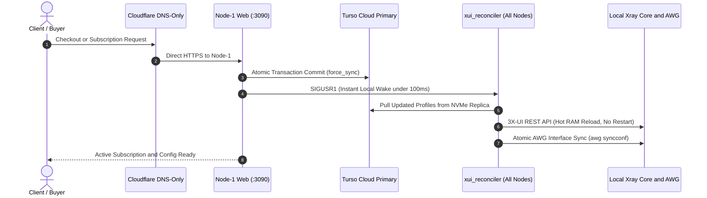

# SilentConnect: High-Availability Multi-Node VPN & Subscription Mesh

[](#automated-security--zero-leak-verification)
[](#automated-security--zero-leak-verification)
[](#architecture-overview)
[](#ingress-and-dns-routing-architecture)
[](https://www.python.org/)
[](#supported-protocols--socket-matrix)
[](LICENSE)

[English Portal](README.md) • [Русская версия (README_RU.md)](README_RU.md)

---

## Executive Summary

**SilentConnect** is an enterprise-grade, geo-distributed **Active-Active Mesh** multi-protocol tunneling and subscription automation platform engineered to withstand aggressive Deep Packet Inspection (DPI), state-level censorship, and datacenter-level hardware outages.

Operating on a shared-nothing distributed architecture, SilentConnect coordinates a global authoritative cluster state in **Turso Cloud (libSQL)** with local embedded NVMe replicas (`libsql_replica.py`) on each node, providing sub-0.02ms read latencies for routing and client verification. An autonomous local pull daemon (`xui_reconciler.py`) synchronizes client states every 15 seconds (or within 100ms via `SIGUSR1` wakeups) directly into 3X-UI memory via local REST API without restarting Xray Core or terminating active user sessions.

External ingress on port 443 is demultiplexed via `xray-dokodemo-door`, transparently separating stealth Reality traffic from service hostnames handled by Caddy TLS reverse proxies. The platform features an automated web storefront with SBP, bank card, and Digiseller acquiring (`vpn_shop.web`), an asynchronous Telegram bot systemd service (`vpn_shop.bot`), a multi-format subscription generator (`subjson-service`), an **AmneziaWG Device Slots Hub** with monotonic 30-day quota accounting and soft-disable guarantees, and dedicated **OpenFlux Sandbox Containers** for extreme whitelisting environments.

---

## Documentation Navigation Portal (Diátaxis Framework)

This documentation suite is organized strictly in accordance with the **Diátaxis Technical Framework**:

| Diátaxis Layer | Document | Scope & Purpose |
|---|---|---|
| **Overview & Portal** | [README.md](README.md) / [README_RU.md](README_RU.md) | High-level architectural summary, quickstart guide, protocol matrix, and security baseline. |
| **Explanation** | [ARCHITECTURE.md](ARCHITECTURE.md) | Deep system design: Active-Active Mesh, Turso WAL replication, NVMe embedded replicas, reconciler lifecycle, and circuit breakers. |
| **How-To Runbook** | [DEPLOYMENT.md](DEPLOYMENT.md) | Production operations guide: step-by-step node bootstrapping, systemd units, UFW firewall, iptables port hopping, and generic `Node-N` playbook. |
| **Technical Reference** | [AMNEZIA_SLOTS.md](AMNEZIA_SLOTS.md) | AmneziaWG slot topology, monotonic 30-day quota accounting, soft-disable guarantee, and packet obfuscation parameters (`Jc`, `S1-S4`, `H1-H4`). |
| **Technical Reference** | [WHITELIST_SPEC.md](WHITELIST_SPEC.md) | OpenFlux v0.3.0 dedicated Docker container sandbox architecture, two-phase zero-downtime migration, and node distribution. |

---

## Architecture Overview

SilentConnect implements a fully de-localized, symmetric **Active-Active Mesh** across modular nodes (`Node-1`, `Node-2`, `Node-3`, and generic `Node-N`). Every node functions as an autonomous transit peer, serving incoming VPN traffic, reading from its local embedded NVMe replica, and independently reconciling local daemon configurations directly from the Turso Cloud primary.

There are no single points of failure, no cross-node SSH bottlenecks during checkout, and no brittle cron database file synchronizations.

### System Topology Diagram

```mermaid
flowchart TD
    subgraph Clients["Clients and Ingress Layer"]
        CLI["VPN Clients\n(Streisand / Happ / Sing-box / Amnezia)"]
        WEB_CLI["Web and Telegram Users\n(Storefront / Cabinet / Payment)"]
        DNS["Cloudflare DNS-Only A-Records\n(SHOP / SUB / EDGE Domains)"]
    end

    subgraph Cluster["Active-Active Multi-Node Cluster Mesh"]
        subgraph N1["Node-1 (Core Hub and Control Plane Origin - 1 Gbps)"]
            MUX1["xray-dokodemo-door (:443 Mux)"]
            CAD1["Caddy Reverse Proxy (:4430 TLS)"]
            WEB1["vpn-shop-web (:3090 Active Storefront)"]
            BOT1["vpn_shop.bot (Systemd Daemon)"]
            SUB1["subjson-service (:3088 Subscriptions)"]
            VPN1["Xray Reality and Hysteria 2 and AWG (:44121)"]
            OF1["OpenFlux Dedicated Sandbox Workers"]
            REC1["xui_reconciler.py (Pull Daemon)"]
            DB1[("Local NVMe Replica (libsql)")]
        end

        subgraph N2["Node-2 (High-Throughput Transit Mesh Peer - 10 Gbps)"]
            MUX2["xray-dokodemo-door (:443 Mux)"]
            CAD2["Caddy Reverse Proxy (:4430 TLS)"]
            WEB2["vpn-shop-web (:3090 Standby API)"]
            SUB2["subjson-service (:3088 Subscriptions)"]
            VPN2["Xray Reality and Hysteria 2 and AWG (:44121)"]
            OF2["OpenFlux Dedicated Sandbox Workers"]
            REC2["xui_reconciler.py (Pull Daemon)"]
            DB2[("Local NVMe Replica (libsql)")]
        end

        subgraph N3["Node-3 (Edge Transit Mesh Peer - 1 Gbps)"]
            MUX3["xray-dokodemo-door (:443 Mux)"]
            CAD3["Caddy Reverse Proxy (:4430 TLS)"]
            WEB3["vpn-shop-web (:3090 Standby API)"]
            SUB3["subjson-service (:3088 Subscriptions)"]
            VPN3["Xray Reality and Hysteria 2 and AWG (:49752)"]
            REC3["xui_reconciler.py (Pull Daemon)"]
            DB3[("Local NVMe Replica (libsql)")]
        end
    end

    subgraph State["Global Authoritative State Layer"]
        TURSO[("Turso Cloud Primary (libSQL)\nAuthoritative Mesh Database")]
        PROTO["tgcloud (Experimental Prototype)"]
    end

    %% Ingress and Client Connections
    WEB_CLI -->|"HTTPS Web / Cabinet"| DNS
    DNS -->|"SHOP_DOMAIN -> Node-1 IP"| MUX1
    DNS -->|"SUB_DOMAIN -> Node-1 IP"| MUX1

    CLI -->|"EDGE_DOMAIN / Node-1 IP"| MUX1
    CLI -->|"NODE2_DOMAIN / Node-2 IP"| MUX2
    CLI -->|"NODE3_DOMAIN / Node-3 IP"| MUX3

    %% Internal Demultiplexing on Node-1
    MUX1 -->|"Reality SNI"| VPN1
    MUX1 -->|"Service SNI"| CAD1
    CAD1 --> WEB1
    CAD1 --> SUB1

    %% Internal Demultiplexing on Node-2
    MUX2 -->|"Reality SNI"| VPN2
    MUX2 -->|"Service SNI"| CAD2
    CAD2 --> WEB2
    CAD2 --> SUB2

    %% Internal Demultiplexing on Node-3
    MUX3 -->|"Reality SNI"| VPN3
    MUX3 -->|"Service SNI"| CAD3
    CAD3 --> WEB3
    CAD3 --> SUB3

    %% libSQL Embedded NVMe Synchronization
    DB1 <-->|"sync_if_stale (60s) / force_sync"| TURSO
    DB2 <-->|"sync_if_stale (60s) / force_sync"| TURSO
    DB3 <-->|"sync_if_stale (60s) / force_sync"| TURSO

    %% Autonomous Reconciler Hooks
    REC1 -.->|"pull 60s / SIGUSR1"| DB1
    REC1 -.->|"Hot RAM Reload"| VPN1

    REC2 -.->|"pull 60s / SIGUSR1"| DB2
    REC2 -.->|"Hot RAM Reload"| VPN2

    REC3 -.->|"pull 60s / SIGUSR1"| DB3
    REC3 -.->|"Hot RAM Reload"| VPN3

    BOT1 <--> DB1
    PROTO -.->|"Evaluation Only"| TURSO
```



### Autonomous Client Provisioning Sequence



---

## Modular Topology & Node Inventory

SilentConnect strictly replaces physical geographical labels with modular topological roles:

| Node Identifier | Topological Role | Uplink | Web Storefront Mode (`:3090`) | SubJSON (`:3088`) | VPN Inbounds & Ports | Mesh Responsibilities |
|---|---|---|---|---|---|---|
| **Node-1** | Core Hub & Control Plane Origin | 1 Gbps | **Active** (`DIGISELLER_ENABLED=true`, Web Storefront) | **Active** | Reality (TCP 443 / 23385 / 29443 / 8443), Hysteria 2 (UDP 38443), AWG (`10.8.1.0/24`, UDP 44121) | Origin for `<SHOP_DOMAIN>`, `<SUB_DOMAIN>`, `<EDGE_DOMAIN>`. Runs native `vpn_shop.bot` daemon and OpenFlux workers. |
| **Node-2** | High-Throughput Transit Mesh Peer | **10 Gbps** | **Standby** (`DIGISELLER_ENABLED=false`, Healthz / API) | **Active** | Reality (TCP 443 / 23385 / 29443 / 8443), Hysteria 2 (UDP 38443), AWG (`10.8.3.0/24`, UDP 44121) | High-bandwidth 10 Gbps transit peer. Origin for `<NODE2_DOMAIN>`. Runs local reconciler and OpenFlux workers. |
| **Node-3** | Edge Transit Mesh Peer | 1 Gbps | **Standby** (`DIGISELLER_ENABLED=false`, Healthz / API) | **Active** | Reality (TCP 443 / 23385 / 29443 / 8443), Hysteria 2 (UDP 38443), AWG (`10.8.2.0/24`, UDP 49752) | Resilient edge transit peer. Origin for `<NODE3_DOMAIN>`. Runs local reconciler. OpenFlux omitted due to upstream CDN captcha rules. |
| **Node-N** | Modular Mesh Expansion Peer | 1–10 Gbps | **Standby** (`DIGISELLER_ENABLED=false`, Healthz / API) | **Active** | Reality, Hysteria 2, AmneziaWG (Allocated Subnet & Port) | Provisioned dynamically via `DEPLOYMENT.md` Node-N playbook. Synchronizes directly via Turso Cloud mesh. |

---

## Ingress and DNS Routing Architecture

### Cloudflare DNS-Only (⚪ Grey Cloud) Standard
All cluster DNS A-records are configured strictly in **Cloudflare DNS-Only (⚪ grey cloud)** mode:
- `<SHOP_DOMAIN>` &rarr; `<NODE1_IP>` (Web storefront and self-service cabinet)
- `<SUB_DOMAIN>` &rarr; `<NODE1_IP>` (Multi-format subscription delivery endpoint)
- `<EDGE_DOMAIN>` &rarr; `<NODE1_IP>` (Direct Node-1 VPN client ingress)
- `<NODE1_DOMAIN>` &rarr; `<NODE1_IP>` (Node-1 direct FQDN)
- `<NODE2_DOMAIN>` &rarr; `<NODE2_IP>` (Node-2 direct 10 Gbps FQDN)
- `<NODE3_DOMAIN>` &rarr; `<NODE3_IP>` (Node-3 direct edge FQDN)
- `<NODE_N_DOMAIN>` &rarr; `<NODE_N_IP>` (Modular node ingress)

> [!CAUTION]
> **Cloudflare Proxy (🟠 Orange Cloud) is Strictly Forbidden**:
> Cloudflare CDN proxying is actively blocked by TSPU within the Russian Federation, causing immediate total loss of connectivity. Furthermore, Cloudflare Proxy only supports HTTP/HTTPS traffic and **completely drops** arbitrary UDP/TCP protocols required for VPN tunnels (Hysteria 2 UDP 38443, port hopping 30000:40000, AmneziaWG UDP 44121/49752, and VLESS Reality TCP 443/23385).
> 
> *Note on Legacy Infrastructure*: Legacy intermediate gateways (such as Yandex Cloud API Gateway) have been completely eliminated from the production topology in favor of direct Cloudflare DNS-Only routing.

### Port 443 Front Multiplexer (`xray-dokodemo-door`)
Each node binds a single public TCP port `443` socket using Xray's `dokodemo-door` protocol:
1. **Reality Camouflage SNI**: Packets matching approved camouflage domains are routed internally to `127.0.0.1:23385` (VLESS Reality Vision).
2. **Service & Subscription Hostnames**: Packets matching cluster domains (`<SHOP_DOMAIN>`, `<SUB_DOMAIN>`, `<EDGE_DOMAIN>`) are routed internally to `127.0.0.1:4430` (Caddy TLS reverse proxy).

### Service `:3090` (`vpn-shop-web.service`) Multi-Node Distribution
`vpn-shop-web.service` runs on all nodes across the mesh:
- **Node-1 (Active Storefront)**: Serves the public web storefront for `<SHOP_DOMAIN>`, processing cart checkouts, promo codes, Cloudflare Turnstile verification, and automated Digiseller order delivery (`DIGISELLER_ENABLED=true`).
- **Node-2 & Node-3 (Standby Mode)**: Run on `127.0.0.1:3090` with `DIGISELLER_ENABLED=false` behind local Caddy. They actively service local health checks (`GET /healthz`), HMAC-authenticated cluster bridge requests (`POST /api/bridge`), direct order lookups (`GET /order/*`), secondary payment webhooks, and AmneziaWG slot country switching.

---

## Supported Protocols & Socket Matrix

| Protocol / Transport | Layer | Public Ingress | Internal Target | Bound Daemon | Camouflage & Security | Target Clients |
|---|---|---|---|---|---|---|
| **Front Multiplexer** | TCP | `443` | `127.0.0.1:443` | `xray-dokodemo-door` | SNI demux (Reality vs Caddy TLS) | All inbound TCP traffic |
| **Caddy Ingress** | TCP | — (internal) | `127.0.0.1:4430` | `caddy` | TLS termination, Let's Encrypt / ZeroSSL | Web browsers, Cabinet, Subscriptions |
| **VLESS Reality Vision** | TCP | `443` (via demux) | `127.0.0.1:23385` | `xray` (3X-UI) | Flow: `xtls-rprx-vision`, uTLS Chrome/Edge | Happ, Sing-Box, v2rayN, Streisand |
| **VLESS Reality gRPC** | TCP | `29443` | `0.0.0.0:29443` | `xray` (3X-UI) | Direct gRPC Reality, `serviceName: grpc-maxru` | High-latency mobile links, LTE/5G |
| **VLESS Reality XHTTP** | TCP | `8443` | `0.0.0.0:8443` | `xray` (3X-UI) | HTTP/2 bidirectional stream (`/xh-7m-path`) | High-DPI restricted networks |
| **Hysteria 2 Core** | UDP | `38443` | `0.0.0.0:38443` | `hysteria-server` | Mandatory `gecko` obfs (`64-1400` bytes padding) | Streisand, Sing-Box, Nekobox |
| **Hysteria 2 Hopping** | UDP | `30000:40000` | Redirect `38443` | `iptables` PREROUTING | Dynamic port hopping bypassing UDP rate limits | Streisand, Sing-Box |
| **Hysteria 2 Direct** | UDP | `443` | Redirect `38443` | `iptables` PREROUTING | Transparent QUIC port 443 redirection | Streisand, Sing-Box |
| **AmneziaWG (Node-1/2)** | UDP | `44121` | `172.17.0.2:44121` | Docker `amnezia-awg2` | Header obfuscation (`Jc=5, S1-S4=12, H1=1..4`) | Amnezia VPN, WG-Tunnel |
| **AmneziaWG (Node-3)** | UDP | `49752` | `172.17.0.2:49752` | Docker `amnezia-awg2` | Custom obfuscation (`Jc=5, S1=51, S2=30, S3=34`) | Amnezia VPN, WG-Tunnel |
| **OpenFlux Dedicated** | WSS | `443` (via CDN) | Outbound Egress | Docker `openflux-worker` | Base64 frames over collaborative document stream | OpenFlux clients (Node-1 & Node-2) |
| **SubJSON Service** | TCP | — (internal) | `127.0.0.1:3088` | `subjson.service` | Dynamic multi-format subscription engine | All client subscription requests |
| **VPN Shop Web** | TCP | — (internal) | `127.0.0.1:3090` | `vpn-shop-web.service` | Storefront, payments, and cluster RPC bridge | Web users, payment webhooks |
| **3X-UI Admin API** | TCP | — (internal) | `127.0.0.1:2053` | `x-ui` | Local administrative REST API (localhost only) | Autonomous `xui_reconciler.py` |

---

## Core Subsystems & Resilience Guarantees

### 1. Turso Cloud libSQL Embedded NVMe Replicas (`libsql_replica.py`)
- **Sub-0.02ms Read Latency**: Every node maintains a local SQLite database directly on NVMe disk. Read operations use thread-local read-only connections with `PRAGMA query_only = ON;`.
- **Non-Blocking Fast Path**: The `sync_if_stale()` method syncs with Turso Cloud when staleness exceeds `TURSO_SYNC_INTERVAL` (`2.0s`). Concurrency is guarded by an isolated non-blocking `_sync_lock`. Concurrent readers never block on network synchronization.
- **Atomic Cloud Commit**: Writing connections track SQL mutations (`INSERT`, `UPDATE`, `DELETE`). Upon `commit()`, changes are committed to the local replica and immediately flushed to Turso Cloud via `force_sync()`.
- **Process Isolation**: Each daemon maintains its own local replica file on disk (`vpn_shop_replica_bot.db`, `vpn_shop_replica_web.db`, `vpn_shop_replica_subjson.db`, `vpn_shop_replica_xui_reconcile.db`), completely eliminating inter-process SQLite file locks.

### 2. Autonomous 3X-UI Reconciler & Circuit Breakers (`xui_reconciler.py`)
- **Local Pull Model**: Runs as a systemd service polling the local Turso replica every 15.0 seconds.
- **Sub-100ms Instant Wake**: Listens for `signal.SIGUSR1` from local checkout hooks, triggering instantaneous reconciliation without waiting for the polling timer.
- **Zero-Downtime Hot In-Memory Updates**: Applies client mutations directly to the 3X-UI REST API (`add_client`, `update_client`, `delete_client`), hot-reloading running Xray memory without restarting processes or dropping user connections.
- **Zero-Profiles Circuit Breaker**: If Turso returns 0 profiles (due to upstream partition or empty replica state), the reconciler immediately aborts, preventing catastrophic deletion of existing users.
- **AmneziaWG Mass Deletion Circuit Breaker**: Blocks synchronization if a single run would remove more than 30% (with >3 peers) or more than 10 total peers, shielding against accidental mass revocation.

### 3. AmneziaWG Dedicated Device Slots & Soft-Disable Guarantee
- **1-Slot-Per-Device Topology**: Devices are allocated dedicated IP addresses across subnets `10.8.1.0/24` (Node-1), `10.8.3.0/24` (Node-2), and `10.8.2.0/24` (Node-3).
- **Monotonic 30-Day Quota Accounting**: `CounterStateTracker` caches kernel transfer snapshots in `/dev/shm/awg_last_counters.json`. Kernel interface restarts and 64-bit counter wraps are detected automatically, guaranteeing strictly non-negative, monotonic traffic accumulation.
- **Soft-Disable Guarantee**: When a user reaches their monthly quota (250 GB for 3 devices, 500 GB for 6 devices, 1000 GB for 9 devices), **only their AmneziaWG peer is removed from the kernel**. VLESS Reality Vision, Reality gRPC, Reality XHTTP, and Hysteria 2 remain **100% UNMETERED and FULLY FUNCTIONAL**. The customer never experiences a complete service blackout.

### 4. OpenFlux White-Lists Dedicated Sandbox Workers (`openflux_manager.py`)
- **Dedicated Container Pool**: User slots run inside isolated Docker containers (`openflux-worker-<uid>`) utilizing `php:8.2-cli-alpine` (capped at 64 MB RAM and 0.5 CPU) with read-only root mounts.
- **Two-Phase Handover**: Migrating between nodes maintains parallel worker execution for 5 minutes (`300s`), automatically rolling back if the user fails to confirm the transition.
- **Node Distribution**: Deployed on Node-1 and Node-2 with smart load balancing (`choose_least_loaded_server`). Omitted on Node-3 due to upstream CDN captcha restrictions.

### 5. Telegram Bot Engine: Systemd Daemon vs TGCloud Prototype
- **Production Authority**: The authoritative production engine is the native Python 3 systemd daemon `vpn-shop-silentconnect.service` executing `vpn_shop.bot` via long-polling. It coordinates distributed cluster leases in Turso Cloud (`try_acquire_cluster_lease`).
- **Experimental Prototype**: `tgcloud/` is an experimental serverless JavaScript prototype designed for serverless edge evaluation, communicating via REST API and `POST /api/bridge`.

---

## Supported Platforms & Client Integration Matrix

| Platform | Primary Recommended Client | Alternative Clients | Integration Method |
|---|---|---|---|
| **iOS / iPadOS** | **Happ**, **sing-box MT** | Streisand, Clash Mi | 1-Click Deep Links (`happ://`, `sing-box://`, `streisand://`) |
| **Android** | **Happ**, **Sing-box** | Clash Meta, NekoBox, v2rayNG | 1-Click Import button, QR Code, APK direct link |
| **Windows** | **Happ**, **Clash Verge Rev** | Sing-box, v2rayN, AmneziaVPN | Native TUN driver and 1-click subscription import |
| **macOS** | **Happ**, **sing-box MT** | Clash Verge Rev, Streisand | Apple Silicon & Intel native client import |
| **Linux / Routers** | **Sing-box CLI**, **AmneziaWG** | Mihomo CLI, Keenetic / OpenWrt | Direct `.conf` download or JSON/YAML subscription URL |

---

## Quickstart & Operations Runbook

### Prerequisites
- **Target OS**: Debian 13 (Trixie) or Ubuntu 24.04 LTS (Linux kernel 6.12+ with BBR enabled).
- **Core Dependencies**: Python 3.11+, Docker, Xray Core, 3X-UI, Hysteria 2, Caddy v2, UFW, `iptables-persistent`.

### Starting Node Services
```bash
# 1. Initialize local Turso replica schema
python3 -m vpn_shop --env-file .env.silentconnect init-db

# 2. Perform dry-run reconciliation check
python3 -m vpn_shop --env-file .env.silentconnect reconcile-xui --dry-run

# 3. Enable and start core mesh services
systemctl enable --now subjson.service vpn-shop-web.service vpn-shop-xui-reconciler.service

# 4. On Node-1 (Core Hub only), enable Telegram Bot daemon
systemctl enable --now vpn-shop-silentconnect.service
```

### Cluster Health Verification Commands
```bash
# 1. Verify local web storefront and API health
curl -fsS http://127.0.0.1:3090/healthz

# 2. Verify local SubJSON subscription generator health
curl -fsS http://127.0.0.1:3088/healthz

# 3. Inspect active listening sockets across mesh protocols
ss -tulpn | grep -E '443|4430|8443|23385|29443|38443|44121|49752|3088|3090'

# 4. Check status of autonomous reconciler daemon
systemctl status vpn-shop-xui-reconciler.service --no-pager
```

---

## Automated Security & Zero-Leak Verification

SilentConnect enforces strict zero-leak security across all code, configuration files, and documentation. No production IP addresses, API tokens, cryptographic private keys, or raw connection strings are permitted in the repository.

### Standardized Placeholder Specification
- Public Node IPs: `<NODE1_IP>`, `<NODE2_IP>`, `<NODE3_IP>`, `<NODE_N_IP>` (or RFC 5737 testnet IPs: `192.0.2.1`, `198.51.100.1`, `203.0.113.1`).
- Domain FQDNs: `<SHOP_DOMAIN>`, `<SUB_DOMAIN>`, `<EDGE_DOMAIN>`, `<NODE1_DOMAIN>`, `<NODE2_DOMAIN>`, `<NODE3_DOMAIN>`, `<NODE_N_DOMAIN>`.
- Cryptographic Secrets: `<REALITY_PUBLIC_KEY>`, `<TURSO_AUTH_TOKEN>`, `<TELEGRAM_BOT_TOKEN>`, `<HYSTERIA_GECKO_PASSWORD>`.

### Running Automated Pre-Commit Audits & Tests
```bash
# 1. Run strict zero-leak security audit scanner
python3 scripts/security_audit_scanner.py --target-dir github_export --strict

# Expected output:
# Files Scanned: 177, Violations Found: 0.
# [PASS] AUDIT PASSED: Zero leaks, zero binaries, zero untracked secrets detected.

# 2. Execute regression test harness (128 tests)
python3 -m unittest discover -s github_export/tests -p "test_*.py"

# Expected output:
# Ran 128 tests ... OK (skipped=8)
```

---

## In-Depth Documentation Index

For complete operational and protocol specifications, refer to the individual technical guides:

- **[ARCHITECTURE.md](ARCHITECTURE.md)** &mdash; Deep-dive system design, Turso Cloud libSQL replication, NVMe embedded replica concurrency, reconciler circuit breakers, and TCP 443 multiplexing.
- **[DEPLOYMENT.md](DEPLOYMENT.md)** &mdash; Production operations runbook: step-by-step node setup, systemd units, UFW and iptables port hopping, quiet logging mode, and the generic `Node-N` playbook.
- **[AMNEZIA_SLOTS.md](AMNEZIA_SLOTS.md)** &mdash; AmneziaWG device slots architecture, 30-day monotonic quota accounting engine, soft-disable guarantees, and packet obfuscation parameters.
- **[WHITELIST_SPEC.md](WHITELIST_SPEC.md)** &mdash; OpenFlux v0.3.0 dedicated Docker container sandbox specification, two-phase zero-downtime migration, and node distribution.
- **[README_RU.md](README_RU.md)** &mdash; Полная синхронизированная русскоязычная версия портала документации.

---

## License

Distributed under the MIT License. See [LICENSE](LICENSE) for details.
