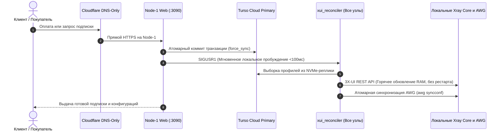

# SilentConnect: Мультипротокольная Active-Active VPN-платформа и распределённая сеть подписок

[](#автоматизированный-контроль-безопасности-и-zero-leak)
[](#автоматизированный-контроль-безопасности-и-zero-leak)
[](#обзор-архитектуры)
[](#архитектура-маршрутизации-dns-и-входящего-трафика)
[](https://www.python.org/)
[](#матрица-протоколов-и-сетевых-сокетов)
[](LICENSE)

[English Portal (README.md)](README.md) • [Русская версия](README_RU.md)

---

## Резюме проекта

**SilentConnect** — высокодоступная геораспределённая мультипротокольная платформа защищённого туннелирования и автоматизации подписок на базе архитектуры **Active-Active Mesh**, спроектированная для непрерывной работы в условиях глубокой фильтрации пакетов (DPI / ТСПУ), блокировок по белым спискам и аппаратных отказов дата-центров.

Построенная по принципу распределённой архитектуры без разделяемых ресурсов (shared-nothing), SilentConnect объединяет глобальное авторитетное состояние в **Turso Cloud (libSQL)** с локальными встроенными NVMe-репликами (`libsql_replica.py`) на каждом узле, обеспечивая время отклика на чтение менее 0.02 мс. Автономный локальный pull-демон (`xui_reconciler.py`) опрашивает базу каждые 60 секунд (или в течение 100 мс по сигналу `SIGUSR1`) и обновляет состояние клиентов непосредственно в оперативной памяти 3X-UI через локальный REST API без перезапуска ядра Xray Core и без разрыва активных клиентских сессий.

Входящий TCP-трафик на порту 443 демультиплексируется через `xray-dokodemo-door`, прозрачно разделяя скрытый трафик Reality от служебных веб-доменов, обслуживаемых TLS-прокси Caddy. Платформа включает автоматизированную веб-витрину с приёмом платежей через СБП, банковские карты и Digiseller (`vpn_shop.web`), асинхронный systemd-демон Telegram-бота (`vpn_shop.bot`), генератор мультиформатных клиентских подписок (`subjson-service`), хаб выделенных устройств **AmneziaWG** с монотонным 30-дневным квотированием и гарантией мягкого отключения, а также выделенные контейнеры **OpenFlux Sandbox** для работы в изолированных белых списках.

---

## Портал навигации по документации (Фреймворк Diátaxis)

Вся техническая документация репозитория структурирована строго по стандарту **Diátaxis**:

| Уровень Diátaxis | Документ | Область и назначение |
|---|---|---|
| **Обзор и портал** | [README.md](README.md) / [README_RU.md](README_RU.md) | Общая архитектурная сводка, руководство по быстрому старту, матрица протоколов и базис безопасности. |
| **Объяснение (Explanation)** | [ARCHITECTURE.md](ARCHITECTURE.md) | Глубокий разбор архитектуры: Active-Active Mesh, репликация Turso WAL, встроенные реплики на NVMe, жизненный цикл реконсилятора и предохранители. |
| **Инструкции (How-To)** | [DEPLOYMENT.md](DEPLOYMENT.md) | Эксплуатационное руководство: пошаговая инициализация узлов, шаблоны systemd, файрвол UFW, port hopping в iptables и playbook добавления `Node-N`. |
| **Справочник (Reference)** | [AMNEZIA_SLOTS.md](AMNEZIA_SLOTS.md) | Топология слотов AmneziaWG, монотонный учёт 30-дневных квот, гарантия мягкого отключения и параметры обфускации пакетов (`Jc`, `S1-S4`, `H1-H4`). |
| **Справочник (Reference)** | [WHITELIST_SPEC.md](WHITELIST_SPEC.md) | Спецификация изолированных Docker-песочниц OpenFlux v0.3.0, двухфазная миграция без простоя и распределение по узлам. |

---

## Обзор архитектуры

SilentConnect функционирует как полностью делокализованная симметричная сеть **Active-Active Mesh** между модульными узлами (`Node-1`, `Node-2`, `Node-3` и универсальным `Node-N`). Каждый узел кластера является автономным пиром, одновременно обслуживает входящий VPN-трафик пользователей, читает данные из собственной встроенной NVMe-реплики и независимо синхронизирует локальные службы напрямую с базой Turso Cloud.

В системе отсутствуют единые точки отказа (SPOF), нет блокирующих межсерверных SSH-вызовов при покупке тарифа и исключена синхронизация файлов баз данных по cron через SCP.

### Диаграмма топологии системы

```mermaid
flowchart TD
    subgraph Clients["Уровень клиентов и точек входа"]
        CLI["VPN-клиенты\n(Streisand / Happ / Sing-box / Amnezia)"]
        WEB_CLI["Пользователи Web и Telegram\n(Витрина / Кабинет / Оплата)"]
        DNS["Cloudflare DNS-Only A-Records\n(SHOP / SUB / EDGE Домены)"]
    end

    subgraph Cluster["Кластерная сеть Active-Active Multi-Node Mesh"]
        subgraph N1["Node-1 (Главный координатор и Control Plane - 1 Gbps)"]
            MUX1["xray-dokodemo-door (:443 Mux)"]
            CAD1["Реверс-прокси Caddy (:4430 TLS)"]
            WEB1["vpn-shop-web (:3090 Активная витрина)"]
            BOT1["vpn_shop.bot (Systemd-демон)"]
            SUB1["subjson-service (:3088 Подписки)"]
            VPN1["Xray Reality и Hysteria 2 и AWG (:44121)"]
            OF1["Пул воркеров OpenFlux Sandbox"]
            REC1["xui_reconciler.py (Pull-демон)"]
            DB1[("Локальная NVMe-реплика (libsql)")]
        end

        subgraph N2["Node-2 (Высокоскоростной транзитный пир - 10 Gbps)"]
            MUX2["xray-dokodemo-door (:443 Mux)"]
            CAD2["Реверс-прокси Caddy (:4430 TLS)"]
            WEB2["vpn-shop-web (:3090 Standby API)"]
            SUB2["subjson-service (:3088 Подписки)"]
            VPN2["Xray Reality и Hysteria 2 и AWG (:44121)"]
            OF2["Пул воркеров OpenFlux Sandbox"]
            REC2["xui_reconciler.py (Pull-демон)"]
            DB2[("Локальная NVMe-реплика (libsql)")]
        end

        subgraph N3["Node-3 (Периферийный транзитный пир - 1 Gbps)"]
            MUX3["xray-dokodemo-door (:443 Mux)"]
            CAD3["Реверс-прокси Caddy (:4430 TLS)"]
            WEB3["vpn-shop-web (:3090 Standby API)"]
            SUB3["subjson-service (:3088 Подписки)"]
            VPN3["Xray Reality и Hysteria 2 и AWG (:49752)"]
            REC3["xui_reconciler.py (Pull-демон)"]
            DB3[("Локальная NVMe-реплика (libsql)")]
        end
    end

    subgraph State["Слой глобального авторитетного состояния"]
        TURSO[("Turso Cloud Primary (libSQL)\nАвторитетная СУБД кластера")]
        PROTO["tgcloud (Экспериментальный прототип)"]
    end

    %% Входной трафик и клиенты
    WEB_CLI -->|"HTTPS Web / Кабинет"| DNS
    DNS -->|"SHOP_DOMAIN -> Node-1 IP"| MUX1
    DNS -->|"SUB_DOMAIN -> Node-1 IP"| MUX1

    CLI -->|"EDGE_DOMAIN / Node-1 IP"| MUX1
    CLI -->|"NODE2_DOMAIN / Node-2 IP"| MUX2
    CLI -->|"NODE3_DOMAIN / Node-3 IP"| MUX3

    %% Внутренняя демультиплексация на Node-1
    MUX1 -->|"Reality SNI"| VPN1
    MUX1 -->|"Служебный SNI"| CAD1
    CAD1 --> WEB1
    CAD1 --> SUB1

    %% Внутренняя демультиплексация на Node-2
    MUX2 -->|"Reality SNI"| VPN2
    MUX2 -->|"Служебный SNI"| CAD2
    CAD2 --> WEB2
    CAD2 --> SUB2

    %% Внутренняя демультиплексация на Node-3
    MUX3 -->|"Reality SNI"| VPN3
    MUX3 -->|"Служебный SNI"| CAD3
    CAD3 --> WEB3
    CAD3 --> SUB3

    %% Синхронизация встроенных реплик libSQL NVMe
    DB1 <-->|"sync_if_stale (60с) / force_sync"| TURSO
    DB2 <-->|"sync_if_stale (60с) / force_sync"| TURSO
    DB3 <-->|"sync_if_stale (60с) / force_sync"| TURSO

    %% Автономные хуки реконсилятора
    REC1 -.->|"pull 60с / SIGUSR1"| DB1
    REC1 -.->|"Горячее обновление RAM"| VPN1

    REC2 -.->|"pull 60с / SIGUSR1"| DB2
    REC2 -.->|"Горячее обновление RAM"| VPN2

    REC3 -.->|"pull 60с / SIGUSR1"| DB3
    REC3 -.->|"Горячее обновление RAM"| VPN3

    BOT1 <--> DB1
    PROTO -.->|"Только тестирование"| TURSO
```



### Последовательность автономной активации клиента



---

## Модульная топология и инвентарь узлов

Все географические привязки в документации заменены модульными топологическими ролями:

| Идентификатор узла | Топологическая роль | Канал связи | Режим веб-витрины (`:3090`) | SubJSON (`:3088`) | VPN-инбаунды и порты | Обязанности в кластере |
|---|---|---|---|---|---|---|
| **Node-1** | Главный координатор и Control Plane Origin | 1 Gbps | **Активный** (`DIGISELLER_ENABLED=true`, Витрина) | **Активный** | Reality (TCP 443 / 23385 / 29443 / 8443), Hysteria 2 (UDP 38443), AWG (`10.8.1.0/24`, UDP 44121) | Точка входа для `<SHOP_DOMAIN>`, `<SUB_DOMAIN>`, `<EDGE_DOMAIN>`. Демон `vpn_shop.bot` и воркеры OpenFlux. |
| **Node-2** | Высокоскоростной транзитный пир Mesh | **10 Gbps** | **Standby** (`DIGISELLER_ENABLED=false`, Healthz / API) | **Активный** | Reality (TCP 443 / 23385 / 29443 / 8443), Hysteria 2 (UDP 38443), AWG (`10.8.3.0/24`, UDP 44121) | Высокопроизводительный транзитный пир 10 Gbps. Точка входа для `<NODE2_DOMAIN>`. Локальный реконсилятор и воркеры OpenFlux. |
| **Node-3** | Периферийный транзитный пир Mesh | 1 Gbps | **Standby** (`DIGISELLER_ENABLED=false`, Healthz / API) | **Активный** | Reality (TCP 443 / 23385 / 29443 / 8443), Hysteria 2 (UDP 38443), AWG (`10.8.2.0/24`, UDP 49752) | Отказоустойчивый периферийный пир. Точка входа для `<NODE3_DOMAIN>`. Локальный реконсилятор. OpenFlux исключён из-за капчи апстрима. |
| **Node-N** | Модульный узел расширения кластера | 1–10 Gbps | **Standby** (`DIGISELLER_ENABLED=false`, Healthz / API) | **Активный** | Reality, Hysteria 2, AmneziaWG (Выделенная подсеть и порт) | Разворачивается по плейбуку `DEPLOYMENT.md` Node-N. Автоматически синхронизируется через Turso Cloud mesh. |

---

## Архитектура маршрутизации DNS и входящего трафика

### Стандарт Cloudflare DNS-Only (⚪ Серое облако)
Все DNS A-записи доменов кластера настроены строго в режиме **Cloudflare DNS-Only (⚪ серое облачко)**:
- `<SHOP_DOMAIN>` &rarr; `<NODE1_IP>` (Веб-витрина и личный кабинет)
- `<SUB_DOMAIN>` &rarr; `<NODE1_IP>` (Генератор мультиформатных подписок)
- `<EDGE_DOMAIN>` &rarr; `<NODE1_IP>` (Прямой вход клиентов VPN на Node-1)
- `<NODE1_DOMAIN>` &rarr; `<NODE1_IP>` (Прямой FQDN узла Node-1)
- `<NODE2_DOMAIN>` &rarr; `<NODE2_IP>` (Прямой 10 Gbps FQDN узла Node-2)
- `<NODE3_DOMAIN>` &rarr; `<NODE3_IP>` (Прямой FQDN узла Node-3)
- `<NODE_N_DOMAIN>` &rarr; `<NODE_N_IP>` (Точка входа дополнительных узлов)

> [!CAUTION]
> **Проксирование Cloudflare (🟠 Оранжевое облако) Категорически Запрещено**:
> Cloudflare CDN Proxy активно блокируется ТСПУ на территории РФ, что приводит к полной недоступности сервиса. Кроме того, Cloudflare Proxy поддерживает исключительно HTTP/HTTPS трафик и **полностью сбрасывает** произвольные UDP/TCP протоколы, критически важные для VPN-туннелей (Hysteria 2 UDP 38443, port hopping 30000:40000, AmneziaWG UDP 44121/49752 и VLESS Reality TCP 443/23385).
> 
> *Примечание об устаревшей инфраструктуре*: Устаревшие промежуточные шлюзы (такие как Yandex Cloud API Gateway) полностью ликвидированы из рабочей топологии в пользу прямой DNS-маршрутизации.

### Входной мультиплексор порта 443 (`xray-dokodemo-door`)
Каждый узел слушает публичный TCP-порт `443` единым процессом Xray по протоколу `dokodemo-door`:
1. **Камуфляжные SNI Reality**: Пакеты с одобренными доменами маскировки перенаправляются локально на `127.0.0.1:23385` (VLESS Reality Vision).
2. **Служебные и подписные домены**: Пакеты доменов кластера (`<SHOP_DOMAIN>`, `<SUB_DOMAIN>`, `<EDGE_DOMAIN>`) перенаправляются локально на `127.0.0.1:4430` (TLS-прокси Caddy).

### Распределение службы `:3090` (`vpn-shop-web.service`) по узлам
`vpn-shop-web.service` развёрнут на всех узлах кластера:
- **Node-1 (Активная витрина)**: Обслуживает публичный интерфейс магазина `<SHOP_DOMAIN>`, корзину, промокоды, проверку Cloudflare Turnstile и автоматическую выдачу товаров через Digiseller (`DIGISELLER_ENABLED=true`).
- **Node-2 и Node-3 (Режим Standby)**: Работают на `127.0.0.1:3090` с `DIGISELLER_ENABLED=false` за локальным Caddy. Они обрабатывают локальные проверки здоровья (`GET /healthz`), HMAC-подписанные RPC-вызовы кластера (`POST /api/bridge`), прямую проверку заказов (`GET /order/*`), резервные вебхуки платежей и переключение стран для AmneziaWG.

---

## Матрица протоколов и сетевых сокетов

| Протокол / Компонент | Уровень | Публичный порт | Внутренняя цель | Обслуживающий демон | Маскировка и безопасность | Целевые клиенты |
|---|---|---|---|---|---|---|
| **Входной мультиплексор** | TCP | `443` | `127.0.0.1:443` | `xray-dokodemo-door` | SNI-демультиплексирование (Reality vs Caddy TLS) | Весь входящий TCP-трафик |
| **Вход Caddy** | TCP | — (внутренний) | `127.0.0.1:4430` | `caddy` | Терминация TLS, сертификаты Let's Encrypt / ZeroSSL | Веб-браузеры, кабинет, подписки |
| **VLESS Reality Vision** | TCP | `443` (через Mux) | `127.0.0.1:23385` | `xray` (3X-UI) | Flow: `xtls-rprx-vision`, фингерпринт uTLS Chrome/Edge | Happ, Sing-Box, v2rayN, Streisand |
| **VLESS Reality gRPC** | TCP | `29443` | `0.0.0.0:29443` | `xray` (3X-UI) | Прямой gRPC Reality, `serviceName: grpc-maxru` | Мобильные сети, нестабильный LTE/5G |
| **VLESS Reality XHTTP** | TCP | `8443` | `0.0.0.0:8443` | `xray` (3X-UI) | HTTP/2 двунаправленный поток (`/xh-7m-path`) | Сети с жёстким DPI и корпоративные файрволы |
| **Hysteria 2 Core** | UDP | `38443` | `0.0.0.0:38443` | `hysteria-server` | Обязательная обфускация `gecko` (паддинг `64-1400` байт) | Streisand, Sing-Box, Nekobox |
| **Hysteria 2 Hopping** | UDP | `30000:40000` | Редирект `38443`| `iptables` PREROUTING | Динамический port hopping против UDP rate-limiting | Streisand, Sing-Box |
| **Hysteria 2 Direct** | UDP | `443` | Редирект `38443`| `iptables` PREROUTING | Прозрачный редирект QUIC с порта 443 | Streisand, Sing-Box |
| **AmneziaWG (Node-1/2)** | UDP | `44121` | `172.17.0.2:44121` | Docker `amnezia-awg2`| Обфускация заголовков (`Jc=5, S1-S4=12, H1=1..4`) | Amnezia VPN, WG-Tunnel |
| **AmneziaWG (Node-3)** | UDP | `49752` | `172.17.0.2:49752` | Docker `amnezia-awg2`| Специальный профиль обфускации (`Jc=5, S1=51, S2=30, S3=34`) | Amnezia VPN, WG-Tunnel |
| **OpenFlux Dedicated** | WSS | `443` (через CDN) | Исходящий эгресс | Docker `openflux-worker`| Base64-фреймы в потоке совместных облачных документов | Клиенты OpenFlux (Node-1 и Node-2) |
| **SubJSON Service** | TCP | — (внутренний) | `127.0.0.1:3088` | `subjson.service` | Динамический мультиформатный генератор подписок | Запросы подписок от всех клиентов |
| **VPN Shop Web** | TCP | — (внутренний) | `127.0.0.1:3090` | `vpn-shop-web.service` | Магазин, приём платежей, RPC-мост кластера | Пользователи браузеров, платежи |
| **3X-UI Admin API** | TCP | — (внутренний) | `127.0.0.1:2053` | `x-ui` | Локальный административный REST API (только localhost)| Автономный демон `xui_reconciler.py` |

---

## Ключевые подсистемы и механизмы отказоустойчивости

### 1. Встроенные NVMe-реплики Turso Cloud libSQL (`libsql_replica.py`)
- **Задержка чтения менее 0.02 мс**: Каждый узел хранит локальную базу данных SQLite непосредственно на быстром NVMe-накопителе. Операции чтения используют локальные потокобезопасные соединения в режиме `PRAGMA query_only = ON;`.
- **Неблокирующий быстрый путь**: Метод `sync_if_stale()` выполняет фоновую синхронизацию с Turso Cloud только при устаревании данных более `TURSO_SYNC_INTERVAL` (`60.0с`). Блокировка `_sync_lock` не блокирует параллельные операции чтения, сетевая синхронизация вынесена в фоновый поток с защитой от сбоев и экспоненциальным backoff.
- **Атомарные коммиты в облако**: Соединения с правом записи отслеживают любые модифицирующие запросы (`INSERT`, `UPDATE`, `DELETE`). При вызове `commit()` транзакция фиксируется локально и мгновенно выталкивается в Turso Cloud через `force_sync()`.
- **Защита от шторма синхронизаций и мгновенная репликация продлений (`min_interval=2.0`)**: При чтении свежесозданных или только что продлённых пользователями профилей (`get_profile`), если запись отсутствует или числится просроченной, `Store` выполняет мгновенный точечный `force_sync(min_interval=2.0)`. Это гарантирует нулевую задержку активации подписки на любом сервере кластера и надёжную защиту квоты Turso от флуда.
- **Изоляция процессов**: Каждый сервис использует отдельный файл локальной реплики (`vpn_shop_replica_bot.db`, `vpn_shop_replica_web.db`, `vpn_shop_replica_subjson.db`, `vpn_shop_replica_xui_reconcile.db`), полностью исключая межпроцессные файловые блокировки.

### 2. Автономный реконсилятор 3X-UI и предохранители (`xui_reconciler.py`)
- **Локальная модель Pull**: Работает как независимый systemd-сервис, опрашивая локальную реплику Turso каждые 60.0 секунд.
- **Мгновенное пробуждение (<100 мс)**: Реагирует на сигнал `signal.SIGUSR1` при создании заказа, мгновенно применяя изменения без ожидания следующего тайм-аута.
- **Горячее обновление памяти без простоя**: Передаёт изменения клиентов напрямую в REST API 3X-UI (`add_client`, `update_client`, `delete_client`), динамически обновляя память работающего Xray Core без перезапуска процесса.
- **Предохранитель нулевых профилей (Zero-Profiles Circuit Breaker)**: Если Turso возвращает 0 профилей (при сетевом сбое или пустой реплике), реконсилятор немедленно прерывает работу, защищая пользователей от случайного удаления.
- **Предохранитель массового удаления AWG**: Блокирует операцию, если одна итерация пытается удалить более 30% (при >3 пирах) или более 10 пиров суммарно.

### 3. Выделенные слоты AmneziaWG и гарантия мягкого отключения
- **Принцип «1 слот — 1 устройство»**: Устройствам назначаются фиксированные IP-адреса в подсетях `10.8.1.0/24` (Node-1), `10.8.3.0/24` (Node-2) и `10.8.2.0/24` (Node-3).
- **Монотонный учёт 30-дневной квоты**: Модуль `CounterStateTracker` кэширует счётчики трафика в `/dev/shm/awg_last_counters.json`. Сбросы интерфейсов ядра и переполнения 64-битных счётчиков обрабатываются корректно с гарантией строго неотрицательного монотонного накопления объёма.
- **Гарантия мягкого отключения (Soft-Disable Guarantee)**: При исчерпании месячной квоты трафика (250 ГБ на 3 устройства, 500 ГБ на 6 устройств, 1000 ГБ на 9 устройств) **из ядра отключается исключительно пир AmneziaWG**. Протоколы VLESS Reality Vision, Reality gRPC, Reality XHTTP и Hysteria 2 остаются **100% БЕЗЛИМИТНЫМИ И ПОЛНОСТЬЮ РАБОТОСПОСОБНЫМИ**. Пользователь никогда не теряет доступ в сеть полностью.

### 4. Изолированные воркеры OpenFlux для белых списков (`openflux_manager.py`)
- **Пул изолированных контейнеров**: Пользовательские слоты запускаются в отдельных контейнерах Docker (`openflux-worker-<uid>`) на базе `php:8.2-cli-alpine` (ограничения: 64 МБ RAM, 0.5 CPU) с монтированием томов только для чтения.
- **Двухфазное переключение без простоя**: Миграция между серверами запускает параллельного воркера на 5 минут (`300с`), автоматически откатывая изменения, если пользователь не подтвердил переключение.
- **Распределение по узлам**: Развёрнуто на Node-1 и Node-2 с умным балансировщиком (`choose_least_loaded_server`). Исключено на Node-3 из-за капчи на стороне CDN дата-центра.

### 5. Движок Telegram-бота: Systemd-демон против прототипа TGCloud
- **Боевой продакшн-движок**: Единственным авторитетным боевым сервисом является нативный systemd-демон Python 3 `vpn-shop-silentconnect.service`, запускающий `vpn_shop.bot` в режиме long-polling. Он координирует распределённые распределительные лизы в Turso Cloud (`try_acquire_cluster_lease`).
- **Экспериментальный прототип**: Директория `tgcloud/` представляет собой экспериментальный серверлесс-прототип на JavaScript, взаимодействующий через REST API и `POST /api/bridge`.

---

## Клиентские платформы и интеграция

| Платформа | Рекомендуемое приложение | Альтернативные клиенты | Способ подключения |
|---|---|---|---|
| **iOS / iPadOS** | **Happ**, **sing-box MT** | Streisand, Clash Mi | Глубокие ссылки в 1 клик (`happ://`, `sing-box://`, `streisand://`) |
| **Android** | **Happ**, **Sing-box** | Clash Meta, NekoBox, v2rayNG | Кнопка импорта в 1 клик, QR-код, прямая загрузка APK |
| **Windows** | **Happ**, **Clash Verge Rev** | Sing-box, v2rayN, AmneziaVPN | Автонастройка TUN-драйвера и импорт подписки в 1 клик |
| **macOS** | **Happ**, **sing-box MT** | Clash Verge Rev, Streisand | Нативный импорт для процессоров Apple Silicon и Intel |
| **Linux / Роутеры** | **Sing-box CLI**, **AmneziaWG** | Mihomo CLI, Keenetic / OpenWrt | Скачивание `.conf` или ссылки подписки JSON/YAML |

---

## Быстрый старт и эксплуатация

### Системные требования
- **ОС**: Debian 13 (Trixie) или Ubuntu 24.04 LTS (ядро Linux 6.12+ с алгоритмом TCP BBR).
- **Пакеты**: Python 3.11+, Docker, Xray Core, 3X-UI, Hysteria 2, Caddy v2, UFW, `iptables-persistent`.

### Запуск сервисов на узле кластера
```bash
# 1. Инициализация схемы локальной реплики Turso
python3 -m vpn_shop --env-file .env.silentconnect init-db

# 2. Пробный запуск реконсилятора в режиме dry-run
python3 -m vpn_shop --env-file .env.silentconnect reconcile-xui --dry-run

# 3. Активация и запуск основных сервисов узла
systemctl enable --now subjson.service vpn-shop-web.service vpn-shop-xui-reconciler.service

# 4. Только на главном узле Node-1: запуск демона Telegram-бота
systemctl enable --now vpn-shop-silentconnect.service
```

### Команды проверки работоспособности
```bash
# 1. Проверка доступности локального веб-магазина и API
curl -fsS http://127.0.0.1:3090/healthz

# 2. Проверка доступности генератора подписок SubJSON
curl -fsS http://127.0.0.1:3088/healthz

# 3. Диагностика активных сетевых портов кластера
ss -tulpn | grep -E '443|4430|8443|23385|29443|38443|44121|49752|3088|3090'

# 4. Проверка состояния автономного демона реконсиляции
systemctl status vpn-shop-xui-reconciler.service --no-pager
```

---

## Автоматизированный контроль безопасности и Zero-Leak

SilentConnect придерживается строгой политики Zero-Leak: любые реальные IP-адреса серверов, токены API, приватные ключи или строки подключения к базам данных запрещены к размещению в репозитории.

### Спецификация стандартных плейсхолдеров
- Публичные IP узлов: `<NODE1_IP>`, `<NODE2_IP>`, `<NODE3_IP>`, `<NODE_N_IP>` (или тестовые RFC 5737: `192.0.2.1`, `198.51.100.1`, `203.0.113.1`).
- Доменные имена: `<SHOP_DOMAIN>`, `<SUB_DOMAIN>`, `<EDGE_DOMAIN>`, `<NODE1_DOMAIN>`, `<NODE2_DOMAIN>`, `<NODE3_DOMAIN>`, `<NODE_N_DOMAIN>`.
- Секретные ключи: `<REALITY_PUBLIC_KEY>`, `<TURSO_AUTH_TOKEN>`, `<TELEGRAM_BOT_TOKEN>`, `<HYSTERIA_GECKO_PASSWORD>`.

### Автоматический запуск проверок и тестов
```bash
# 1. Запуск строгого сканера безопасности Zero-Leak
python3 scripts/security_audit_scanner.py --target-dir github_export --strict

# Ожидаемый вывод:
# Files Scanned: 177, Violations Found: 0.
# [PASS] AUDIT PASSED: Zero leaks, zero binaries, zero untracked secrets detected.

# 2. Прогон набора регрессионных тестов (128 тестов)
python3 -m unittest discover -s github_export/tests -p "test_*.py"

# Ожидаемый вывод:
# Ran 128 tests ... OK (skipped=8)
```

---

## Указатель детальной технической документации

Полные спецификации компонентов доступны в специализированных технических руководствах:

- **[ARCHITECTURE.md](ARCHITECTURE.md)** &mdash; Системный дизайн: устройство Active-Active Mesh, репликация Turso libSQL, параллелизм embedded NVMe, предохранители реконсилятора и мультиплексирование TCP 443.
- **[DEPLOYMENT.md](DEPLOYMENT.md)** &mdash; Операционный регламент: пошаговая настройка узлов, юниты systemd, файрвол UFW и port hopping в iptables, режим тихих логов и playbook `Node-N`.
- **[AMNEZIA_SLOTS.md](AMNEZIA_SLOTS.md)** &mdash; Архитектура слотов устройств AmneziaWG, монотонный движок 30-дневных квот, гарантии мягкого отключения и параметры обфускации пакетов.
- **[WHITELIST_SPEC.md](WHITELIST_SPEC.md)** &mdash; Спецификация изолированных контейнеров OpenFlux v0.3.0, двухфазная миграция без простоя и ограничения узлов.
- **[README.md](README.md)** &mdash; English primary overview and quickstart portal.

---

## Лицензия

Проект распространяется под лицензией MIT. Подробности в файле [LICENSE](LICENSE).
