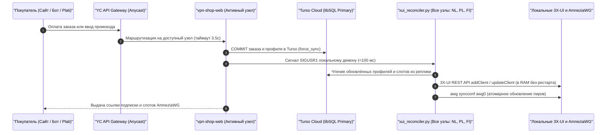

# SilentConnect: Мультипротокольная Active-Active VPN-платформа и автоматизация подписок

[](#автоматическая-безопасность-и-верификация)
[-10b981.svg?style=flat-square)](#автоматическая-безопасность-и-верификация)
[](#обзор-архитектуры)
[](https://www.python.org/)
[](LICENSE)
[](#поддержка-протоколов-и-доставка-подписок)

**SilentConnect** — высокодоступная геораспределённая мультипротокольная платформа защищённого туннелирования и автоматизации подписок, построенная на базе архитектуры **Active-Active Mesh**. Платформа спроектирована для бесперебойной работы в условиях глубокой фильтрации трафика (DPI / ТСПУ), блокировок по белым спискам и отказов отдельных дата-центров.

Экосистема объединяет серверлесс-совместимого Telegram-бота (`tgcloud` / `vpn_shop.bot`), веб-витрину с мгновенной оплатой по СБП / картам / Plati.market (`vpn_shop.web`), динамический генератор мультиформатных подписок (`subjson-service`), хаб выделенных слотов **AmneziaWG** с квотированием трафика и **автономный демон Pull-реконсиляции 3X-UI и WireGuard** (`xui_reconciler.py`) поверх облачной СУБД **Turso (libSQL)** с локальными NVMe-репликами.

---

## Содержание

1. [Обзор архитектуры](#обзор-архитектуры)
2. [Инвентарь боевых узлов](#инвентарь-боевых-узлов)
3. [Микросервисы и ключевые движки](#микросервисы-и-ключевые-движки)
4. [Плоскость данных Active-Active и автономная реконсиляция](#плоскость-данных-active-active-и-автономная-реконсиляция)
5. [Поддержка протоколов и доставка подписок](#поддержка-протоколов-и-доставка-подписок)
6. [Поддерживаемые платформы и клиентская матрица](#поддерживаемые-платформы-и-клиентская-матрица)
7. [Telegram-бот и сценарии управления](#telegram-бот-и-сценарии-управления)
8. [Веб-витрина, платёжные шлюзы и личный кабинет](#веб-витрина-платёжные-шлюзы-и-личный-кабинет)
9. [Конфигурация и каталог переменных окружения](#конфигурация-и-каталог-переменных-окружения)
10. [Деплой и быстрый старт](#деплой-и-быстрый-старт)
11. [Автоматическая безопасность и верификация](#автоматическая-безопасность-и-верификация)
12. [Указатель детальной документации](#указатель-детальной-документации)

---

## Обзор архитектуры

В отличие от традиционных систем с одним мастер-сервером и периодическим копированием базы по SSH, **SilentConnect** функционирует как симметричный **Active-Active Mesh**. Каждый узел кластера (**NL**, **PL**, **FI**) одновременно обслуживает пользовательский трафик, читает данные из собственной локальной NVMe-реплики за `0.02 мс` и автономно синхронизирует свои прокси-инбаунды из облака **Turso (libSQL)**:

```text
                                       [ Пользователи, Клиенты и Вебхуки ]
                                                        │
                 ┌──────────────────────────────────────┴──────────────────────────────────────┐
                 │                                                                             │
  [ HTTPS: Магазин, Кабинет и Подписки ]                                        [ VPN-трафик (Обход DPI) ]
                 │                                                                             │
       https://<SUB_DOMAIN>                                                    https://<EDGE_DOMAIN> / <PL_DOMAIN>
 (Yandex Cloud API Gateway Anycast)                                                    / <FI_DOMAIN>
  Авто-фэйловер: NL -> PL -> FI (3.5s)                                          (Прямые A-записи узлов)
                 │                                                                             │
       ┌─────────┴──────────────────────────────┬────────────────────────────────────┐         │
       ▼                                        ▼                                    ▼         ▼
┌───────────────────────────────┐      ┌───────────────────────────────┐      ┌───────────────────────────────┐
│     NL NODE (1 Gbps Mesh)     │      │    PL NODE (10 Gbps Mesh)     │      │     FI NODE (1 Gbps Mesh)     │
│                               │      │                               │      │                               │
│ • Xray Dokodemo Mux (:443)    │      │ • Xray Dokodemo Mux (:443)    │      │ • Xray Dokodemo Mux (:443)    │
│ • Caddy v2 TLS (:4430)        │      │ • Caddy v2 TLS (:4430)        │      │ • Caddy v2 TLS (:4430)        │
│ • Web Shop (:3090) & SubJSON  │      │ • Web Shop (:3090) & SubJSON  │      │ • Web Shop (:3090) & SubJSON  │
│ • Xray Reality / Hysteria 2   │      │ • Xray Reality / Hysteria 2   │      │ • Xray Reality / Hysteria 2   │
│ • AmneziaWG (:44121)          │      │ • AmneziaWG (:44121)          │      │ • AmneziaWG (:49752)          │
│ • OpenFlux v0.3.0 Worker      │      │ • OpenFlux v0.3.0 Worker      │      │ • Cluster Watchdog Daemon     │
│ • xui_reconciler.py (Демон)   │      │ • xui_reconciler.py (Демон)   │      │ • xui_reconciler.py (Демон)   │
│ • Локальная NVMe-реплика      │      │ • Локальная NVMe-реплика      │      │ • Локальная NVMe-реплика      │
└───────────────┬───────────────┘      └───────────────┬───────────────┘      └───────────────┬───────────────┘
                │                                      │                                      │
                └──────────────────────────────────────┼──────────────────────────────────────┘
                                                       │
                                   [ Двунаправленная синхронизация libSQL (2.0s) ]
                                                       ▼
                                     ┌───────────────────────────────────┐
                                     │     TURSO CLOUD (libSQL Primary)  │
                                     │ • Глобальное состояние кластера   │
                                     │ • Профили, заказы, слоты AWG      │
                                     │ • Распределённые лизы (Leases)    │
                                     └─────────────────┬─────────────────┘
                                                       ▲
                                                       │
                                     ┌─────────────────┴─────────────────┐
                                     │  Серверлесс Telegram-бот (tgcloud)│
                                     │  + Фоновый исполнитель по лизу    │
                                     └───────────────────────────────────┘
```

> [!IMPORTANT]
> **Отказ от межсерверного SSH и SCP-скриптов**: Узлы не копируют файлы баз данных друг другу по cron. Запись любого заказа или слота в Turso автоматически доставляется на все узлы кластера и применяется в оперативной памяти Xray и ядре WireGuard.

---

## Инвентарь боевых узлов

| Код узла | Регион | Канал связи | Размещённые службы | Роль в кластере |
|---|---|---|---|---|
| **NL (`nl`)** | Западная Европа (Нидерланды) | 1 Gbps | • `vpn-shop-web` (`:3090`) и `subjson` (`:3088`)<br>• `xui_reconciler.py` (Pull-демон)<br>• Xray Reality / Hysteria 2 (`gecko`)<br>• AmneziaWG (`10.8.1.0/24`, `:44121`)<br>• Воркеры OpenFlux v0.3.0 | **ACTIVE MESH PEER**<br>(Основной апстрим для YC API Gateway; локальная NVMe-реплика Turso) |
| **PL (`pl`)** | Центральная Европа (Польша) | **10 Gbps** | • `vpn-shop-web` (`:3090`) и `subjson` (`:3088`)<br>• `xui_reconciler.py` (Pull-демон)<br>• Xray Reality / Hysteria 2 (`gecko`)<br>• AmneziaWG (`10.8.3.0/24`, `:44121`)<br>• Воркеры OpenFlux v0.3.0 | **ACTIVE MESH PEER**<br>(Второй апстрим в цепочке YC API Gateway; высокоскоростной 10 Gbps транзит) |
| **FI (`fi`)** | Северная Европа (Финляндия) | 1 Gbps | • `vpn-shop-web` (`:3090`) и `subjson` (`:3088`)<br>• `xui_reconciler.py` (Pull-демон)<br>• Xray Reality / Hysteria 2 (`gecko`)<br>• AmneziaWG (`10.8.2.0/24`, `:49752`)<br>• Демон Cluster Watchdog | **ACTIVE MESH PEER**<br>(Третий апстрим в цепочке YC API Gateway; активный узел транзита трафика) |

---

## Микросервисы и ключевые движки

### 1. `vpn_shop.libsql_replica` (Менеджер встроенных реплик Turso)
- **Путь**: [`vpn-shop/vpn_shop/libsql_replica.py`](vpn-shop/vpn_shop/libsql_replica.py)
- **Описание**: Потокобезопасный драйвер встроенных реплик (`LibsqlReplicaManager` и `LibsqlConnectionProxy`) с полной эмуляцией `sqlite3.Row`.
- **Возможности**:
  - Чтение с локального NVMe-диска за `0.02 мс` без сетевых задержек.
  - Фоновая неблокирующая синхронизация (`sync_if_stale` каждые `2.0 с`) под отдельным мьютексом `_sync_lock`.
  - Принудительная синхронизация `force_sync()` сразу после `COMMIT` любой пишущей транзакции.

### 2. `vpn_shop.xui_reconciler` (Автономный демон реконсиляции 3X-UI и AWG)
- **Путь**: [`vpn-shop/vpn_shop/xui_reconciler.py`](vpn-shop/vpn_shop/xui_reconciler.py)
- **Описание**: Фоновый демон (`python3 -m vpn_shop reconcile-xui --daemon --interval 15.0`), работающий на каждой ноде.
- **Возможности**:
  - **Zero-Downtime провижининг Xray**: Сравнивает профили из реплики Turso с локальной базой `/etc/x-ui/x-ui.db` и добавляет/обновляет клиентов через REST API 3X-UI прямо в RAM **без перезапуска службы Xray**.
  - **Мгновенный отклик (`<100 мс`)**: Просыпается по сигналу `SIGUSR1` (`notify_local_reconciler()`) сразу после оплаты заказа.
  - **Локальная само-реконсиляция AmneziaWG**: Синхронизирует пиров локального контейнера `amnezia-awg2` и отправляет дельты трафика в Turso без использования SSH.

### 3. `vpn_shop.bot` и `tgcloud` (Движок Telegram-бота и кластерных лизов)
- **Путь**: [`vpn-shop/vpn_shop/bot.py`](vpn-shop/vpn_shop/bot.py)
- **Описание**: FSM-контроллер Telegram-бота с поддержкой серверлесс-инфраструктуры `tgcloud`.
- **Распределённая идемпотентность**: Использует таблицу `cluster_leases` в Turso (`try_acquire_cluster_lease`), гарантируя, что фоновые рассылки уведомлений, отключение истёкших подписок и сверка платежей выполняются строго одним узлом в кластере.

### 4. `vpn_shop.web` (Веб-витрина, платёжные шлюзы и личный кабинет)
- **Путь**: [`vpn-shop/vpn_shop/web.py`](vpn-shop/vpn_shop/web.py), [`platega.py`](vpn-shop/vpn_shop/platega.py), [`digiseller.py`](vpn-shop/vpn_shop/digiseller.py), [`bridge.py`](vpn-shop/vpn_shop/bridge.py)
- **Описание**: Асинхронный веб-сервер на порту `3090`.
- **Возможности**:
  - Автоматический приём платежей через **Platega.io** (СБП QR, карты МИР/Visa/Mastercard, крипто) и **Digiseller / Plati.market** (двухсторонняя сверка с API, защита от возвратов через `tombstone`).
  - Вход в личный кабинет по одноразовым/временным HMAC-ссылкам (Magic Links на 30 минут) с защитой Cloudflare Turnstile.

### 5. `subjson-service` (Мультиформатный генератор подписок)
- **Путь**: [`subjson-service/app.py`](subjson-service/app.py)
- **Описание**: Высокопроизводительный сервис выдачи конфигураций на порту `3088`.
- **Возможности**:
  - Генерация профилей с умной авто-балансировкой для **Sing-box**, **Clash Meta (Mihomo)**, **Happ**, **Streisand**, **v2rayN** и **NekoBox**.
  - Интерактивный веб-мастер подключения (`/{SECRET_SEGMENT}/import/{sub_id}`) с управлением слотами **AmneziaWG** и персональными каналами **OpenFlux (Белые списки)**.

---

## Плоскость данных Active-Active и автономная реконсиляция



---

## Поддержка протоколов и доставка подписок

| Протокол / Транспорт | Уровень L4 | Порты узлов | Маршрут подписки | Ключевые особенности |
|---|---|---|---|---|
| **VLESS Reality Vision** | TCP | `443` / `23385` | `/singbox/{id}`, `/happ/{id}` | Маскировка TLS 1.3 (`minClientVer: 0.0.0`), поток `xtls-rprx-vision` |
| **VLESS Reality XHTTP** | TCP | `8443` / `39443` | `/singbox/{id}`, `/happ/{id}` | Мультиплексированный HTTP/2 поток (`packet-up`) |
| **VLESS Reality gRPC** | TCP | `29443` | `/singbox/{id}`, `/happ/{id}` | Устойчивый транспорт для мобильных сетей |
| **VLESS WebSocket TLS** | TCP | `443` (Caddy) | `/singbox/{id}`, `/happ/{id}` | WebSocket по пути `/sc-ws-9c3d7f1e` за Caddy |
| **Hysteria 2** | UDP | `38443` (редиректы `443`, `30k-40k`) | `/singbox/{id}`, `/streisand/{id}` | Обфускация `gecko`, QUIC port hopping (`30000:40000`) |
| **AmneziaWG 3.1** | UDP | `44121` (NL/PL), `49752` (FI) | `/sub/awg/{id}/slot/{idx}/config` | Защита заголовков (`Jc/Jmin/Jmax/S1-S4/H1-H4`), слоты устройств |
| **OpenFlux v0.3.0** | WSS | `443` (CDN) | `/sub/openflux/{id}/state` | Выделенный канал через облачные документы для «Белых Списков» |

---

## Поддерживаемые платформы и клиентская матрица

| Платформа | Рекомендуемый клиент | Альтернативные клиенты | Способ подключения |
|---|---|---|---|
| **iOS / iPadOS** | **Happ**, **sing-box MT** | Streisand, Clash Mi | Импорт в 1 клик (`happ://`, `sing-box://`, `streisand://`) |
| **Android** | **Happ**, **Sing-box** | Clash Meta, NekoBox, v2rayNG | Кнопка 1-Click Import / QR-код / скачивание APK |
| **Windows** | **Happ**, **Clash Verge Rev** | Sing-box, v2rayN, AmneziaVPN | Автонастройка TUN и импорт подписки в 1 клик |
| **macOS** | **Happ**, **sing-box MT** | Clash Verge Rev, Streisand | Нативная поддержка Apple Silicon и Intel |
| **Linux / Роутеры** | **Sing-box CLI**, **AmneziaWG** | Mihomo CLI, Keenetic / OpenWrt | Скачивание `.conf` файлов или ссылка подписки |

---

## Telegram-бот и сценарии управления

### Команды для пользователей
- `/start` — Главное меню, статус активной подписки и обработка ссылок (`open`, `ref_*`, `claim_*`).
- `/prices` — Выбор тарифа (3, 6, 9 устройств на 1, 3, 6, 12 месяцев).
- `/pay` — Оплата текущего заказа или переход к выбору тарифа.
- `/cabinet` — Личный кабинет со ссылкой подключения и мастером настройки.
- `/referral` — Партнёрская программа (10% скидка другу + 10% комиссия с каждой оплаты).
- `/help`, `/faq`, `/rules`, `/support` — Инструкции, ответы на вопросы, оферта и связь с поддержкой.

### Панель администратора (`/admin`)
- **Мониторинг сервера и трафика**: Состояние служб systemd, Load Average, RAM, диск, число TCP-соединений, проверка DNS и топ-20 профилей по трафику.
- **Управление профилями**: Просмотр статуса, отправка предупреждения владельцу, мгновенное отключение или включение профиля в Xray.
- **Промокоды и инвайты**: Генерация подарочных кодов готового доступа и скидочных промокодов (`10%`–`100%`).
- **Реферальные выплаты**: Учёт балансов партнёров и проведение полных или частичных выплат.
- **Выдача AmneziaWG**: Прямая генерация `.conf` файлов для узлов NL, PL и FI.

---

## Веб-витрина, платёжные шлюзы и личный кабинет

- **Тарифная сетка** (`catalog.py`):
  - **3 устройства (Личный)**: `149 ₽ / мес` (`250 ГБ` квота AmneziaWG + **безлимитный** VLESS / Hysteria 2)
  - **6 устройств (Домашний)**: `199 ₽ / мес` (`500 ГБ` квота AmneziaWG + **безлимитный** VLESS / Hysteria 2)
  - **9 устройств (Расширенный)**: `235 ₽ / мес` (`1000 ГБ` квота AmneziaWG + **безлимитный** VLESS / Hysteria 2)
  - *Скидки за период*: `-10%` за 3 месяца, `-20%` за 6 месяцев, `-30%` за 12 месяцев (с округлением до цен, оканчивающихся на `9`).

---

## Конфигурация и каталог переменных окружения

| Переменная | Значение по умолчанию / Пример | Описание |
|---|---|---|
| `TURSO_DATABASE_URL` | `libsql://<db>-<org>.turso.io` | URL облачной базы данных Turso (libSQL). |
| `TURSO_AUTH_TOKEN` | `""` | Токен авторизации Turso JWT. |
| `TURSO_SYNC_INTERVAL` | `2.0` | Интервал фоновой синхронизации локальной реплики (сек). |
| `SERVER_PEPPER` | *Обязателен в Prod* | Секретный ключ-пеппер для HMAC-хэширования токенов и промокодов. |
| `SECRET_SEGMENT` | *Обязателен в Prod* | Секретный префикс URL для маршрутов `subjson-service`. |
| `TELEGRAM_BOT_TOKEN` | `""` | Токен Telegram-бота от `@BotFather`. |
| `SERVERLESS_MODE` | `false` | Режим фонового Lease-воркера (включается автоматически при 409). |
| `SERVERLESS_BRIDGE_SECRET`| `""` | Секретный ключ HMAC-подписи для `/api/bridge`. |
| `XUI_PANEL_URL` | `http://127.0.0.1:2053/...` | Внутренний адрес панели 3X-UI. |
| `XUI_DB_PATH` | `/etc/x-ui/x-ui.db` | Путь к локальной базе SQLite панели 3X-UI. |
| `AWG_NL_SERVER_PUBKEY` | `<BASE64_PUBKEY>` | Публичный ключ Curve25519 сервера AmneziaWG (NL). |
| `AWG_PL_SERVER_PUBKEY` | `<BASE64_PUBKEY>` | Публичный ключ Curve25519 сервера AmneziaWG (PL). |
| `AWG_FI_SERVER_PUBKEY` | `<BASE64_PUBKEY>` | Публичный ключ Curve25519 сервера AmneziaWG (FI). |
| `PLATEGA_ENABLED` | `false` | Включение онлайн-оплаты через СБП и карты (Platega.io). |
| `DIGISELLER_ENABLED` | `false` | Включение интеграции с Digiseller / Plati.market. |

---

## Деплой и быстрый старт

```bash
# 1. Инициализация локальной реплики Turso
python3 -m vpn_shop --env-file .env.silentconnect init-db

# 2. Тестовый прогон автономного реконсилятора 3X-UI
python3 -m vpn_shop --env-file .env.silentconnect reconcile-xui --dry-run

# 3. Активация и запуск всех служб узла
systemctl enable --now subjson.service vpn-shop-web.service vpn-shop-xui-reconciler.service

# 4. Проверка прослушиваемых сокетов
ss -tulpn | grep -E '3088|3090|443|4430|38443|44121'
```

---

## Автоматическая безопасность и верификация

Репозиторий защищён автоматическим сканером утечек и набором регрессионных тестов, запускаемых в GitHub Actions и pre-push хуках:

```bash
# 1. Запуск строгого сканера безопасности (Zero Leaks)
python3 scripts/security_audit_scanner.py --strict

# Вывод:
# [PASS] AUDIT PASSED: Zero leaks, zero binaries, zero untracked secrets detected.

# 2. Запуск полного набора тестов
python3 -m unittest discover -s tests -p "test_*.py"

# Вывод:
# Ran 128 tests
# OK
```

---

## Указатель детальной документации

- **[ARCHITECTURE.md](ARCHITECTURE.md)** — Детальная спецификация Active-Active Mesh, реплик Turso libSQL, демона `xui_reconciler.py` и матрицы портов.
- **[DEPLOYMENT.md](DEPLOYMENT.md)** — Руководство по развёртыванию узлов на Debian 13 / Ubuntu 24.04, каталогу systemd-юнитов и аварийному восстановлению.
- **[AMNEZIA_SLOTS.md](AMNEZIA_SLOTS.md)** — Спецификация хаба слотов AmneziaWG, 30-дневного цикла квот UTC, механизма Soft-Disable и локальной реконсиляции.
- **[WHITELIST_SPEC.md](WHITELIST_SPEC.md)** — Спецификация выделенных слотов OpenFlux v0.3.0 для обхода «Белых Списков».
- **[README.md](README.md)** — Англоязычная версия документации.

---

## Лицензия

Распространяется под лицензией MIT. Подробности в файле [LICENSE](LICENSE).
