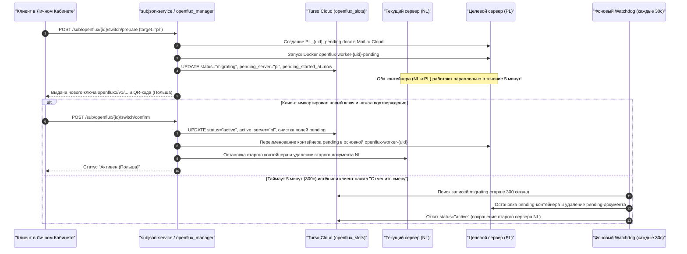

# Спецификация системы обхода белых списков OpenFlux (v0.3.0 Dedicated Slots)

> **Статус документа**: Актуальная боевая спецификация (Production Verified)  
> **Дата последней верификации**: 21.10.2026  
> **Версия подсистемы**: OpenFlux v0.3.0 (Mail.ru Cloud Dedicated Slots) + Legacy v0.2.0 Fallback  
> **Связанные документы**: [ARCHITECTURE.md](ARCHITECTURE.md) • [DEPLOYMENT.md](DEPLOYMENT.md) • [AMNEZIA_SLOTS.md](AMNEZIA_SLOTS.md) • [README.md](README.md)

---

## 1. Концепция и назначение OpenFlux

**OpenFlux** — специализированный транспортный уровень экосистемы **SilentConnect**, предназначенный для работы в условиях экстремальной сетевой изоляции — **режима «Белых Списков» (White-Lists)**, когда на стороне провайдера или ТСПУ полностью заблокированы все зарубежные IP-адреса и протоколы (VLESS, Reality, Hysteria 2, WireGuard), а доступ разрешён только к доверенным российским облачным платформам и CDN.

OpenFlux инкапсулирует двунаправленный поток данных внутрь сессии совместного редактирования офисных документов (`docs.datacloudmail.ru`), проходящей через разрешённую инфраструктуру CDN внутри РФ.

```text
┌────────────────────────────────────┐                       ┌────────────────────────────────────┐
│     Клиент (в сети с White-List)   │                       │   Облачный CDN-шлюз (внутри РФ)    │
│     OpenFlux Client (iOS/Andr/PC)  │                       │   Mail.ru Cloud / R7 Office Docs   │
│                                    │                       │   docs.datacloudmail.ru:443        │
│ 1. Чтение обновлений чужого курсора├──────────────────────►│                                    │
│ 2. Запись Base64-пакетов в курсор  │◄──────────────────────┤ • WebSocket / Engine.IO v4 (WSS)   │
│    совместного редактирования      │  WSS / TLS 1.3 (CDN)  │ • Документ <COUNTRY>_<UID>.docx    │
└────────────────────────────────────┘                       └─────────────────┬──────────────────┘
                                                                               │
                                                                               │ WSS / WebSocket
                                                                               ▼
                                                             ┌────────────────────────────────────┐
                                                             │   Боевой узел кластера (NL или PL) │
                                                             │   Docker: openflux-worker-<uid>    │
                                                             │   (php:8.2-cli-alpine)             │
                                                             │                                    │
                                                             │ 1. Декодирование фреймов курсора   │
                                                             │ 2. Выход в открытый интернет       │
                                                             │ 3. Отправка ответа обратно в док   │
                                                             └────────────────────────────────────┘
```

---

## 2. Сравнение поколений: OpenFlux v0.3.0 vs v0.2.0

| Характеристика | Поколение v0.3.0 (Dedicated Stream — Основное) | Поколение v0.2.0 (Legacy Shards — Резерв) |
|---|---|---|
| **Облачный транспорт** | **Mail.ru Cloud Docs** (`docs.datacloudmail.ru`) | **Яндекс.Диск / Volga** (`disk.yandex.ru`) |
| **Сетевой протокол** | Полнодуплексный WebSocket (Socket.IO / Engine.IO) | HTTP Long Polling / WebDAV REST API |
| **Изоляция клиентов** | **1 подписка = 1 персональный `.docx` + 1 контейнер** | Общие шарды из пула `/etc/openflux-node/pool_*.json` |
| **Среда исполнения** | Изолированный Docker-контейнер `php:8.2-cli-alpine` | Системный демон `openflux` |
| **Координация состояния** | Таблица `openflux_slots` в облачной БД **Turso (libSQL)** | Статические конфигурационные файлы |
| **Смена геолокации** | **Двухфазный Handover без разрыва связи (5 мин)** | Переключение ссылки вручную |

---

## 3. Архитектура выделенных слотов (v0.3.0 Dedicated Slots)

Управление жизненным циклом слотов реализовано в модуле `vpn_shop/openflux_manager.py`:

### 3.1. Ленивая инициализация и Умный балансировщик (`choose_least_loaded_server`)
Слот создаётся в состоянии `uninitialized` и не расходует ресурсы сервера до момента нажатия пользователем кнопки **«⚡ Активировать подключение (OpenFlux)»** в личном кабинете:
1. Балансировщик `choose_least_loaded_server(conn)` подсчитывает количество активных воркеров в таблице `openflux_slots` (синхронизируемой через **Turso**) и проверяет TCP-доступность узлов `nl` и `pl`.
2. Через утилиту `rclone` из эталонного шаблона `/opt/openflux/template.docx` в облаке создаётся индивидуальный документ `mailru:openflux_docs/<COUNTRY>_<profile_public_id>.docx` и публикуется публичная ссылка (`rclone link`).
3. На выбранном узле (`nl` или `pl`) запускается легковесный изолированный Docker-контейнер:
   ```bash
   docker run -d --name openflux-worker-<uid> --restart unless-stopped \
     --memory=64m --cpus=0.5 \
     -v /opt/openflux:/opt/openflux:ro \
     php:8.2-cli-alpine \
     sh -c 'while true; do php -d memory_limit=48M /opt/openflux/runner.php "$1"; sleep 1; done' _ '<PUBLIC_DOC_URL>'
   ```
4. Клиенту формируется сжатая ссылка формата `openflux://v1/<base64url_raw_deflate>` (`build_openflux_stream_link`) и PNG QR-код.

### 3.2. Схема таблицы `openflux_slots` в Turso (`store.py`)
```sql
CREATE TABLE IF NOT EXISTS openflux_slots (
    id INTEGER PRIMARY KEY AUTOINCREMENT,
    profile_public_id TEXT NOT NULL UNIQUE,
    slot_label TEXT NOT NULL DEFAULT 'Белые списки (OpenFlux)',
    status TEXT NOT NULL DEFAULT 'uninitialized', -- 'uninitialized', 'active', 'migrating'
    active_server TEXT DEFAULT NULL,              -- 'nl' или 'pl'
    active_doc_name TEXT DEFAULT NULL,
    active_doc_url TEXT DEFAULT NULL,
    active_container_name TEXT DEFAULT NULL,
    pending_server TEXT DEFAULT NULL,
    pending_doc_name TEXT DEFAULT NULL,
    pending_doc_url TEXT DEFAULT NULL,
    pending_container_name TEXT DEFAULT NULL,
    pending_started_at INTEGER DEFAULT NULL,
    created_at INTEGER NOT NULL,
    updated_at INTEGER NOT NULL,
    FOREIGN KEY (profile_public_id) REFERENCES profiles(public_id)
);
```

---

## 4. Двухфазная смена сервера без потери связи (Two-Phase Handover)

Поскольку пользователь, находящийся в зоне действия «Белых Списков», выходит в интернет через свой текущий активный документ OpenFlux, немедленное удаление старого контейнера при смене страны оборвало бы ему связь до того, как он успеет скачать новый ключ.

Для решения этой задачи реализована **двухфазная миграция с 5-минутным окном подтверждения**:



---

## 5. Техническое обоснование исключения узла Финляндии (`fi`) из пула OpenFlux

В словаре `SERVERS` модуля `vpn_shop/openflux_manager.py` разрешены локации `nl` (Нидерланды) и `pl` (Польша). Узел Финляндии (`fi`) намеренно исключён из пула воркеров OpenFlux по результатам сетевого аудита:
1. **Блокировка подсетей дата-центра на стороне облачного API**: При подключении с IP `<FI_IP>` к авторизационным и WebSocket-шлюзам облака соединение принудительно сбрасывается пакетом `TCP RST` (`errno 104`) либо ошибкой `HTTP/2 stream 1 was not closed cleanly: PROTOCOL_ERROR`.
2. **Принудительная Captcha на публичных ссылках**: Запросы к публичным документам с финской подсети перенаправляются на страницу `/showcaptcha` (`X-Captcha-Required: 1`), что блокирует работу автоматизированного CLI-раннера `runner.php`.
3. **Оптимальная маршрутизация через NL и PL**: Узлы в Нидерландах и Польше (10 Gbps) имеют прямую связность с облачными CDN без капчи и ограничений, полностью обеспечивая потребности пользователей режима «Белых Списков».
