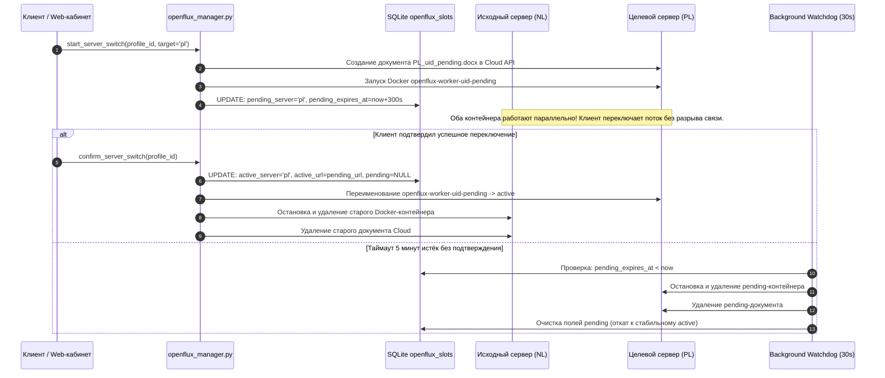

# Спецификация системы обхода белых списков OpenFlux (v0.3.0 Dedicated Slots)

> **Статус документа**: Актуальная боевая спецификация (Production Verified)  
> **Дата последней верификации**: 14.10.2026  
> **Версия подсистемы**: OpenFlux v0.3.0 (Mail.ru Cloud Dedicated Slots) vs Legacy v0.2.0 (Yandex Volga)  
> **Связанные документы**: [ARCHITECTURE.md](ARCHITECTURE.md) • [DEPLOYMENT.md](DEPLOYMENT.md) • [AMNEZIA_SLOTS.md](AMNEZIA_SLOTS.md) • [README.md](README.md)

---

## 1. Концепция и назначение OpenFlux

**OpenFlux** — специализированная подсистема туннелирования трафика в условиях жесточайших белых списков (WhiteLists), когда ТСПУ блокирует все внешние IP-адреса, протоколы WireGuard, VLESS, Hysteria и зарубежный трафик, разрешая доступ исключительно к крупным доверенным сервисам Рунета (VK, Mail.ru, Yandex, Госуслуги, банки).

Архитектура OpenFlux маскирует двунаправленный байтовый поток под совместное редактирование документов в облачных офисных редакторах, проходящих через инфраструктуру доверенных CDN внутри РФ.

```
┌─────────────────────────────────┐                       ┌─────────────────────────────────┐
│     Клиент (внутри РФ / ТСПУ)   │                       │   Облачный сервис (РФ CDN)      │
│     OpenFlux Client Stream      │                       │   Mail.ru Cloud / R7 Docs       │
│                                 │                       │   docs.datacloudmail.ru:443     │
│ 1. Чтение чужих курсоров        ├──────────────────────►│                                 │
│ 2. Запись данных в свой курсор  │◄──────────────────────┤ • Сокет Socket.IO / WebSocket   │
│    (Base64 payload фрагменты)   │  WSS / TLS 1.2 / 1.3  │ • Документ <COUNTRY>_<UID>.docx │
└─────────────────────────────────┘                       └────────────────┬────────────────┘
                                                                           │
                                                                           │ WSS / WebSocket
                                                                           ▼
                                                          ┌─────────────────────────────────┐
                                                          │   Боевой узел (NL или PL)       │
                                                          │   Docker: openflux-worker-<uid> │
                                                          │   (php:8.2-cli-alpine)          │
                                                          │                                 │
                                                          │ 1. Декодирование Base64 курсора │
                                                          │ 2. L3/L4 выход в интернет       │
                                                          │ 3. Передача ответа обратно в doc│
                                                          └─────────────────────────────────┘
```

---

## 2. Сравнение поколений: OpenFlux v0.3.0 vs v0.2.0

В боевой инфраструктуре на 14.10.2026 зафиксировано сосуществование двух поколений системы:

| Параметр | Поколение v0.3.0 (Актуальное / Dedicated) | Поколение v0.2.0 (Legacy Shards) |
|---|---|---|
| **Облачный транспорт** | **Mail.ru Cloud** (`docs.datacloudmail.ru`) | **Яндекс.Диск / Volga** (`disk.yandex.ru`) |
| **Протокол обмена** | Socket.IO WebSocket (Engine.IO v4, WSS) | HTTP Long Polling / WebDAV API |
| **Модель изоляции** | **Персональный выделенный слот** (1 пользователь = 1 документ + 1 контейнер) | Общие шарды (несколько пользователей на один документ) |
| **Исполняемая среда** | Docker: `php:8.2-cli-alpine` (изолированный процесс на профиль) | Системный демон: `/opt/openflux-node/bin/openflux` (systemd unit) |
| **Управление и балансировка** | Менеджер `vpn_shop.openflux_manager` с двухфазной миграцией | Статические конфигурационные файлы `/etc/openflux-node/` |
| **Статус в проде** | Активно обслуживает живых клиентов на NL и PL | Сохранено как резервный fallback на NL, PL и FI |

---

## 3. Архитектура выделенных слотов (v0.3.0 Dedicated Slots)

### 3.1. Модель изоляции пользователей
Каждый клиентский профиль с поддержкой белых списков получает строго изолированное окружение:
1. **Персональный документ Mail.ru Cloud**:
   - Автоматически создаётся через `rclone` в каталоге `mailru:openflux_docs/` на основе шаблона.
   - Имя файла: `<COUNTRY>_<profile_public_id>.docx` (например, `NL_<PROFILE_ID_1>.docx`).
   - Для документа генерируется уникальная публичная ссылка через Mail.ru API (`https://cloud.mail.ru/public/...`).
2. **Изолированный Docker-контейнер воркера**:
   - Имя контейнера: `openflux-worker-<profile_public_id>` (например, `openflux-worker-<PROFILE_ID_1>`).
   - Базовый образ: `php:8.2-cli-alpine` (размер 141 MB, PHP 8.2.34-cli).
   - Лимиты ресурсов: `--memory=64m` (67,108,864 байт), PHP CLI `memory_limit=48M`, `--cpus=0.5`.
   - Тома: монтирование скриптов `/opt/openflux:/opt/openflux:ro` в режиме только для чтения.
   - Политика перезапуска: `--restart unless-stopped`.
   - Команда запуска воркера:
     ```bash
     sh -c 'while true; do php -d memory_limit=48M /opt/openflux/runner.php "$1"; sleep 1; done' _ '<PUBLIC_DOC_URL>'
     ```
3. **Механизм кодирования (Framing)**:
   - Входящий поток TCP-пакетов фрагментируется, упаковывается в формат Base64 и помещается в структуру координат курсора текстового редактора совместной работы. Воркер и клиент считывают обновления курсора друг друга через WebSocket-стрим.

### 3.2. Состояние слотов в базе данных (`vpn_shop.db`)
Таблица `openflux_slots` на NL Master хранит распределение:

```sql
CREATE TABLE openflux_slots (
    id INTEGER PRIMARY KEY AUTOINCREMENT,
    profile_public_id TEXT NOT NULL UNIQUE,
    status TEXT NOT NULL DEFAULT 'uninitialized', -- uninitialized, active, pending_switch
    active_server TEXT,                           -- 'nl' или 'pl'
    active_doc_name TEXT,
    active_doc_url TEXT,
    active_container_name TEXT,
    pending_server TEXT,
    pending_doc_name TEXT,
    pending_doc_url TEXT,
    pending_container_name TEXT,
    pending_server_expires_at REAL,
    created_at REAL NOT NULL,
    updated_at REAL NOT NULL
);
```

#### Боевой срез слотов на 14.10.2026:
- Всего слотов в базе: **9** (2 активных, 7 в резерве `uninitialized`).
- **Слот 1** (`<PROFILE_ID_1>`): активен на `nl`, документ `<CLOUD_DOC_URL_1>`, контейнер `openflux-worker-<PROFILE_ID_1>` (uptime 9 дней на NL Master `<NL_IP>`).
- **Слот 7** (`<PROFILE_ID_2>`): активен на `pl`, документ `<CLOUD_DOC_URL_2>`, контейнер `openflux-worker-<PROFILE_ID_2>` (перенесён и активен на New PL `<PL_IP>`).

---

## 4. Двухфазная миграция без простоя (Two-Phase Zero-Downtime Switch)

Для смены геолокации выхода пользователя (например, переключение между серверами Нидерландов и Польши) разработана двухфазная процедура с автоматическим сторожевым таймером (Watchdog):



---

## 5. Доказательная база исключения узла Финляндии (FI Exclusion Audit)

В словаре доступных серверов `SERVERS` в `vpn_shop/openflux_manager.py` (строки 48–61) присутствуют **только** `nl` и `pl`. Сервер Финляндии (`fi`) исключён из пула. В ходе аудита 14.10.2026 была проведена серия прямых сетевых тестов с IP `<FI_IP>` (Datacenter FI), выявившая объективные причины непригодности ноды:

### 5.1. Принудительный сброс TCP авторизации облачного API
- При обращении к авторизационному эндпоинту с IP `<FI_IP>` TLS-рукопожатие завершается, но на уровне HTTP/2 сервер немедленно возвращает:
  ```text
  HTTP/2 stream 1 was not closed cleanly: PROTOCOL_ERROR (err 1)
  ```
- При принудительном откате на HTTP/1.1 удалённый шлюз разрывает сокет TCP RST пакетом:
  ```text
  OpenSSL SSL_read: Connection reset by peer, errno 104
  ```
- Дата-центры провайдера узла FI находятся в черных списках антиспам- и антифрод-защиты облачного шлюза. Автоматическое создание документов и обновление токенов с финского сервера технически невозможно.

### 5.2. Captcha на legacy-транспорте
- При выполнении запроса к запасному облачному хранилищу с IP `<FI_IP>`:
  ```http
  HTTP/1.1 302 Moved temporarily
  Location: https://<LEGACY_STORAGE_DOMAIN>/showcaptcha?cc=1...
  X-Captcha-Required: 1
  ```
- Сервис идентифицирует IP датацентра как прокси и принудительно выдаёт капчу.

### 5.3. Фильтрация и дропы пакетов со стороны провайдеров РФ
- Трафик между клиентами в РФ и северноевропейскими сетями датацентра FI подвергается дропу пакетов и завышению RTT со стороны магистральных DPI. Сети узлов NL и PL подключены к прямым стыкам с лучшей связностью.

---

## 6. Миграция воркера со старого PL на новый PL (Успешно завершена 14.10.2026)

### Статус миграции: ВЫПОЛНЕНО
Активный контейнер `openflux-worker-<PROFILE_ID_2>` успешно перенесён на сервер `<PL_IP>` (New PL Debian 13, 10 Gbps) и подключен к актуальному документу `<CLOUD_DOC_URL_2>`. 

На NL Master переменные `PL_HOST` и `PL_STANDBY_IP` в `.env.silentconnect` и `subjson.env` переключены на `<PL_IP>`, службы `subjson` и `vpn-shop-silentconnect` перезапущены.

Старый контейнер на `<OLD_PL_IP>` остановлен и удален. Сервер полностью освобожден от клиентской нагрузки и готов к отключению.

